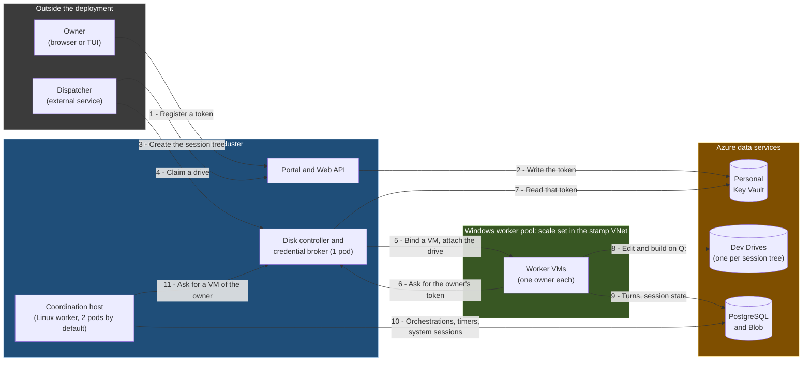
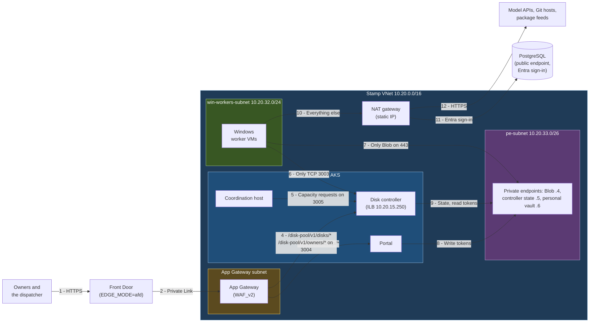
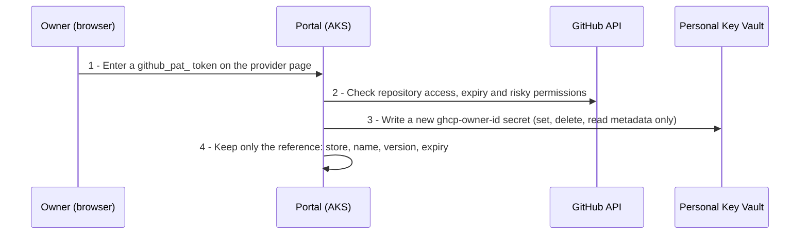
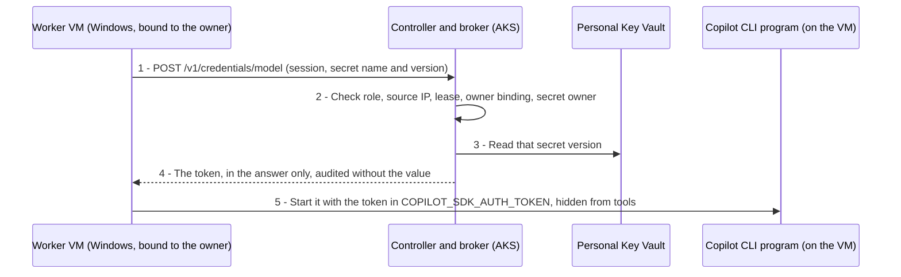
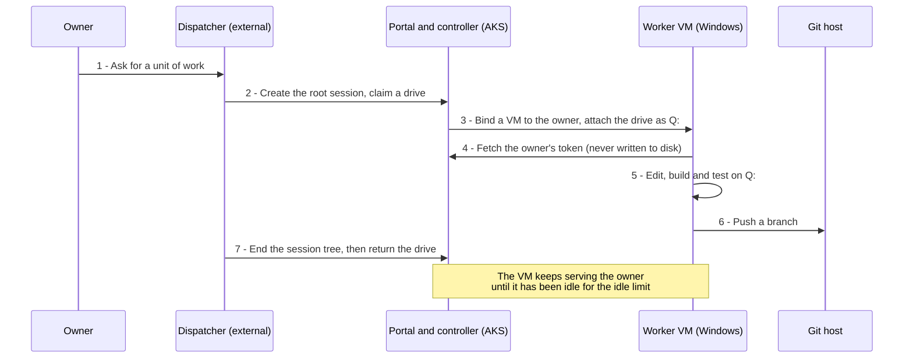
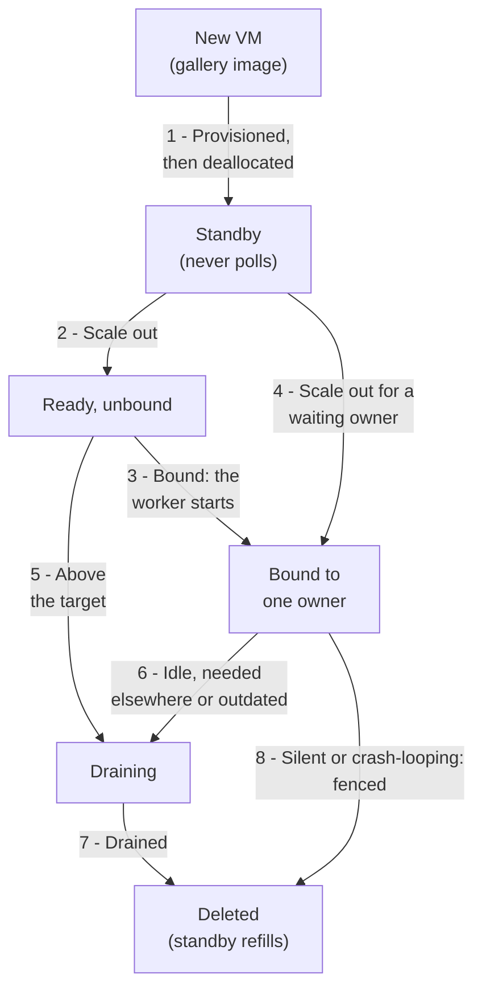
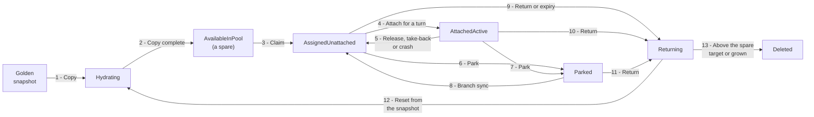
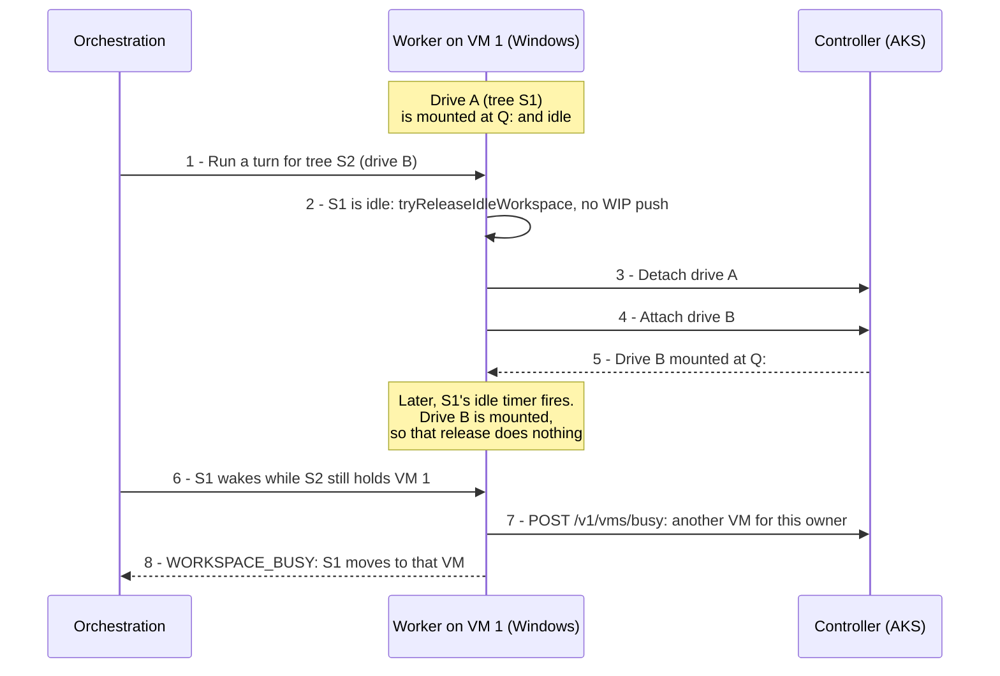
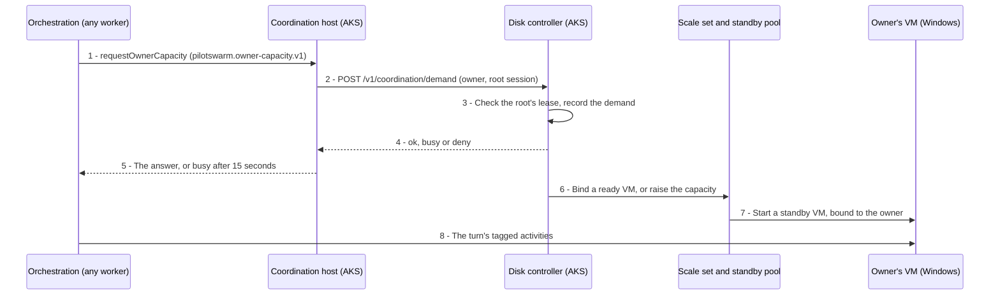
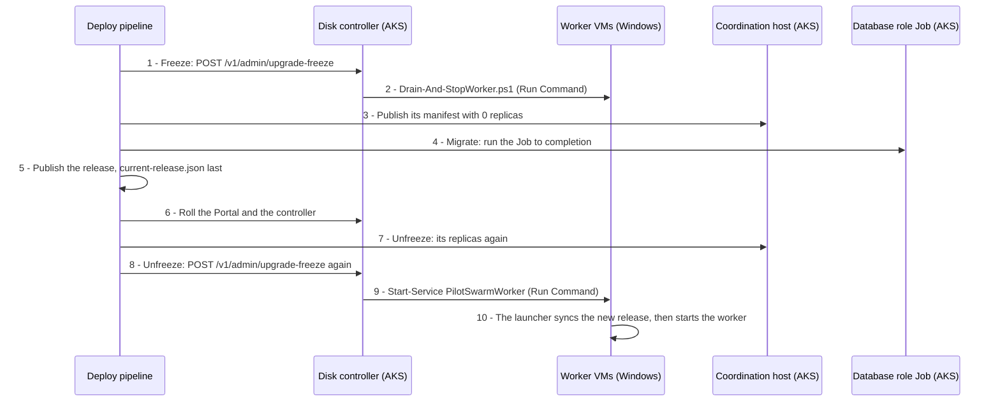

# Windows Workers

PilotSwarm's workers run on Linux, but some codebases build only on Windows:
solutions that need MSBuild, SQL Server LocalDB or Docker with Hyper-V-isolated
containers. The optional **Windows worker pool** runs each owner's sessions on
Windows VMs that serve that owner alone, with a drive per session tree that
keeps its clones, build output and package caches across turns and VMs. This
guide covers what the pool is made of, how a session reaches a VM, how to
deploy, upgrade and operate it on Azure, its security model and every setting
it adds.

Everything here is opt-in. A deployment that leaves `WIN_WORKERS_ENABLED`
unset deploys exactly as before, and each new SDK setting defaults to the
behavior PilotSwarm had without it. The
[Windows worker pool proposal](../../proposals/windows-worker-pool.md) holds
the design and the reasons behind it; this page describes what the code does.

| Piece | Where | Reference |
|---|---|---|
| Dev Drive workspace extension | `packages/sdk/examples/devdrive-workspaces/` | [README](../../../packages/sdk/examples/devdrive-workspaces/README.md) |
| Windows image, services and scripts | `deploy/providers/azure/windows/` | [README](../../../deploy/providers/azure/windows/README.md) |
| Disk controller and credential broker | `deploy/providers/azure/disk-controller/` | [README](../../../deploy/providers/azure/disk-controller/README.md) |
| Key Vault personal secret store | `deploy/providers/azure/secret-store/` | [README](../../../deploy/providers/azure/secret-store/README.md) |
| Coordination host module and manifests | `deploy/providers/azure/linux-worker/`, `deploy/providers/azure/gitops/worker/components/coordination-host/`, `deploy/scripts/lib/coordination-host.mjs` | [README](../../../deploy/providers/azure/linux-worker/README.md), [orchestrator reference](../../../deploy/scripts/README.md#the-coordination-host) |
| Settings, Bicep and the deploy step | `deploy/providers/azure/envs/template.env`, `deploy/providers/azure/services/base-infra/bicep/`, `deploy/providers/azure/deploy-steps/win-workers.mjs` | [Orchestrator reference](../../../deploy/scripts/README.md#optional-windows-worker-pool) |
| Database role Job | `deploy/providers/azure/deploy-steps/Setup-WinWorkerDbRole.mjs`, `deploy/providers/azure/deploy-steps/db-role-job.mjs` | [Orchestrator reference](../../../deploy/scripts/README.md#the-database-role-job) |
| Entra app roles for applications | `deploy/scripts/auth/` | [Portal Entra app roles](./entra-app-roles.md#roles-for-application-identities) |
| SDK settings and hooks | `packages/sdk/` | [Configuration](../reference/configuration.md#windows-worker-pool-azure) |

## Contents

1. [What a pool is made of](#what-a-pool-is-made-of)
2. [How it fits together](#how-it-fits-together)
3. [Where everything runs](#where-everything-runs)
4. [Models and credentials](#models-and-credentials)
5. [The life of a session tree](#the-life-of-a-session-tree)
6. [The compute pool](#the-compute-pool)
7. [Dev Drives](#dev-drives)
8. [Sharing a VM between session trees](#sharing-a-vm-between-session-trees)
9. [Parking a drive for local work](#parking-a-drive-for-local-work)
10. [Session routing and admission](#session-routing-and-admission)
11. [Delegation to the dispatcher](#delegation-to-the-dispatcher)
12. [Session message scope](#session-message-scope)
13. [Deploying a pool](#deploying-a-pool)
14. [The database role Job](#the-database-role-job)
15. [The coordination host](#the-coordination-host)
16. [Upgrading](#upgrading)
17. [Security model](#security-model)
18. [Performance and sizing](#performance-and-sizing)
19. [Settings](#settings)
20. [Operating the pool](#operating-the-pool)
21. [Testing](#testing)

## What a pool is made of

- **Worker VMs.** Windows Server 2025 VMs built from the deployment's own
  gallery image, in an Azure Flexible virtual machine scale set with a standby
  pool of deallocated VMs. Between `Y` and `X` VMs are active
  (`WIN_WORKER_MIN_RUNNING` and `WIN_WORKER_COUNT`). A VM serves one owner from
  the moment the controller binds it until it is deleted, and runs only that
  owner's sessions. With no demand the pool scales in step by step, down to
  `Y`, which can be 0.
- **Dev Drives.** Premium SSD v2 data disks, at most `M` at once
  (`WIN_DEV_DRIVE_POOL_COUNT`), one per session tree, mounted as the ReFS Dev
  Drive `Q:`. Each is a copy of a golden snapshot, starts at 1 TiB and grows
  online when it runs low on space. The pool keeps a few hydrated spares rather
  than `M` idle drives, and a drive moves between its owner's VMs, so builds
  stay incremental.
- **The disk controller and credential broker.** One replica in the cluster,
  `pilotswarm-disk-controller`. It sizes the pool, binds VMs to owners, leases,
  attaches, grows, resets and refreshes drives, fences VMs that go silent, and
  releases each owner's model token only to that owner's VMs.
- **The coordination host.** PilotSwarm's Linux worker, at two replicas by
  default, in the cluster. It runs everything that needs neither a repository
  nor an owner's token: orchestrations, timers, system agents, titles, the
  bookkeeping around every turn, and every capacity request. With it the
  Windows VMs run only their owners' work, and the pool can be empty while
  nothing runs.
- **Personal model credentials.** An owner's sessions call models with that
  owner's own GitHub Copilot account, through a fine-grained token the owner
  registers once on the Portal. The token is kept only in a personal Key
  Vault; PostgreSQL keeps a reference to it.
- **A dispatcher.** An external service, named by `DISPATCHER_SP_OBJECT_ID`,
  that creates, steers and ends session trees for the owners who allow it.
  Only the dispatcher can claim a drive, so a deployment without one can run
  no owner's session on the pool.

## How it fits together



- **Steps 1 and 2:** the owner registers a fine-grained GitHub token once, on
  the Portal's provider page. The Portal writes it to the personal vault with a
  role that can write and delete secrets but not read them.
- **Steps 3 and 4:** the dispatcher creates the root session for the owner, who
  owns it, and claims a drive for it. It sends the first prompt only after the
  claim, so every turn belongs to a root session that holds a drive lease.
- **Step 5:** the controller binds a ready VM to the owner, or scales out with a
  VM bound from the start, and attaches the drive at LUN 0, where the VM's
  attacher service mounts it as `Q:`.
- **Steps 6 to 9:** the turn runs on that VM as `NT SERVICE\PilotSwarmWorker`,
  with the owner's token, which the broker releases only to a VM bound to that
  owner and which the worker keeps only in memory. PostgreSQL holds the durable
  queue and the session catalog; Blob holds session state between VMs.
- **Steps 10 and 11:** the coordination host runs the orchestrations, timers and
  system sessions. When a session needs a turn and its owner has no free VM,
  its capacity request reaches the controller from there, which starts one.

## Where everything runs

One deployment (a stamp) is one subscription, resource group and VNet, but the
Linux and the Windows machines are not in one cluster:

- **A Linux AKS cluster is the control plane.** It runs the Portal and its
  database role Job, the disk controller and the coordination host. The AKS
  cluster autoscaler scales its nodes.
- **The Windows workers are a Flexible scale set with a standby pool, outside
  AKS,** in `win-workers-subnet` of the same VNet. They reach the controller
  through its internal load balancer, Blob through its private endpoint, and
  PostgreSQL and the internet through a NAT gateway. Nothing else in the VNet
  is reachable from them, and nothing reaches them.
- **One deploy run creates both.** `deploy.mjs` runs base-infra's Bicep, which
  creates the pool's Azure resources, then publishes the cluster's manifests,
  and the Portal's rollout step runs the database role Job. With the
  coordination host, `deploy all` deploys the `worker` service just after the
  `portal` instead of before it, so that Job has run before the host's pods
  sign in. Each VM takes its code from a hashed release at every start of its
  worker service.

| Component | Runs on | Deployed by | Updated by | Scaled by |
|---|---|---|---|---|
| Portal | AKS (Linux) | the `portal` service's manifests | a rolling deploy; upgrade step 3 | the AKS cluster autoscaler (nodes) |
| Database role Job | AKS (Linux), the Portal's image | the `portal` service's rollout step, outside Flux | re-created at each run of that step, and in upgrade step 2 | one run at a time |
| Disk controller and broker | AKS, 1 replica, `Recreate` | the `disk-controller` service | upgrade step 3 | fixed at 1 |
| Coordination host (`copilot-runtime-worker`) | AKS, 2 replicas by default | the `worker` service's manifests | a new image in upgrade step 3, started in step 4 | `WIN_WORKER_COORDINATION_HOST_REPLICAS`; 0 during the upgrade freeze |
| Windows workers | Flexible scale set and standby pool | base-infra (`win-workers.bicep`) | worker code: the release, synced at each service start; the OS: a new gallery image version | the controller |
| Dev Drives | Managed disks (Premium SSD v2) | the controller | the weekly golden-snapshot refresh | the controller: spares up to `M`, online growth per drive |
| PostgreSQL, Blob, vaults, Log Analytics | Azure PaaS | Bicep | Bicep | — |

**Why not AKS Windows node pools?** AKS controls the node image, but a worker
needs its own: build tools, LocalDB, Hyper-V, Docker, locked-down folder
permissions and pre-installed MCP servers. Windows containers on AKS use
process isolation only, without Hyper-V isolation or nested virtualization.
And one owner with one large drive per machine fits whole VMs, not pods that
share a node.

### The network



With `EDGE_MODE=private` the dispatcher comes in through the cluster's
internal NGINX ingress instead of Front Door and App Gateway. The pool needs
the stamp VNet, so `EDGE_MODE=public` can't have one.

**The worker subnet's NSG.** A worker accepts no connection, and reaches
nothing in the VNet but the controller's worker port and the main storage
account's blob private endpoint:

| Rule | Priority | Direction | What it does |
|---|---|---|---|
| `DenyAllInboundFirst` | 100 | Inbound | Denies every inbound connection, ahead of Azure's default rules and of any rule network automation adds at a later priority |
| `AllowDiskControllerOutbound` | 100 | Outbound | TCP to `10.20.15.250:3003`, the controller's worker port |
| `AllowBlobPrivateEndpointOutbound` | 105 | Outbound | TCP to `10.20.33.4:443`, the main storage account's blob private endpoint |
| `AllowVnetDnsOutbound` | 106 | Outbound | Only with the VPN gateway: port 53 to the VNet's Private DNS Resolver |
| `DenyVnetOutbound` | 110 | Outbound | Denies the rest of `10.20.0.0/16` |
| `DenyVpnClientsOutbound` | 111 | Outbound | Only with the VPN gateway: denies its client address pool, which lies outside the VNet |

The rules name address ranges, not the `VirtualNetwork` service tag. Workers
open every connection themselves and NSGs are stateful, so the replies still
arrive; the attacher listens only on `127.0.0.1`, and Run Command needs no
inbound port. DHCP, DNS and the instance metadata service are not subject to
NSG rules. Without these rules, Azure's default `AllowVnetInBound` would let an
agent, which is an administrator of its own VM, reach other owners' VMs and the
cluster's pods and nodes.

**The controller's three ports.** All three serve HTTPS with one certificate
from the controller's private CA.

| Port | Reached through | Who reaches it | Routes |
|---|---|---|---|
| `3003` | the internal load balancer `pilotswarm-disk-controller` at `10.20.15.250` | the worker subnet only (the load balancer's source ranges, and a NetworkPolicy at the pod); operators through `kubectl port-forward` | worker routes and `/v1/admin/*` |
| `3004` | the ClusterIP Service `pilotswarm-disk-controller-dispatcher`, behind its own Ingress on the Portal's host | the edge (App Gateway's subnet with `EDGE_MODE=afd`) | the dispatcher routes and `GET /disk-pool/v1/healthz` |
| `3005` | the ClusterIP Service `pilotswarm-disk-controller-coordination` | the coordination host's pods only (NetworkPolicy) | `POST /v1/coordination/demand` |

**Data services.**

- **PostgreSQL** keeps its public endpoint, takes Entra sign-in only, and its
  firewall admits only the cluster's pinned egress IP (`AllowClusterEgress`) and
  the NAT gateway's (`AllowWinWorkerEgress`). The deploy step deletes an
  `AllowAllAzureServices` rule that an earlier deploy left.
- **The personal vault and the controller's state account** have public access
  turned off, or, with `SFI_COMPLIANT=true`, a network security perimeter
  profile with no access rule. Only their private endpoints reach them: the
  Portal writes tokens and the controller reads tokens and its state.
- **Blob:** the workers use the main storage account's private endpoint, which
  the VNet's private DNS zone selects.

## Models and credentials

### Two kinds of model provider

| Provider | Used by | Credential |
|---|---|---|
| Each owner's personal GitHub Copilot provider (a `github` type, such as `github-copilot`) | That owner's sessions | The owner's fine-grained `github_pat_` token, in the personal vault |
| A shared provider without a key, such as Foundry with `FOUNDRY_AUTH_MODE=entra` (`foundry-wif`) | System agents and titles, and anyone who picks it | None stored: the worker signs in with its own identity |

- **Personal providers.** Each owner adds one in **Admin Console → Model
  Providers → Add GitHub Copilot provider**, so model calls spend that owner's
  own Copilot budget. Provider names are unique across a deployment, so name
  each one after its owner, for example `ghcp-<alias>`.
- **The shared provider.** System agents and titles need a model that no
  owner's credential pays for, and they run on the coordination host, which
  never gets a token. Keep `GITHUB_TOKEN`, `GH_TOKEN` and `COPILOT_GITHUB_TOKEN`
  unset on the Portal, the workers and the database role Job, so no shared
  GitHub provider is seeded. Each run of the
  [database role Job](#the-database-role-job) sets the cluster and system
  default model to the `defaultModel` of the Portal's model catalog
  (`MODEL_PROVIDERS_FILE`, when set), which names the shared provider's model.
  See
  [Providers With No Key](../reference/configuration.md#providers-with-no-key-workload-identity).

### Registering a token



- **Checks** (`PILOTSWARM_REQUIRE_FINE_GRAINED_GH_PAT=1` on the Portal and every
  worker): the token starts with `github_pat_`, reaches public repositories
  only, expires within 30 days, and holds none of the riskiest account
  permissions (SSH, GPG and signing keys, email addresses, Codespaces user
  secrets). See
  [Fine-Grained GitHub Tokens Only](../reference/configuration.md#fine-grained-github-tokens-only).
- **Storage** (`PILOTSWARM_PERSONAL_SECRETS=external` on the Portal and every
  worker, with the [Key Vault store](../reference/configuration.md#azure-key-vault-store-for-personal-keys)):
  each registration writes a new secret `ghcp-<owner>-<32 hex>`, where `<owner>`
  is the owner's subject (the Entra object ID), tagged `ownerOid` with the same
  value and expiring with the token. An update writes a new version, and the
  provider row keeps only the store's reference, never the token.
- **Registration happens only on the Portal.** In external mode an agent's
  `manage_provider` tool refuses to add a personal provider or change its key.
- **The store is pluggable.** `PILOTSWARM_PERSONAL_SECRET_STORE_MODULE` names
  any module that implements the SDK's `PersonalSecretStore` contract (`put`,
  `delete`, `describe`); the Azure provider's is the Key Vault store in
  `deploy/providers/azure/secret-store/`, which the Portal image carries. The
  workers never load it: they get tokens from a credential resolver, here the
  broker's. See
  [Personal Keys in an External Secret Store](../reference/configuration.md#personal-keys-in-an-external-secret-store).

### Releasing a token to a VM



The broker releases the token only when all of these hold, and audits every
answer without the value:

1. the caller's token is an Entra v2 token of the tenant with the `worker` role
   and the workers' identity's object ID (`EXPECTED_WIN_WORKER_OID`);
2. the request comes from an active, non-draining VM of the pool, known by its
   private source address (every VM has the same identity);
3. the session's root holds a drive lease. A parked, returning or quarantined
   lease answers `busy` with a 15-minute retry instead; no lease answers
   `refused` (`NO_DRIVE_LEASE`);
4. the VM is bound to the lease's owner (`VM_NOT_BOUND_TO_OWNER`);
5. the secret is the owner's: its name is `ghcp-<owner>-<32 hex>`, the version
   exists, its `ownerOid` tag names the owner, and it is enabled and unexpired.

During the controller's start-up grace every credential request answers `busy`
(`CONTROLLER_STARTING`); with no personal vault configured it answers
`unavailable`.

### The token on the VM

- **Memory only.** The extension's credential resolver passes the token to the
  worker, which keeps it in memory, keyed by store, secret name and version,
  and asks again after a model `401`. PilotSwarm never writes it to disk, and
  the image turns off crash dumps.
- **No fallback.** A refusal fails the turn as an authentication failure that is
  not retried; `busy` holds the session like a busy workspace; a broker outage
  fails the turn with a retry. Nothing stands in: not a legacy key, the worker's
  `GITHUB_TOKEN` or another provider.
- **Out of the tools' environment.** The SDK gives the token to the Copilot CLI
  in `COPILOT_SDK_AUTH_TOKEN`. With
  `PILOTSWARM_CLI_SECRET_ENV_VARS=COPILOT_SDK_AUTH_TOKEN`, every CLI starts as
  the Copilot CLI program with `--secret-env-vars`, which keeps the variable out
  of the environments of shells, MCP servers and hooks. The program runs from
  an unpacked copy the worker can only read (`COPILOT_PKG_CACHE_HOME`), so no
  session can plant a modified one. See
  [Copilot CLI Environment](../reference/configuration.md#copilot-cli-environment).
- **Out of sight is not out of reach.** The program redacts nothing it prints,
  and an agent that reads the token from memory can print it. PilotSwarm
  redacts token patterns from the events, tool output and logs it persists,
  and from what an agent sends another session, so a sub-agent gets
  `[REDACTED]` where its parent quoted a token. It doesn't redact what agents
  store on purpose (facts, artifacts and canvas content), nor the CLI's own
  session files, which dehydration archives to Blob as the CLI wrote them.
- **Rotation.** An update on the Portal writes a new version, which the next
  turn uses. A CLI process keeps the token it started with until the worker
  stops, and the VM's deletion at recycle ends it.
- **Removal.** Deleting the provider soft-deletes its secret, which the vault
  keeps for 7 days with purge protection. A new registration takes a new name,
  so a deleted one never blocks it.
- **Expiry.** A token lives at most 30 days. The dispatcher can read an owner's
  expiry, never the value, from
  `GET /disk-pool/v1/owners/{ownerOid}/model-credential`, which answers
  `{ present, expiresOn, enabled }`, to remind the owner to rotate it.

### The per-work credential

The dispatcher can hand each session tree an opaque credential of its own, for
example one that lets the tree's tools call the dispatcher's API. PilotSwarm
never interprets it:

- a claim, a branch sync and a rebind set it, `POST /disk-pool/v1/disks/credential`
  rotates it, and a park, a return or a lease expiry wipes it. The controller
  keeps it in its state and never checks its expiry; the service that accepts
  it does;
- `POST /v1/credentials/work` releases it only to the VM that holds the tree's
  drive and is bound to its owner. The deployment's own tool modules get it
  with `fetchWorkCredential(rootSessionId)` from the extension's
  `disk-pool-client.mjs`.

## The life of a session tree

A unit of work runs as one root session tree, a root session and its
sub-agents, which holds one drive.



1. **Once:** the owner registers a fine-grained token on the Portal and turns
   on delegation ([Delegation to the dispatcher](#delegation-to-the-dispatcher)).
2. **Start:** the dispatcher creates the root session with `onBehalfOfOwner`,
   then claims a drive (`POST /disk-pool/v1/disks/claim`), and only then sends
   the first prompt.
3. **Bind:** the controller binds a ready VM, or scales out with one bound from
   the start, and attaches the drive at LUN 0 of that VM.
4. **Run:** each turn runs on one of the owner's VMs, which fetches the token
   from the broker.
5. **Deliver:** the agent pushes a branch. Pull requests and reviews belong to
   the deployment's own workflow.
6. **Pause:** a paused tree keeps its drive. While the owner works on it
   elsewhere, the drive is parked ([Parking a drive for local work](#parking-a-drive-for-local-work)).
7. **Finish:** the dispatcher stops any running turn, ends the tree's sessions
   and returns the drive (`POST /disk-pool/v1/disks/return`). The VM that holds
   it releases it at its next heartbeat; only after the detach does the
   controller reset the drive from the golden snapshot, or delete it when the
   pool is above its spare target or the drive grew. A VM that keeps a returned
   drive for 10 minutes is deleted first, like a crashed VM. Otherwise the VM
   stays for the owner's other trees.

## The compute pool

### How VMs come and go



- **One owner from binding until deletion.** The controller binds a VM to one
  owner and sets instance protection on it, so scale-set-wide actions leave it
  alone. A bound VM runs only that owner's activities. A used VM never rejoins
  the standby pool, which refills only with new VMs: deletion is the wipe
  between owners.
- **Activation.** A VM's launcher starts heartbeating to the controller before
  anything slow, syncs the release, and polls `POST /v1/vms/register` until the
  VM is active. A standby VM, or any VM while the pool is frozen, starts no
  worker. Before a VM is first active, the controller associates it with the
  workers' data collection rule, so its Azure Monitor Agent reports from the
  start. It removes the association whenever it deletes the VM, drained or
  fenced; a fence removes it beside the deletion, so a slow or failed removal
  never delays the drive's move, and retries it with every retried deletion.
- **Binding.** With owner-only workers (the coordination host), the launcher of
  an unbound VM starts the worker only when a heartbeat answer first names an
  owner, with `PILOTSWARM_WORKER_OWNER_TAG=owner.<ownerOid>`. Without them, an
  unbound VM runs untagged work until it is bound; the worker then drains for
  up to two minutes and exits with code 75, and the service manager starts it
  again with the owner's tag.
- **A finished session tree doesn't delete its VM.** The VM serves its owner's
  other trees until it has been idle (no attached drive, no active workload)
  for `WIN_WORKER_IDLE_RECYCLE_MINUTES`, or until the pool is full and another
  owner waits.

### How the controller sizes the pool

PilotSwarm's own autoscaling covers only the cluster's Linux node pools. The
controller sizes the Windows pool, because only it sees the real demand: drive
claims, capacity requests, busy refusals, owner bindings and attached drives.
Azure Monitor autoscale sees none of these and would scale in a VM that holds a
drive. The controller re-evaluates on every 15-second tick, and at once on
demand:

1. **Demand.** An owner needs a VM when a root session of theirs that holds a
   live lease has work and none of their bound VMs is free. The controller
   learns of it from claims and branch syncs, capacity requests
   (`/v1/coordination/demand` or `/v1/vms/demand`), `/v1/vms/busy` from the
   owner's VMs, and an admission request on an unbound VM. Unserved demand is
   kept in the controller's state, survives a restart, and is served oldest
   first; an entry lapses 30 minutes after its last signal, and a waiting
   session's retries renew it.
2. **Bind or scale out.** Demand gets the ready unbound VM. Without one, the
   controller raises the scale set's capacity with a PATCH of `sku.capacity`
   alone, and the new VM starts bound to the owner. Azure takes it from the
   standby pool when one is ready. A deploy never writes the capacity after
   creating the scale set, and nothing scales out while the pool is frozen.
3. **Target.** The pool keeps `min(X, max(Y, bound + ready))` VMs active, where
   `ready` is 1 while a demand signal arrived within
   `WIN_WORKER_IDLE_RECYCLE_MINUTES`. While owners are active, one unbound VM
   stays ready for the next one. Inside `WIN_WORKER_WORKING_HOURS`, `Y` is at
   least 1.
4. **Scale in, in steps.** After a 15-minute minimum uptime, the controller
   drains and deletes at most `WIN_WORKER_SCALE_IN_BATCH` VMs every
   `WIN_WORKER_SCALE_IN_INTERVAL_MINUTES`, longest-idle first: a bound VM idle
   for `WIN_WORKER_IDLE_RECYCLE_MINUTES`, an unbound VM above the target, or an
   idle VM on another image or configuration version. It never goes below `Y`:
   it starts a replacement first.
5. **A full pool.** At `X` with another owner waiting, the longest-idle bound VM
   of an owner who isn't waiting goes at once, without the idle limit, the
   minimum uptime or the scale-in interval. The waiting owner gets its
   replacement.
6. **Rollouts.** When a deploy of the `disk-controller` service brings a new
   `WIN_WORKER_IMAGE_VERSION` or `WIN_WORKER_CONFIG_VERSION` from base-infra's
   outputs, the controller deletes the standby VMs, so the standby pool
   refills from the new model, and treats the active VMs on the old version as
   `outdated`. It replaces each in a scale-in step once it is idle and holds
   no drive; until then, an outdated VM keeps serving its owner.

A VM's standby state comes from its instance view, so the controller needs no
Standby Pool permission.

### Crashes and fencing

Missed heartbeats can mean a crash, or a network partition while the VM keeps
writing to its drive. So the controller deletes such a VM, and waits until Azure
reports it gone, before the drive moves:

- a VM that sends no heartbeat for 60 seconds is fenced. A VM in its binding
  restart, or one the unfreeze restarted, gets 3 minutes; a VM stopped for an
  upgrade is never treated as crashed;
- a bound VM that reports no `running` heartbeat for 10 minutes, or any VM that
  reports a fourth launch ID within 15 minutes, is fenced too, and raises the
  crash-loop alert. Restarts the controller asked for don't count;
- the controller counts silence from the later of a VM's last heartbeat and the
  end of its own 60-second start-up grace, so a controller restart fences no VM;
- when at least two VMs, and more than half of the active ones, go silent or
  loop at once, the controller raises the mass-silence alert instead of fencing:
  the fault is more likely in the network or the controller;
- the drive survives the deletion (`deleteOption: Detach`). If the deletion
  isn't confirmed within 15 minutes, the controller quarantines the drive's
  lease and alerts instead of attaching it anywhere;
- the next attach after a crash removes stale Git lock files and checks only the
  objects written since the drive's last clean detach, then runs `git status`.

| Timing | Value |
|---|---|
| Controller tick, VM heartbeat | 15 seconds |
| Silence before fencing | 60 seconds |
| Binding restart and unfreeze windows | 3 minutes |
| Start window (bound VM to `running`) | 10 minutes |
| Crash loop | a fourth launch ID within 15 minutes |
| Controller start-up grace | `PS_DISK_CONTROLLER_STARTUP_GRACE_SECONDS` (60) |
| Minimum uptime before scale-in | 15 minutes |
| Release deadline (return, refused rebind or branch sync, move) | 10 minutes, then the VM is fenced |
| Fence confirmation before quarantine | 15 minutes |

## Dev Drives

### Drive states



| State | Meaning |
|---|---|
| `Hydrating` | Being copied from the golden snapshot. A drive joins the pool only when both the copy and the snapshot report 100% complete |
| `AvailableInPool` | A hydrated spare |
| `AssignedUnattached` | Leased to a session tree and on no VM |
| `AttachedActive` | Leased and attached at LUN 0 of one of the owner's VMs |
| `Parked` | Leased, and no turn of its tree may start ([Parking a drive for local work](#parking-a-drive-for-local-work)) |
| `Returning` | Returned; busy for its tree until the VM that holds it has detached it |

### Spares, resets and limits

- **Spares follow demand.** The controller keeps `WIN_DEV_DRIVE_SPARE_COUNT`
  drives hydrated or hydrating, within `WIN_DEV_DRIVE_POOL_COUNT` (`M`) drives in
  all and four copies at a time. A claim takes the oldest hydrated spare and
  starts a new one. A returned drive is reset from the golden snapshot while
  the pool is below its spare target, and deleted otherwise or when it grew.
- **Busy, not failed.** A claim answers `busy` with `HYDRATING` while no spare
  is ready yet, `POOL_FULL` when every drive of `M` is leased, and `NOT_READY`
  before the pool has a scale set and a golden snapshot.
- **Per-owner limit.** An owner holds at most `WIN_DEV_DRIVE_MAX_PER_USER`
  (`N`) leases, parked ones included; one more claim is denied with
  `OWNER_DRIVE_LIMIT`.
- **Expiry.** A lease that no VM holds and nothing used for
  `WIN_DEV_DRIVE_LEASE_EXPIRY_DAYS` is returned automatically. A parked lease
  never expires.
- **Performance.** Every drive is `PremiumV2_LRS` at `WIN_DEV_DRIVE_IOPS` and
  `WIN_DEV_DRIVE_MBPS`, attached with host caching off, in the scale set's zone.

### Online growth

Each heartbeat reports the mounted drive's size and free space. When a mounted
drive has less than `WIN_DEV_DRIVE_GROW_FREE_PERCENT` free, the controller grows
the disk by `WIN_DEV_DRIVE_GROW_STEP_GB`, up to `WIN_DEV_DRIVE_MAX_GB`, one step
at a time. The next heartbeat answer asks the VM to extend `Q:`, and the
attacher's `/extend-lun0` does so once Windows sees the new size, without
detaching the drive. The drive-full alert fires when a drive at its maximum
runs low, or when Windows doesn't see a growth within 15 minutes. A grown drive
is deleted, not reset, when it is returned.

### The golden snapshot

Every new drive is a copy of the golden snapshot, so its content reaches every
session tree:

- **The first snapshot.** On a VM built from the worker image, attach an empty
  disk at LUN 0, run `Initialize-WinWorkerDisk.ps1`, then
  `Seed-WorkerReposDisk.ps1` with the snapshot parameters. It clones the seed
  manifest's repositories with full history, fills the package caches, grants
  the worker Modify only on the manifest's folders, writes each repository's
  first clean-detach record, and makes the worker's service account the owner
  of each repository, because Git refuses a repository another account owns.
  It must run on a VM built from the image: `icacls` resolves the worker
  service's SID only where that service is installed. It waits until Azure
  reports the snapshot `Succeeded` with its background copy complete, and
  stops with an error if the snapshot fails to provision. Set
  `WIN_DEV_DRIVE_GOLDEN_SNAPSHOT_ID` to the snapshot.
- **The weekly refresh.** Every `PS_DISK_CONTROLLER_SNAPSHOT_REFRESH_DAYS` (7;
  `0` turns it off) the controller scales out one VM that it never activates,
  attaches a copy of the current snapshot, and runs
  `Seed-WorkerReposDisk.ps1 -Refresh` and then `-Verify` there as Managed Run
  Commands. Only when every check passes (refs, `git fsck --connectivity-only`,
  no Git hooks, current clean-detach records, owners and folder permissions)
  does it take an incremental snapshot, record it as the golden snapshot and
  keep the previous one for rollback. Then it deletes the drive and the VM. A
  failed step keeps the current snapshot and raises the refresh alert. A copy,
  the drive's or the snapshot's, fails its step as soon as Azure reports it
  `Failed`, or when it is still copying after 6 hours. The controller keeps
  each finished run's drive on a list in its state and retries its deletion at
  every refresh check until Azure confirms it gone, so a failed deletion
  leaves no drive behind.

The seed manifest names the repositories, and the toolchain manifest the tools,
so no code names a repository or a tool. Both formats are in the
[Windows image README](../../../deploy/providers/azure/windows/README.md#the-golden-drive).

## Sharing a VM between session trees

A VM mounts one drive at a time, at LUN 0 as `Q:`. After a turn, the session
keeps its drive mounted while it stays on the worker, for the idle hold
(`PILOTSWARM_DEFAULT_IDLE_TIMEOUT_SEC` on the Portal), so its next turn starts
warm. When another session tree of the same owner needs that VM, the worker
takes the drive back from the idle session instead of waiting:



- **No lost work.** The released drive keeps every edit, so a take-back needs no
  push to a WIP branch.
- **No ping-pong.** The session that was just taken back on this VM is refused
  there (`WORKSPACE_BUSY`) instead of taking the drive back in turn, and the
  controller binds or adds another VM for its owner.
- **Only within one owner.** A session this VM didn't admit never takes the
  drive back, and owner routing keeps other owners' sessions off the VM.
- **The building blocks are generic.** The extension uses the worker's
  `tryReleaseIdleWorkspace`, which answers `released`, `busy` or `notHeld`
  without waiting; see
  [Taking a folder back, and shutting down](../building/workspace-providers.md#taking-a-folder-back-and-shutting-down).
  One LUN 0 mutex per VM orders every attach and release, and a release that
  isn't for the mounted drive does nothing.

When the turn's root already holds the mounted drive, the attach needs neither
the controller nor the attacher. A release that isn't a take-back pushes the
drive's work, committed or not, as one commit to the WIP branch
`<PS_WIP_BRANCH_PREFIX><rootSessionId>`, unless the controller asked for the
drive or the worker is shutting down. That push, like the crash recovery,
covers the repositories right under a root and their submodules, not a
repository cloned deeper. The
[extension's README](../../../packages/sdk/examples/devdrive-workspaces/README.md#how-a-turn-gets-its-drive)
has every rule.

## Parking a drive for local work

An owner can take a session tree's work to another machine for a while. The
dispatcher parks the drive first, then stops the turns:

1. **Park.** `POST /disk-pool/v1/disks/park` puts the drive in `Parked`, so no
   turn of the tree can start: capacity requests answer `busy`, and admission
   and every attach, from a timer, a cron, a child's update or a webhook, get
   `WORKSPACE_BUSY` with `"Dev Drive is parked for local work"` and
   `retryAfterMs: 900000` (15 minutes), so a parked session doesn't wake every
   few minutes. Parking also wipes the per-work credential.
2. **Stop the running turns.** The dispatcher stops every running turn in the
   tree (`stopSessionTurn`) until each reports `stopped`, `too_late` or
   `no_active_turn`. Stopping first would leave a gap in which a cron or a
   child's update starts a new turn. A bounded abort of a wedged CLI
   (`PILOTSWARM_CLI_ABORT_TIMEOUT_MS`) ends a turn that doesn't stop, and
   ends that CLI's shells, which would otherwise keep writing to the drive.
3. **Release.** A VM that still holds the drive in its idle hold is asked to
   release it at its next heartbeat (`releaseRequested`); a holder that is busy,
   for example with a background shell still running, keeps it and is asked
   again at the following heartbeat. The end of the idle hold cancels its shells
   and releases it.
4. **Come back.** `POST /disk-pool/v1/disks/sync-branch` unparks the drive once
   no VM holds it, and records `{ sourceBranch, headSha }`, the https URL to
   fetch them from and a new per-work credential. While a VM still holds the
   drive, the call answers `busy` with `DRIVE_ATTACHED` and
   `retryAfterMs: 10000` and changes nothing: the drive stays parked, and its
   holder is still asked to release it. The dispatcher retries until the call
   succeeds, as for a rebind. A holder that keeps the drive 10 minutes after the
   first refused call is fenced, like a crashed VM. So the next attach always
   goes through the controller: the extension pushes anything on the drive that
   `headSha` doesn't contain to the tree's WIP branch, then moves the working
   copy to `headSha` (`git clean -fd`, never `-x`, so ignored build output
   stays). A failed push resets nothing. The dispatcher can then call
   `retrySessionWorkspace` so the waiting turn runs at once instead of at its
   next busy retry. A dispatcher that lost the answer retries with the same
   branch and head: on the unparked drive, that call answers `ok` with the same
   `syncId` and only sets the call's credential, so nothing resets the working
   copy again under the session's later work. Any other `sync-branch` on a
   drive that isn't parked gets `409 NOT_PARKED`.

An idle hold of 10 minutes or less (`PILOTSWARM_DEFAULT_IDLE_TIMEOUT_SEC=600`)
ends before that deadline unless the tree comes back within a couple of
minutes of its last turn. With a longer hold, such as the 1,800-second default,
a quicker hand-back can reach the deadline first: the VM is replaced, and the
next attach checks the drive's repositories, as after a crash, before it
applies the sync.

A parked drive never expires on its own. It stays leased until the tree comes
back or the dispatcher returns it.

## Session routing and admission

### Owner tags and owner-only workers

- **Owner tags.** With `PILOTSWARM_OWNER_ROUTING=1` on the Portal, the client
  records `owner.<subject>` of a top-level user session's owner in its
  orchestration input, and orchestration `1.0.83` tags every session-scoped
  activity with it. A session created during a turn takes that turn's tag.
  System sessions, and every session under a system root, stay untagged.
- **Bound workers.** The launcher of a bound VM starts the worker with
  `PILOTSWARM_WORKER_OWNER_TAG=owner.<ownerOid>`, so the worker also runs that
  owner's tagged activities, and only a worker with that tag runs them.
- **Owner-only workers.** With `WIN_WORKER_COORDINATION_HOST=true`, the deploy
  writes `PILOTSWARM_WORKER_OWNER_ONLY=1` into the VMs' `userData`. Such a
  worker claims only its owner's tagged activities: no untagged work (system
  sessions' turns, titles, the manager activities around every turn), no
  capability-tagged activity and no capacity request. The coordination host
  runs all of that. An owner-only worker still runs orchestration turns, but
  `ctx.utcNow()` and `ctx.newGuid()` are untagged Duroxide activities, so a
  deployment with owner-only workers always needs a worker without the option.

See [Owner Routing](../reference/configuration.md#owner-routing-optional) and
the orchestration design's
[owner routing](../../architecture/orchestration/design.md#owner-routing-and-capacity-requests-1083)
and [owner-only workers](../../architecture/orchestration/design.md#owner-only-workers).

### Admission

Before every turn, the Windows worker asks the controller
(`POST /v1/vms/admit`), as a backstop for anything that reaches a VM without its
owner's tag:

| Session | VM bound to the session's owner | Unbound VM | VM bound to another owner |
|---|---|---|---|
| A session under a root with a live lease | Admit | `WORKSPACE_BUSY` (`VM_UNBOUND`): the controller binds a VM | `WORKSPACE_BUSY` (`OWNER_MISMATCH`) |
| Any session under a root whose lease is parked, returning or quarantined | `WORKSPACE_BUSY`, retry after 15 minutes | the same | the same |
| A user session under a root without a lease | Deny (`NO_DRIVE_LEASE`) | Deny | Deny |
| A system session | Admit; `WORKSPACE_BUSY` on a pool with the coordination host | the same | the same |

- **Every user session belongs to a leased root.** Any other user session is
  denied, and a denied turn fails with the controller's message and isn't
  retried.
- **System sessions stay off the VMs.** With the coordination host, no Windows
  VM claims a system session's activity. A system session that still reaches a
  VM waits for the coordination host instead of running next to a token. The
  coordination host's own admission hook admits only system sessions.
- **A controller that doesn't answer** fails the turn, which is retried.

The hook is generic: see
[Admitting turns on a worker](../building/workspace-providers.md#admitting-turns-on-a-worker).

### Capacity requests

Before each turn of a tagged session, and before a set-workspace command's
check, the orchestration asks a worker with a capacity requester for capacity
for the session's owner (`requestOwnerCapacity`):



| Answer | Meaning | The session |
|---|---|---|
| `ok` | The owner has, or will soon have, a VM | The turn goes ahead |
| `busy` | The lease is parked, returning or quarantined (15 minutes), the pool is frozen (`UPGRADE_FROZEN`), not ready (`NOT_READY`) or full (`POOL_FULL`) | Holds the prompt on its timer; complete, cancel and delete still reach it |
| `deny` (`NO_DRIVE_LEASE`) | The root holds no lease of this owner | The turn ends as a refusal that isn't retried |
| no answer in 15 seconds | `CAPACITY_UNAVAILABLE` | Waits a minute; releases no worker |

- **Who asks.** With the coordination host, its module sends every request to
  `POST /v1/coordination/demand`, and the controller refuses `/v1/vms/demand`
  with `403 COORDINATION_HOST`. Without it, each Windows worker's extension
  registers a requester and sends `POST /v1/vms/demand`.
- **Entra object IDs only.** The controller binds VMs to Entra object IDs. Both
  requesters answer `deny` with `OWNER_NOT_SUPPORTED` for an owner whose subject
  isn't one, without asking the controller, rather than retrying a request it
  can never serve. Use Entra sign-in for the Portal.
- **The fast busy policy.** With `PILOTSWARM_WORKSPACE_BUSY_FAST_RELEASE=1` on
  the Portal, a `WORKSPACE_BUSY` refusal releases the session from its worker at
  once and retries after 10 seconds, 20 seconds, a minute, then every 3 minutes,
  instead of 30 seconds, 2 minutes, 5 minutes, then every 15 minutes. See the
  [fast busy policy](../../architecture/orchestration/design.md#fast-busy-policy-1083).

### Ending a session tree

A session's orchestration reads complete, cancel and delete commands only after
its current turn ends, so a turn waiting for an owner VM holds them. So:

- owner-tagged sessions cap their waits: a destroy waits for the owner's worker
  at most `WORKSPACE_RELEASE_CAP_MS` (10 seconds), and a set-workspace command's
  check at most 20 minutes (`WORKSPACE_CHECK_CAP_MS`);
- the dispatcher ends a tree's sessions before it returns the drive, while the
  lease still keeps an owner VM for them, and uses a forced delete
  (`deleteSession(sessionId, reason, { force: true })`) for a tree that doesn't
  settle. After the return, the tree's sessions get `busy`, then `deny`, and run
  no further turn.

A forced delete also finishes a tree whose root is already deleted, such as
what a plain delete from the Portal left when it could not delete a child. With
ownership enforced, the Portal lets the tree's owner and administrators do
that, and the dispatcher only while a live session is left in the tree,
because it reads the dispatcher's share through that session. Anyone else gets
`404`. So the dispatcher ends a tree with `force` from the start: a forced
delete that fails keeps the root, and the retry passes. A tree that a plain
delete left without a live session is for the owner or an administrator to
finish.

## Delegation to the dispatcher

`DISPATCHER_SP_OBJECT_ID`, set on the Portal and the controller, names the
dispatcher: an application that signs in with an app-only Entra token holding
the `user` app role. Unset, delegation is off, and every dispatcher route of the
controller answers `403`.

- **The opt-in.** Each owner turns delegation on or off for themselves only:
  the **Dispatcher Delegation** switch under **Admin Console → Model Providers →
  My Providers** on the Portal, `g` on the same page of the TUI, or
  `setMyDispatcherDelegation(true)` (`PUT /api/v1/me/dispatcher-delegation`). It
  is off until the owner turns it on, and shows only on deployments that name a
  dispatcher. The [user guide](../../user-guide/security-and-sharing.md#letting-the-deployments-dispatcher-work-for-you)
  explains it to owners.
- **What the dispatcher may then do on the Portal.** Create sessions that the
  owner owns (`onBehalfOfOwner`), which stay private and give the dispatcher a
  targeted `write` share, the session's only share; send prompts to them, steer
  and stop their turns; and complete, cancel and delete them, with `force` for a
  tree that doesn't settle or whose root is already deleted
  ([Ending a session tree](#ending-a-session-tree)). Administrators get none of
  this from their role.
- **What it may do on the controller.** Only it passes the dispatcher routes, at
  most `WIN_DEV_DRIVE_MAX_PER_USER` drives per owner:

  | Route | Body | What it does |
  |---|---|---|
  | `POST /disk-pool/v1/disks/claim` | `{ workId, rootSessionId, ownerOid, credential }` | Leases a hydrated spare to the tree; idempotent per work |
  | `POST /disk-pool/v1/disks/park` | `{ workId }` | Parks the drive and wipes the per-work credential |
  | `POST /disk-pool/v1/disks/sync-branch` | `{ workId, sourceBranch, headSha, url, credential }` | Unparks a parked drive once no VM holds it, and records the branch the next attach moves to; `busy` (`DRIVE_ATTACHED`) until then. On a drive that isn't parked, it takes only a retry with the same branch and head, which answers the same `syncId`; anything else gets `409 NOT_PARKED` |
  | `POST /disk-pool/v1/disks/rebind` | `{ workId, rootSessionId, ownerOid, credential }` | Moves the lease to a replacement root session, once no VM holds the drive |
  | `POST /disk-pool/v1/disks/return` | `{ workId }` | Returns the drive; idempotent |
  | `POST /disk-pool/v1/disks/credential` | `{ workId, credential }` | Rotates the per-work credential |
  | `GET /disk-pool/v1/owners/{ownerOid}/model-credential` | — | The owner's token's `{ present, expiresOn, enabled }`, never its value |

- **Turning it off takes effect at the dispatcher's next call.** The Portal
  checks the opt-in on every call: the dispatcher keeps its shares, but gets
  `403 DELEGATION_REVOKED` on that owner's sessions, the sessions leave its
  listings, and an open subscription stops before its next event. Turning
  delegation back on restores access to the same sessions. The controller
  doesn't check delegation, so its drive routes keep accepting the dispatcher
  for that owner until it returns the owner's drives.
- **Audit.** The Portal writes the audit entry of every delegated creation, end
  of work and forced delete before it answers, and fails the call with
  `503 AUDIT_UNAVAILABLE` when it can't; it also logs each as one JSON line
  (`"event":"pilotswarm.dispatcher_delegation"`). The controller audits every
  dispatcher call.

Enforce ownership on a pool that several people share
(`AUTHZ_ENFORCE_OWNERSHIP=true`): with the default, ownership is only audited,
and revoking delegation changes nothing. See
[Dispatcher delegation](../reference/configuration.md#dispatcher-delegation).

## Session message scope

Every session has the `send_session_message` and `reply_session_message` tools.
By default (`PILOTSWARM_SESSION_MESSAGE_SCOPE=fleet`) they reach any live
session, and a message from another user's session is only framed as advisory.
On a pool that several people share, set `PILOTSWARM_SESSION_MESSAGE_SCOPE=owner`
on the Portal, the Windows workers and the coordination host:

- **A message can steer a session, and a steered session runs next to its
  owner's token.** An agent in one owner's session could prompt another owner's
  session, which then runs on that owner's VM. With `owner`, a user session
  reaches only its own owner's sessions.
- **System sessions read every user's content.** Titles, the facts manager and
  the other system agents read other users' transcripts and intake, so injected
  content could steer them. With `owner`, a system session reaches only system
  sessions, so it can't prompt an owner's session either.
- **Knowledge every session reads.** With `owner`, the Portal also lets only
  administrators write the shared `skills/`, `asks/` and `config/facts-manager/`
  facts, which every session's prompt lists.

Any other message or reply is refused with `policy_denied` before it is queued.
See [Session Message Scope](../reference/configuration.md#session-message-scope).

## Deploying a pool

### Requirements

- **The GitOps deploy path** with `EDGE_MODE=afd` or `private`
  ([Deploying to AKS](./aks.md#gitops-iac-path)): the pool lives in the stamp
  VNet, which public mode doesn't have.
- **The stamp's own PostgreSQL server** (`DEPLOY_POSTGRES=true`) with
  `PILOTSWARM_USE_MANAGED_IDENTITY=1`: the workers sign in with their managed
  identity, and the server takes Entra sign-in only.
- **The Portal's Entra app** (`PORTAL_AUTH_ENTRA_CLIENT_ID`), set up with
  `Setup-PortalAuth.ps1 -WorkerRoles`: the workers, the deploy pipeline and the
  coordination host call the controller with that app's v2 tokens. See
  [Roles for application identities](./entra-app-roles.md#roles-for-application-identities).
- **At least one alert receiver** in `WIN_WORKER_ALERT_EMAILS`.
- **Azure capacity:** quota for `WIN_WORKER_VM_SIZE` (a size with nested
  virtualization, which Hyper-V containers need), Premium SSD v2 in the region,
  and a subscription whose Azure Policy allows `securityType: Standard` VMs.
- **Tools:** the Azure CLI, `kubectl` and openssl 1.1.1 or later where the
  deploy runs; a Gen2 Windows Server 2025 build VM with Standard security for
  the image; a Windows x64 machine with Node.js 24.22.1 to pack releases.
- **A dispatcher** (`DISPATCHER_SP_OBJECT_ID`), the only caller that claims
  drives.

`deploy.mjs` refuses a missing requirement before any step, and also refuses
`WIN_WORKER_MIN_RUNNING=0` without the coordination host, the coordination host
without `WIN_WORKERS_ENABLED=true` and `PILOTSWARM_OWNER_ROUTING=1` or with
`WORKSPACES_ENABLED=true`, and `PILOTSWARM_OWNER_ROUTING=1` without the pool:
only a bound Windows worker serves an owner tag.

**The reference GitHub workflow can't deploy a pool.** **Deploy Azure stamp**
(`deploy-azure.yml`) requires `EDGE_MODE=public`, an external HorizonDB
database (`DEPLOY_POSTGRES=false`) and `PILOTSWARM_USE_MANAGED_IDENTITY=0`
(`deploy/scripts/prepare-github-env.mjs`), and the pool needs the opposite of
each. The workflow passes the pool's settings through like any other, but on
its public stamp the deploy refuses `WIN_WORKERS_ENABLED=true` before any
step. Run `deploy.mjs` from your own pipeline, or by hand.

`SFI_COMPLIANT` is independent: a pool deploys with or without it. With it, the
personal vault and the controller's state account join a second perimeter
profile, `private-only`, which has no access rule, the deploy-only vault joins
the `stamp` profile, and the security logs go to the perimeter's workspace. See
[Optional: policy-restricted subscriptions](./aks.md#optional-policy-restricted-subscriptions).

### Step by step

1. **Custom role definitions.** The subscription owner creates three once:
   "PilotSwarm Disk Pool Controller", "PilotSwarm Worker Subnet Join" and
   "PilotSwarm Personal Secret Writer". A role that can assign roles can't
   create role definitions, so the deploy only assigns them. When one is
   missing, the deploy step stops and prints its definition for
   `az role definition create --role-definition @<file>`.
2. **The Entra app.** Run `deploy/scripts/auth/Setup-PortalAuth.ps1` with
   `-WorkerRoles`, for a new app or an existing one (`-ExistingAppId`). It
   switches the app to v2 access tokens and adds the application roles
   `worker`, `deployer` and `coordinator`.
3. **The env file.** Scaffold one with
   `npm run deploy:new-env -- <env> ... --win-workers-enabled y --win-worker-alert-emails <addresses>`,
   or set `WIN_WORKERS_ENABLED=true` and `WIN_WORKER_ALERT_EMAILS` in an
   existing one. Leave `WIN_WORKER_IMAGE_VERSION` unset for now, and choose the
   other [settings](#settings).
4. **The first deploy** (`npm run deploy -- all <env>`). Base-infra creates the
   identities, the gallery and its image definition `pilotswarm-win-worker`,
   the worker subnet and its NAT gateway, the private endpoints, the personal,
   deploy-only and state stores, the release container, the Entra-only
   PostgreSQL server and the alerts, but no VM. The `worker` service publishes
   the Linux worker with 0 replicas. The `portal` service's rollout step runs
   the [database role Job](#the-database-role-job), which applies the
   migrations and makes the workers' identity a member of
   `pilotswarm_worker_group`. The `disk-controller` service makes the
   controller's CA and certificate and deploys the controller, which answers
   worker routes with `503 NOT_READY` until it has a scale set.
5. **Role assignments.** With `Set-PortalAuthAssignments.ps1`, give the
   `worker` role to the workers' identity (`<prefix>-win-worker-mid`), the
   `deployer` role to the deploy pipeline's identity, and the `user` role to the
   dispatcher's service principal. Assigning an app role to a service principal
   needs an Entra administrator, and a managed identity's tokens can take hours
   to show a new role. Ask the subscription owner to send the subscription's
   Activity Log to the stamp's main Log Analytics workspace: the Activity Log
   alerts read it there, and the deploy doesn't configure it.
6. **The first release.** Pack a release with `Pack-WinWorkerRelease.ps1` and
   run `Bootstrap-WinWorkerStamp.ps1`, as for an [upgrade](#upgrading), with
   `-NoCoordinationHost` until the coordination host exists. Its Publish step
   uploads the release, without which a VM starts no worker. Its Migrate step
   runs the database role Job again from
   `deploy/.tmp/portal-<env>/db-role-job.yaml`; since the first deploy already
   ran it, `-SkipMigration` works too.
7. **The image.** Create the build VM with `--security-type Standard`, from a
   Gen2 Windows Server 2025 image, in a resource group of its own: the gallery
   takes no Trusted launch VM's image for this definition, and `az vm create`
   makes a Gen2 VM Trusted launch by default. Run `Build-WorkerOsImage.ps1`
   there with your toolchain manifest, worker settings file and seed manifest,
   and `-Generalize`, which runs Sysprep and shuts the VM down. Deallocate and
   generalize the VM, create the image version (`Major.Minor.Patch`) from it in
   `<alphaprefix>gallery/pilotswarm-win-worker` with
   `az sig image-version create`, and delete the build resource group. See
   [Capturing it into the gallery](../../../deploy/providers/azure/windows/README.md#capturing-it-into-the-gallery).
8. **The golden snapshot.** Seed it on a VM built from that image version
   ([The golden snapshot](#the-golden-snapshot)), keep the snapshot in the
   stamp's resource group, where the controller's role reaches it, and set
   `WIN_DEV_DRIVE_GOLDEN_SNAPSHOT_ID` to its resource ID.
9. **The second deploy.** Set `WIN_WORKER_IMAGE_VERSION` and deploy again.
   Base-infra now creates the scale set, with capacity `Y`, and its standby
   pool, and the controller gets their IDs. The deploy step generates the VMs'
   local administrator password once, keeps it only in the deploy-only vault and
   passes it as a secure parameter. Nobody signs in with it: operators use Run
   Command.
10. **The coordination host** (recommended): set
    `WIN_WORKER_COORDINATION_HOST=true`, `PILOTSWARM_OWNER_ROUTING=1` and
    `WORKSPACES_ENABLED=false`, and deploy with `all`, which then deploys the
    `worker` service after the `portal`, so the database role Job has made the
    host's identity a member of the workers' group before its pods start. Have
    an Entra administrator give that identity the `coordinator` role, and then,
    if you like, set `WIN_WORKER_MIN_RUNNING=0`. See
    [Turning the coordination host on](#turning-the-coordination-host-on).
11. **Check it.** Claim a drive with the dispatcher's identity, send a prompt,
    and watch the controller's status ([Operating the pool](#operating-the-pool)).
    Confirm that every log stream arrives in its workspace.

After the scale set exists, a deploy changes only its VM size, image and
`userData`, with a PATCH that never names the capacity, which the controller
owns. It also deletes the Portal identity's old account-wide Blob grant once its
container grant exists, and an `AllowAllAzureServices` firewall rule.

### What the deploy creates

Base-infra, only with `WIN_WORKERS_ENABLED=true`:

| Resource | Name | Notes |
|---|---|---|
| Workers' identity | `<prefix>-win-worker-mid` | The only identity of every VM: a database sign-in can't choose between two |
| Controller's identity | `<prefix>-disk-pool-mid` | Federated with the controller's service account |
| Coordination host's identity | `<prefix>-linux-worker-mid` | With `WIN_WORKER_COORDINATION_HOST=true` too: federated with the Linux worker's service account ([The coordination host](#the-coordination-host)) |
| Compute gallery and image definition | `<alphaprefix>gallery`, `pilotswarm-win-worker` | Windows, generalized, Gen2 |
| Scale set and standby pool | `<prefix>-win-workers`, `<prefix>-win-worker-standby` | Once `WIN_WORKER_IMAGE_VERSION` is set: one zone, Standard security, a 256 GiB managed OS disk, manual upgrades, no automatic repairs, the Azure Monitor Agent |
| Worker subnet, NAT gateway and NSG | `win-workers-subnet`, `<prefix>-win-worker-nat` | [The network](#the-network) |
| Private endpoints and DNS zones | in `pe-subnet` | Blob, the controller's state account, the personal vault |
| Personal vault | `<alphaprefix>kvpers` | RBAC, purge protection, 7-day soft delete, no public access |
| Deploy-only vault | `<alphaprefix>kvdep` | The controller's CA key and certificate, and during a CA rotation the next CA's certificate and key and the previous CA's certificate; the VMs' administrator password. Only the deploying principal has a role |
| Controller's state account | `<alphaprefix>poolsa`, container `disk-pool-state` | No shared keys, no public access, only the controller has a data role |
| Release container | `win-worker-releases` in the main storage account | Only the deploying principal writes it |
| Data collection rule | `<prefix>-win-worker-dcr` | Event log errors and warnings, performance counters |
| Logs, alerts and action group | `win-worker-alerts.bicep` | [Detection and alerts](#detection-and-alerts) |

`<alphaprefix>` is the resource prefix in lowercase without hyphens or
underscores.

In the cluster, with the pool: the `disk-controller` service; the database role
Job, which the Portal's rollout step applies from outside the Flux tree; and the
Linux worker, at 0 replicas or, with `WIN_WORKER_COORDINATION_HOST=true`, as the
coordination host, with the worker overlay's `coordination-host` component, its
PodDisruptionBudget and its egress NetworkPolicy.

## The database role Job

The workers sign in to PostgreSQL as their own identity
(`<prefix>-win-worker-mid`, `PILOTSWARM_DB_AAD_USER` in their `userData`) and
set `PILOTSWARM_SKIP_DB_MIGRATIONS=1`: they check that every migration they
know is applied, never apply one, and stop at start-up when one is missing.
The database role Job
(`deploy/providers/azure/deploy-steps/Setup-WinWorkerDbRole.mjs`) does the
database work instead. It signs in as the Portal's identity
(`<prefix>-csi-mid`), the server's Entra administrator, which the migrations
run as, and gives the workers' identity what it needs, and only that.

### When it runs

- **Staged with the Portal.** With `WIN_WORKERS_ENABLED=true`, the Portal's
  manifests step also writes `deploy/.tmp/portal-<env>/db-role-job.yaml`,
  outside the tree it publishes to Flux: a ConfigMap `pilotswarm-db-role` that
  holds the script and the Portal's staged model catalog, and a Job
  `pilotswarm-db-role` that runs the script in the Portal's image and
  namespace, with the Portal's service account, and so its workload identity,
  and the Portal's database settings. Without the pool, the step removes a
  manifest an earlier deploy left there.
- **Run by the Portal's rollout step,** once the Portal has rolled out, at
  every deploy of the `portal` service that includes that step: before the
  `disk-controller` service starts any VM and, with the coordination host,
  before `all` deploys the `worker` service. The step deletes the last run's
  Job and ConfigMap, applies the manifest, waits for the Job and prints its
  last log lines. The names are fixed and every run deletes before it applies:
  a Job can't be changed once created, and the grants want one run at a time.
- **Run by every upgrade.** `Bootstrap-WinWorkerStamp.ps1` takes the same file
  as `-MigrationJobManifest` in its Migrate step.
- **Bounded.** The Job has 30 minutes and one retry. The deploy fails unless it
  completes and logs that every step is done.

Its pod runs as the image's unprivileged `node` user, with every capability
dropped, and gets the Portal's model credentials (`pilotswarm-portal-secrets`),
which the default model's provider may need; its other settings are under
[Values the deploy fills in](#values-the-deploy-fills-in). Nothing it prints
holds a credential.

### What each run does

The run stops at the first error, with a non-zero exit, which fails the deploy
or the upgrade:

1. **Migrations.** It starts `PilotSwarmClient` and
   `PilotSwarmManagementClient` as the Portal does, which applies every pending
   migration of the orchestration store (`ps_duroxide` by default), the session
   catalog (`copilot_sessions`) and the facts store (`pilotswarm_facts`): those
   of the Portal image the manifest names. The three must be in one database.
2. **The group.** In one transaction, it creates the `NOLOGIN` role
   `pilotswarm_worker_group` when it is missing and grants it its privileges in
   the three schemas (below). Each grant follows a revoke, so a privilege
   granted outside this list is removed, and the same grants become the
   migrating role's default privileges there, so a later migration's objects
   get them too.
3. **The members.** It adds the workers' identity and, with the coordination
   host, the host's. A missing member is created as a Microsoft Entra service
   principal with `pgaadauth_create_principal_with_oid`, on the server's
   `postgres` database; an existing role of that name must be the Entra
   principal of that object ID. Members are only added, never removed.
4. **The check.** It reads the group's privileges back through PostgreSQL's
   privilege functions and fails on any difference.
5. **The default model.** It sets the cluster and the system default model to
   the `defaultModel` of the Portal's staged model catalog (the file
   `MODEL_PROVIDERS_FILE` names, when set) when either differs, so a default
   changed in the Portal returns to the catalog's at the next run. A
   `defaultModel` whose provider the deployment has no shared provider for,
   because it holds no credential for it, changes nothing.

What the group holds in each of the three schemas:

| Objects | Granted | Never |
|---|---|---|
| The schema | `USAGE` | `CREATE` |
| Tables and views | `SELECT`, `INSERT`, `UPDATE`, `DELETE` | `TRUNCATE`, `TRIGGER`, `REFERENCES` |
| `copilot_sessions.authz_audit` | `SELECT`, `INSERT` | `UPDATE`, `DELETE`, `TRUNCATE`, `TRIGGER`, `REFERENCES` |
| Sequences | `USAGE`, `SELECT`, `UPDATE` | |
| The audit table's ID sequence | `USAGE` | `SELECT`, `UPDATE`, so no `setval` |
| Functions and procedures | `EXECUTE` | |

So a worker reads and writes sessions, orchestrations and facts, and adds audit
rows and reads them. It can't change or remove an audit row, empty a table, or
change any schema: it owns no object, so it can't `ALTER` or `DROP` one, and it
can't create one, a schema included. The group can't log in: a role of that
name that can loses `LOGIN`, and one with `SUPERUSER`, `CREATEROLE`,
`CREATEDB`, `REPLICATION` or `BYPASSRLS` is refused. Like every role, its
members keep what PostgreSQL gives `PUBLIC`: `CONNECT` to the database and
temporary tables.

A worker of a release whose migrations the Job hasn't applied yet fails to
start, which is why an upgrade runs the Job before the workers start again.

## The coordination host

With `WIN_WORKER_COORDINATION_HOST=true`, PilotSwarm's Linux worker,
`copilot-runtime-worker`, runs as the coordination host, at
`WIN_WORKER_COORDINATION_HOST_REPLICAS` replicas (2 by default), and the
Windows workers become owner-only (`PILOTSWARM_WORKER_OWNER_ONLY=1` in their
`userData`). With `false`, a stamp with the pool keeps the Linux worker at 0
replicas, and the Windows workers run that work themselves; without the pool,
the Linux worker keeps its 3 replicas. The host needs `WIN_WORKERS_ENABLED=true`,
`PILOTSWARM_OWNER_ROUTING=1` and `WORKSPACES_ENABLED=false`: it runs no user
turn, so it mounts no session workspace and loads no workspace provider.

- **What it runs.** Every orchestration while no Windows VM is up, the durable
  timers, the system agents, titles, model listing, the manager activities
  before and after every turn, and every capacity request. It claims no
  owner-tagged activity, so it never mounts a drive, runs an owner's turn or
  gets a token: the broker releases tokens only to the pool's VMs.
- **The module.** `PILOTSWARM_EXTENSION_MODULES` loads
  `/app/deploy/providers/azure/linux-worker/capacity-requester.mjs`
  ([README](../../../deploy/providers/azure/linux-worker/README.md)), which
  sends capacity requests to `POST /v1/coordination/demand` with a token of the
  pod's own identity, and admits only system sessions' turns. The deploy sets
  `PS_COORDINATION_URL` to the controller's coordination Service in the
  namespace, `PS_COORDINATION_TOKEN_SCOPE` to the Portal app's `/.default`
  scope, and `NODE_EXTRA_CA_CERTS` to the CA file from the ConfigMap
  `pilotswarm-disk-controller-ca`, which holds two CAs during a CA rotation.
  The host reads that file only when it starts, so it restarts when the bundle
  changes ([Certificates](#certificates)). See
  [Coordination Host on Azure](../reference/configuration.md#coordination-host-on-azure).
- **Its own identity.** On a stamp without the pool, the deploy federates the
  Linux worker's service account with the Portal's identity, PostgreSQL's
  administrator (`worker-fedcred` on `<prefix>-csi-mid`), and loads the worker
  secrets from the stamp vault. With the pool, base-infra creates no
  `worker-fedcred`: the Linux worker runs either as the coordination host or
  no pod at all. With the host, base-infra creates
  `<prefix>-linux-worker-mid` and federates that service account with it
  (`coordination-host-fedcred`). The identity has Storage Blob
  Data Contributor on `copilot-sessions` only and Cognitive Services OpenAI
  User on the stamp's Foundry account; the database role Job makes it a member
  of `pilotswarm_worker_group`; and the Portal app's `coordinator` role, which
  an Entra administrator assigns, reaches only the controller's coordination
  route. The deploy stages the worker with it as the workload identity and the
  database user, for the worker only: the Portal keeps its own.
- **No secrets.** The host loads nothing from the stamp vault: no
  `copilot-worker-secrets` SecretProviderClass, CSI volume or `secretRef`. Its
  database URL is passwordless, Blob and Foundry take its token, and the model
  catalog's Foundry providers use its workload identity in either
  `FOUNDRY_AUTH_MODE`. With no GitHub token and no Key Vault key, its models
  come from Foundry or from shared providers in the database.
- **Its settings.** Every Windows worker setting that governs an activity it
  runs: the tool limits (`PILOTSWARM_LIMIT_TITLE_SESSION_TOOLS=1`,
  `PILOTSWARM_LIMIT_SYSTEM_SESSION_TOOLS=1`), `PILOTSWARM_SCRUB_CLI_ENV=1`,
  `PILOTSWARM_CLI_DISABLE_HOOKS=1`, `PILOTSWARM_AGENT_PACKAGES=0`,
  `PILOTSWARM_SESSION_MESSAGE_SCOPE=owner`, `PILOTSWARM_PERSONAL_SECRETS=external`
  (so the token manager's `manage_provider` refuses personal credentials) with
  `PILOTSWARM_CLI_SECRET_ENV_VARS=COPILOT_SDK_AUTH_TOKEN` and the image's
  unpacked Copilot CLI program in `COPILOT_PKG_CACHE_HOME=/app/copilot-pkg`,
  `PILOTSWARM_REQUIRE_FINE_GRAINED_GH_PAT=1`, `PILOTSWARM_SKIP_DB_MIGRATIONS=1`,
  `PILOTSWARM_EVENT_RETENTION_MINUTES=43200`, `PILOTSWARM_DISABLE_K8S_SCALING=1`
  and `PILOTSWARM_DISABLE_CHILD_WORKSPACE_INHERITANCE=1`. A worker and
  orchestration concurrency of 8 and 4 share its activity slots between the
  system agents' turns, every turn's bookkeeping and the capacity requests,
  within a 4 GiB memory limit. `WIN_WORKER_COORDINATION_HOST_REDACT_SECRET_PREFIXES`
  sets its `PILOTSWARM_REDACT_SECRET_PREFIXES`.
- **Its CLI home.** An init container leaves `COPILOT_HOME` owned by root, with
  the same read-only placeholders and contents as the Windows image and the
  fixed `settings.json` and `config.json` that `PILOTSWARM_CLI_DISABLE_HOOKS=1`
  checks. Only `session-state` is the worker's.
- **Its plugin definitions.** It answers agent and session-policy lookups for
  every session, so it needs the definitions the Windows workers load.
  `WIN_WORKER_COORDINATION_HOST_PLUGIN_CONFIGMAP` names a ConfigMap in the
  worker's namespace that holds that plugin's `plugin.json`,
  `session-policy.json`, its agents' `*.agent.md` files, and each skill an agent
  declares as `<skill>.SKILL.md` (and `<skill>.tools.json`). An init container
  copies only those into a read-only folder in the plugin's layout, which
  `PLUGIN_DIRS` names, so no tool module or MCP server comes from it. Unset,
  the host loads the image's own plugins.
- **Network.** An egress NetworkPolicy allows DNS to the cluster's DNS pods,
  TCP 3005 to the controller's pods, TCP 443 to the blob private endpoint
  `10.20.33.4`, and TCP 443 and 5432 to addresses outside the stamp VNet
  `10.20.0.0/16`, for Entra ID, Foundry and PostgreSQL's public endpoint, but
  never the instance metadata endpoint. A NetworkPolicy can't name hosts, so
  those two ports reach every internet host. Nothing else in the VNet is
  reachable.
- **Availability.** A PodDisruptionBudget keeps one replica up through a node
  drain, and the replicas prefer different nodes. Every turn waits for the
  manager activities around it, so while the coordination host is down, every
  session waits at its next turn boundary: `0` replicas are for the upgrade
  freeze only.
- **Detection.** The worker logs each answer of its capacity requests. A
  request the controller doesn't answer within 15 seconds, or refuses, ends
  `busy` with `CAPACITY_UNAVAILABLE`, and the session asks again a minute
  later. The `capacity-request-unanswered` alert fires once requests have gone
  unanswered for 5 minutes since the last answered one.

### Turning the coordination host on

1. Set `WIN_WORKER_COORDINATION_HOST=true`, `PILOTSWARM_OWNER_ROUTING=1` and
   `WORKSPACES_ENABLED=false`, and optionally the host's other
   [settings](#deployment-settings).
2. Deploy every service: `npm run deploy -- all <env>`. With the host, `all`
   deploys the `worker` service just after the `portal` instead of before it:
   - base-infra creates the host's identity, its federated credential, its
     grants and the `capacity-request-unanswered` alert, and outputs the
     identity as `COORDINATION_IDENTITY_CLIENT_ID`,
     `COORDINATION_IDENTITY_PRINCIPAL_ID` and `COORDINATION_IDENTITY_NAME`;
   - the `worker` service's build step builds its image with
     `--build-arg COPILOT_PKG_CACHE_HOME=/app/copilot-pkg`, so the image holds
     the Copilot CLI program's unpacked copy, owned by root, which external
     personal secrets require. A worker image built without it doesn't start
     as the coordination host;
   - the Portal's rollout step runs the [database role Job](#the-database-role-job),
     which applies the migrations and makes the host's identity a member of
     `pilotswarm_worker_group`;
   - then the `worker` service's manifests step deletes every federated
     credential of the Portal's identity for the worker's service account,
     `worker-fedcred` included, since an incremental deployment keeps one an
     earlier deploy created, and fails while one remains. It puts the
     controller's trusted CAs in the cluster, making the controller's
     certificate first on a stamp's first deploy, and publishes the host,
     whose pods sign in as its identity with `PILOTSWARM_SKIP_DB_MIGRATIONS=1`.

   The Windows workers' `userData` now has `PILOTSWARM_WORKER_OWNER_ONLY=1`,
   so its configuration version changes and the controller replaces their VMs.
3. Have an Entra administrator give the host's identity the Portal app's
   `coordinator` role. Until then, the controller refuses its capacity
   requests:

   ```powershell
   deploy/scripts/auth/Set-PortalAuthAssignments.ps1 -AppId <portal app client ID> `
     -CoordinatorAssignments <COORDINATION_IDENTITY_PRINCIPAL_ID>
   ```

4. Then, if you like, set `WIN_WORKER_MIN_RUNNING=0` and deploy again.

When you deploy the services one at a time, deploy `portal` before `worker`
the first time you turn the host on: until the Job has run, the host's pods
can't use the database, and the worker's rollout fails.

### Turning the coordination host off

Turn it off one service at a time, in the order below, never with a single
`deploy all`. The Windows workers' new `userData`
(`PILOTSWARM_WORKER_OWNER_ONLY=0`) reaches only VMs created from the scale set
model after base-infra's deploy, the controller learns the new configuration
version only when the `disk-controller` service is deployed, and it replaces an
outdated VM only once that VM is idle and holds no drive. Until then the old
VMs stay owner-only, and every turn's bookkeeping is untagged work, which only
the coordination host or a VM that isn't owner-only runs. `all` stages the
Linux worker with 0 replicas before it deploys the `disk-controller` service,
so sessions stop at their next turn boundary, and can stay stuck until a VM
with the new configuration runs a worker: the VMs that hold their drives never
become idle.

The controller keeps serving a running coordination host with the setting off:
its coordination route on port 3005 always listens. So:

1. **Settings.** Set `WIN_WORKER_COORDINATION_HOST=false` in the env file, and
   raise `WIN_WORKER_MIN_RUNNING` to 1 or more if it is 0: the deploy refuses
   `0` without the host.
2. **Base-infra, then the controller.** Run
   `npm run deploy -- base-infra <env>`, then at once
   `npm run deploy -- disk-controller <env>`. Don't deploy `worker`, or `all`,
   yet: the coordination host keeps running from its current manifest.
   - Base-infra patches the scale set model with the new `userData` and
     configuration version. The Portal's identity gets no `worker-fedcred`
     back while the pool is on, and the host's identity, its federated
     credential and its grants stay, since an incremental deployment deletes
     nothing.
   - The controller restarts with the setting off, the new configuration
     version and the new `WIN_WORKER_MIN_RUNNING`. It now accepts the VMs' own
     capacity requests (`/v1/vms/demand`) and admits system sessions on VMs,
     while the host's requests still reach it. It deletes the standby VMs, so
     the standby pool refills from the new model, and treats the VMs on the old
     configuration as outdated. Deploy it right after base-infra: until then
     it still holds the old configuration version, and counts the VMs created
     from the new model as outdated instead.
3. **Wait for the rollout.** New VMs start without owner-only, and the
   controller replaces each outdated VM in a scale-in step once it is idle and
   holds no drive; until then the old VMs keep serving their owners, with the
   coordination host running their bookkeeping. Wait until
   `GET /v1/admin/status` ([Watching the pool](#watching-the-pool)), which
   takes an operator's `admin` token, lists no VM whose `outdated` is `true` or
   `null`. A drive stays on its VM until its session tree releases it, once the
   tree has been idle for the idle hold (`PILOTSWARM_DEFAULT_IDLE_TIMEOUT_SEC`),
   or until the dispatcher parks or returns it. A tree that keeps working keeps
   its VM, so this can take as long as the longest-running tree.
4. **The worker.** Run `npm run deploy -- worker <env>`. It stages the Linux
   worker with 0 replicas, so the coordination host's pods stop. From then on,
   `all` works as usual. Delete `<prefix>-linux-worker-mid` and its role
   assignments by hand if you like: an incremental deployment keeps them, and
   the database role Job never removes a member, so its database role stays in
   `pilotswarm_worker_group` until you drop it.

## Upgrading

### The four-step upgrade

Worker code, the database and the control plane move together, with the
controller's pool frozen from the first step to the last.
`deploy/providers/azure/windows/Bootstrap-WinWorkerStamp.ps1` runs it:



1. **Freeze.** The controller stops scaling out, activating VMs and attaching
   drives, and drains and stops the worker service on every active VM. A
   stopped VM sends no heartbeats, so the controller marks it stopped for the
   upgrade and never treats it as crashed. The coordination host's manifest is
   published with zero replicas, at its current image, so no worker runs during
   the migration. The step ends when every active VM reports stopped.
2. **Migrate.** The [database role Job](#the-database-role-job) runs to
   completion: it applies the migrations of the Portal image its manifest names
   and grants the workers' group again. A failed Job fails the step at once.
3. **Publish and roll.** The release's artifacts are uploaded, then
   `current-release.json` last; the Portal and the controller roll; the
   coordination host's manifest takes the new image, still at zero replicas.
4. **Unfreeze.** The coordination host gets its replicas back
   (`-CoordinationHostReplicas`, 2 by default: keep it equal to
   `WIN_WORKER_COORDINATION_HOST_REPLICAS`, which the next deploy publishes),
   then the controller starts the worker service on the VMs it stopped. Each
   launcher syncs the new release before its worker starts. A VM that sends no
   heartbeat within 3 minutes of its restart is handled as a crashed VM.

- **The controller's admin route.** The script reaches
  `/v1/admin/upgrade-freeze` through `kubectl port-forward` to port 3003, checks
  the certificate against the controller's address with the controller's CA
  only (`-ControllerCaFile`), and presents an Entra token from the signed-in
  Azure CLI: an app-only token with the `deployer` role, or an operator's with
  `admin`. During a CA rotation, `-ControllerCaFile` is the ConfigMap
  `pilotswarm-disk-controller-ca`'s `ca.crt`, with both CAs: the controller may
  serve a leaf from either.
- **The coordination host's script.** `-CoordinationHostScript`, which the
  deployment provides, is called as
  `& <script> -Replicas <n> -Step Freeze|Publish|Unfreeze`. It publishes the
  coordination host's manifest with that many replicas through Flux (Flux owns
  `spec.replicas`, so a `kubectl scale` wouldn't hold), at the current image at
  `Freeze` and the new one from `Publish` on, and returns once its pods are
  gone or ready. The `worker` service's manifests step publishes such a
  manifest when the shell sets the count, which wins over the env file:
  `WIN_WORKER_COORDINATION_HOST_REPLICAS=0 npm run deploy -- worker <env> --steps manifests`.
  `-NoCoordinationHost` skips it on a stamp without one.
- **The migration Job.** `-MigrationJobManifest` takes the database role Job's
  manifest that the Portal's manifests step staged,
  `deploy/.tmp/portal-<env>/db-role-job.yaml`. The step deletes its objects,
  applies it and reads the Job's state every 10 seconds. It fails as soon as
  the Job reports `Failed`, or once `-MigrationTimeoutMinutes` (30) pass without
  it completing, and prints the Job's last log lines; the pool stays frozen.
  `-SkipMigration` skips it.
- **Resuming.** The freeze lives in the controller's state, so after a failure,
  fix the cause and run again with `-From` at the failed step. The pool stays
  frozen until the unfreeze succeeds.
- **The release.** `Pack-WinWorkerRelease.ps1` packs the SDK, the app and their
  production dependencies into `worker-release-<sha>.zip`, unpacks the Copilot
  CLI program the SDK pins into it, and writes `current-release.json` with the
  SHA-256 of the zip and of the model catalog, instructions and plugins it
  names. The attacher's `/sync-release` checks each hash before it extracts or
  uses anything, and changes the release only at the first sync of each service
  start, so a running worker never sees another one.

### Image and configuration changes

- **A new image** (an OS patch, a new toolchain or new worker settings): build
  it, capture it as a new gallery version
  ([Capturing it into the gallery](../../../deploy/providers/azure/windows/README.md#capturing-it-into-the-gallery)),
  set `WIN_WORKER_IMAGE_VERSION` and deploy. The worker settings file is part of
  the image, so changing a worker setting needs a new image.
- **New `userData` values** (`WIN_WORKER_EXTRA_ENV`, `WIN_WORKER_FEED_ENDPOINTS`,
  the controller's trusted CAs, which a CA rotation changes twice, or anything
  the deploy derives) and a new `WIN_WORKER_VM_SIZE` change
  `WIN_WORKER_CONFIG_VERSION`, a SHA-256 of those values and of the VM size and
  image version.
- **Either way,** once the `disk-controller` service is deployed with the new
  version, the controller deletes the standby VMs so the standby pool refills
  from the new model, and replaces each active VM on the old version once it is
  idle and holds no drive; `GET /v1/admin/status` marks those `outdated`. The
  values are read only when a service starts, so nothing changes on a running
  VM.

### Certificates

The controller's listeners use a leaf certificate from its own private CA. The
Azure CLI can't put an IP address in a Key Vault certificate, so the
`disk-controller` service's TLS step makes and signs them with openssl:

- **The CA** (5 years) is made once. Its key lives only in the deploy-only
  vault, as `disk-controller-ca-key`, and the step reads it only to sign a leaf.
  Any read of it, or of the next CA's key during a rotation, raises an alert.
- **The leaf** (1 year, ending at least a day before its CA) names
  `10.20.15.250` and the dispatcher and coordination Services' cluster DNS
  names. A deploy issues a new one when fewer than 60 days remain, when the
  names change, or when another CA signed it, and stores it as
  `disk-controller-tls` in the stamp vault. The controller loads a renewed leaf
  when the mounted file changes, without a restart, which needs the Secrets
  Store CSI driver's secret rotation. The workers, App Gateway and the
  coordination host trust the CA, not the leaf, so a renewal needs no drain and
  interrupts nothing.
- **The trust stores** hold one CA, or two during a rotation, the current one
  first, and never more: the VMs' `userData` (`controllerCaCert`), App
  Gateway's trusted roots with `EDGE_MODE=afd`, and the Secret and ConfigMap
  `pilotswarm-disk-controller-ca` (`ca.crt`) for NGINX and the coordination
  host. App Gateway's roots are matched by certificate: a CA already on a root
  keeps that root, whatever its name, and a CA on none is uploaded as
  `<prefix>-<the first 12 hex digits of the SHA-256 of its DER>`, where the
  prefix is `APPGW_TRUSTED_ROOT_CERTS`. A stamp deployed before CA rotations
  keeps its CA on the root named after the prefix itself.

**Rotating the CA.** From 425 days before the CA's end, each deploy warns. With
60 days or fewer left, the step signs no leaf: during a started rotation, a
deploy keeps a stored leaf that still serves, with a warning; otherwise it
stops and names the way forward. So rotate when the warnings start. The
rotation's own steps are
`npm run deploy:rotate-ca -- <env> status|start|promote|finish|cleanup`, with
`--force` for `promote` and `finish` only; each can run again after an
interruption, and completes what is left.

1. **`start`** makes the next CA.
2. **Deploy** base-infra and `disk-controller`, and `worker` with the
   coordination host. Every trust store now holds both CAs, the current one
   first.
3. **Watch `status`** until its checks hold: `vms` (the scale set model and
   every VM's `userData` hold the next CA, which waits for the controller to
   replace the VMs), `appgw` (with `EDGE_MODE=afd`), `cluster` and, with the
   coordination host, `host`.
4. **`promote`** makes the next CA the current one and switches the leaf to it.
   It checks the next key first, and writes nothing if it's bad. It refuses
   until every check holds; `--force` promotes anyway, and a client that lacks
   the next CA then refuses the controller. It reads the next key and the new
   current key, so expect the `deploy-vault-ca-key-read` alert.
5. **`finish`**, right after promote, stops trusting the previous CA. It
   refuses until the controller serves the new CA's leaf; `--force` finishes
   anyway. A deploy in between would recycle the VMs once more.
6. **Deploy again**, as in step 2. The trust stores drop the previous CA.
7. **`cleanup`** (`EDGE_MODE=afd`), once AGIC has applied that deploy, deletes
   the prefix's App Gateway roots that hold no trusted CA and that no backend
   setting names.

- **The VMs are replaced twice.** Each of the two deploys changes
  `WIN_WORKER_CONFIG_VERSION`, so the controller deletes the standby VMs and
  replaces each active VM once it is idle, as after an image update.
- **The coordination host restarts** with each new bundle: while two CAs are
  trusted, its pod template carries the bundle's SHA-256
  (`pilotswarm.dev/disk-controller-ca-sha256`), since the host reads
  `NODE_EXTRA_CA_CERTS` only when it starts.
- **An upgrade during a rotation** gives `Bootstrap-WinWorkerStamp.ps1` the
  ConfigMap's `ca.crt`, which holds both CAs, as `-ControllerCaFile`.
- **The vault keeps the rotation's state:** the next CA's certificate and key
  (`disk-controller-ca-cert-next`, `disk-controller-ca-key-next`), then the
  previous CA's certificate only (`disk-controller-ca-cert-previous`). A
  retired secret is disabled, never deleted.
- **To abandon a rotation before promote,** disable the next CA's certificate,
  then its key, in the deploy-only vault, and deploy as in step 2. After
  promote there is no way back: finish the rotation instead.
- **If the current CA expires first,** run `start` if no rotation has started,
  then `promote --force` at once, then deploy and `finish`. An expired previous
  CA is left out of every trust store, with a warning.

[Rotating the CA](../../../deploy/providers/azure/disk-controller/README.md#rotating-the-ca)
in the controller's README has the full procedure and each check.

## Security model

### Trust boundaries

| Boundary | What protects it |
|---|---|
| Between owners | One owner per VM, owner tags, admission, the broker's owner binding, enforced session ownership (`AUTHZ_ENFORCE_OWNERSHIP=true`), no registry agent packages on the workers (`PILOTSWARM_AGENT_PACKAGES=0`), the `owner` message scope, and deletion when a VM is recycled |
| Between a VM and the rest of the deployment | The worker subnet's NSG, the controller port's source ranges and NetworkPolicy, and private endpoints for the stores |
| An owner's token | The personal vault, which the Portal can write but not read; the broker's release rules; `--secret-env-vars`; redaction; no shell or file tools for title and system sessions |
| A VM's own agents | An unprivileged service account and locked-down folders. Docker makes agents administrators of their VM, so this boundary is only partial |
| The Portal | Front Door and the App Gateway WAF, Entra sign-in, no personal secret reads, and Blob writes only in `copilot-sessions`. It still makes every access decision and its identity administers PostgreSQL, so trust it like the deployment |
| The coordination host | Its own identity, with no personal token, no shell or file tools for its sessions, a system-only admission hook, a role that reaches only the capacity route, and an egress NetworkPolicy |
| The dispatcher | Each owner's opt-in, a write share only on the sessions it creates, no Azure role in the deployment, controller routes that accept only its identity, and at most `N` drives per owner |
| The deployment itself | A protected deploying identity, alerts on misuse, and no standing Owner |

### Identities

| Identity | Used by | Grants | Never |
|---|---|---|---|
| `<prefix>-win-worker-mid`, on the scale set model, so every VM has it | The worker service, Git, NuGet, the Azure CLI | The `worker` app role; `pilotswarm_worker_group` in PostgreSQL; Storage Blob Data Contributor on `copilot-sessions` and Reader on `win-worker-releases`, container scopes only; Cognitive Services OpenAI User on the stamp's Foundry account | Key Vault; `disk-pool-state` |
| `<prefix>-disk-pool-mid`, the controller's workload identity | The disk controller and broker | "PilotSwarm Disk Pool Controller" on the resource group; "PilotSwarm Worker Subnet Join" on the worker subnet only; Managed Identity Operator on the workers' identity only; Storage Blob Data Contributor on `disk-pool-state`; Key Vault Secrets User on the personal vault and on the secret `disk-controller-tls` | Write a secret |
| `<prefix>-csi-mid`, the workload identity of the Portal and of the database role Job | The Portal and its Key Vault store, the database role Job | Its existing grants, PostgreSQL's Entra administrator among them, with Blob Data Contributor narrowed to `copilot-sessions`; "PilotSwarm Personal Secret Writer" on the personal vault | Read a personal secret; write a release or a Flux manifest |
| `<prefix>-linux-worker-mid`, the coordination host's workload identity (`coordination-host-fedcred`) | The coordination host | `pilotswarm_worker_group` in PostgreSQL; Storage Blob Data Contributor on `copilot-sessions` only; Cognitive Services OpenAI User on the stamp's Foundry account; the `coordinator` app role | Key Vault, `disk-pool-state`, a personal token, any controller route but the coordination route |
| The dispatcher's service principal | The dispatcher | The `user` app role | Any Azure role in the deployment |
| The deploying principal | `deploy.mjs` | Key Vault Secrets Officer on the stamp and deploy-only vaults; writes the releases and the Flux manifests; the `deployer` app role for the upgrade freeze | — |
| The Standby Pool resource provider | The standby pool | Virtual Machine Contributor, Network Contributor, Managed Identity Operator, Compute Gallery Sharing Admin and Compute Gallery Artifacts Publisher on the resource group | — |

- **The controller tells VMs apart by their private source address,** never by
  identity, because every VM has the same one.
- **The Linux worker's federation.** With the pool, base-infra creates no
  `worker-fedcred` on the Portal's identity, with or without the coordination
  host: the Linux worker runs either as the host, with its own identity, or no
  pod at all. The credential returns only when the pool is turned off. An
  incremental deployment keeps one an earlier deploy created: on a stamp with
  the pool, the `worker` service's manifests step deletes it, with or without
  the coordination host, and fails while one remains, so no pod of that
  service account can sign in as PostgreSQL's administrator.
- **The custom role definitions** are created once by the subscription owner,
  and the deploy assigns them. The deploy step finds the Standby Pool resource
  provider's principal by name, which needs directory read access, or takes
  `WIN_WORKER_STANDBY_POOL_PRINCIPAL_ID`.
- **The deploying principal controls the deployment.** Protect it like an owner:
  a pipeline identity that only the deploy pipeline may use, after review and
  approval. A local deploy leaves the signed-in operator with those rights.

### Windows host hardening

Every agent session on a VM runs as `NT SERVICE\PilotSwarmWorker`, and Windows
lets a process read the memory and environment of other processes of the same
account. That is why a VM serves one owner. Within that, the image keeps
sessions from planting what later sessions would load:

- **Locked-down folders.** `C:\`, `Q:\` and `Q:\Repos` grant ordinary users Read
  and Execute only, and the image audits every top-level folder on `C:\`.
  `C:\pilotswarm` has inheritance turned off; the worker can change only its
  CLI home, around read-only placeholders, its logs, `temp` and its Azure CLI
  folder. The service's working folder is read-only, so no `.mcp.json`,
  `AGENTS.md` or skill can be planted there. The
  [Windows image README](../../../deploy/providers/azure/windows/README.md#cpilotswarm)
  lists every folder.
- **The Copilot CLI's home.** Read-only, delete-denied placeholders, which
  only administrators can change, stand where the CLI reads instructions, MCP
  servers, language servers, tool approvals, model providers, MCP credentials,
  skills, agents, extensions, plugins and hook files. Each file holds what the
  CLI reads as no configuration: `{"mcpServers":{}}` in `mcp-config.json` and
  `{"lspServers":{}}` in `lsp-config.json`, because the CLI rejects a plain
  `{}`, and nothing in `providers.json`, which the CLI reads at every start:
  empty reads as missing, so the CLI keeps its normal model providers. The
  worker can read each one, because the CLI takes an unreadable
  `providers.json` for a broken file, not a missing one. The folders
  `mcp-oauth-config` and `mcp-secrets` are where the CLI keeps MCP OAuth tokens
  and secrets without a system keychain, so no session plants one for a later
  session's server. Its `settings.json` and `config.json` are fixed in the
  form `PILOTSWARM_CLI_DISABLE_HOOKS=1` checks, and every session also gets
  `enableFileHooks: false`. The
  [Windows image README](../../../deploy/providers/azure/windows/README.md#why-these-names)
  shows what the CLI does with each name. See
  [Copilot CLI Hooks](../reference/configuration.md#copilot-cli-hooks).
- **Machine-wide configuration.** The image build fails if
  `C:\ProgramData\GitHub` exists, then creates
  `C:\ProgramData\GitHub\Copilot\policy.d` and locks the tree, so no session can
  add a Copilot policy hook, which no setting turns off. It locks
  `C:\ProgramData\Git`, where Git for Windows reads its system-wide
  configuration, the same way, and creates an administrator-owned, read-only
  `C:\node_modules`.
- **The CLI's own code** runs from the release's unpacked copy
  (`COPILOT_PKG_CACHE_HOME=C:\pilotswarm\current\copilot-pkg`), which the worker
  can only read and which the release's hash covers.
- **No crash dumps.** Windows Error Reporting is disabled and no `LocalDumps`
  key exists, so a crash of the worker or its CLI saves no memory.
- **No inbound management.** The Remote Desktop, Windows Remote Management and
  File and Printer Sharing firewall rule groups are off. Operators use Run
  Command.
- **Two services, built-ins only.** `launcher.mjs` and `disk-attacher.mjs`
  import only Node.js built-ins, run under WinSW from the image's pinned
  Node.js, and refuse a missing or invalid `userData` value instead of falling
  back to a default. `userData` holds no secret: any process on the VM can read
  it.
- **No registry agent packages.** Workers set `PILOTSWARM_AGENT_PACKAGES=0`, so
  no package a user uploads is ever imported next to an owner's token.

These permissions bind ordinary tool calls only. An agent that uses Docker acts
as an administrator of its VM and is not bound by them.

### Detection and alerts

`win-worker-alerts.bicep` deploys the logs and alerts with the pool. Each alert
is a scheduled query that runs every 5 minutes on the rows ingested since its
last run, so a late row still counts once, all of them emailing
`WIN_WORKER_ALERT_EMAILS` through one action group.

| Alert | Fires on |
|---|---|
| `personal-vault-read` | A secret read in the personal vault by anyone but the controller |
| `deploy-vault-ca-key-read` | Any read of a key of the controller's CA, the current one or, during a rotation, the next one. A rotation's promote reads both, so expect it then |
| `controller-state-access` | Any access to `disk-pool-state` by anyone but the controller |
| `release-or-manifest-write` | A write or delete in `win-worker-releases` or a Flux manifest container by anyone but the deploying principal |
| `sensitive-role-assignment` | Any role assigned on the personal vault or the state account, other than the deployment's own grants there |
| `data-role-assignment` | A built-in role that reads or writes Key Vault secrets or blobs (Key Vault Certificate User among them), one that hands those roles out, or a pool custom role, assigned on the subscription, the resource group or those two resources, other than the deployment's own grants |
| `run-command` | Run Command by anyone but the controller |
| `federated-credential-write` | A federated credential written on a stamp identity by anyone but the deploying principal |
| `pod-exec` | An exec or attach session into a pod in the stamp's namespace, as it opens |
| `pod-created-directly`, `service-account-token` | A pod created with the controller's, the Portal's or the Linux worker's service account by anyone but its ReplicaSet or Job; a token requested for one of them by anyone but a node |
| `forced-session-delete` | The Portal's forced delete of a delegated session |
| `drive-quarantined`, `vm-crash-loop`, `vm-mass-silence`, `snapshot-refresh-failed`, `pool-full`, `drive-full` | The controller's `alert` records |
| `attach-without-turn` | A drive attached to a VM without an admission of its root session on that VM: none in the 30 minutes before a turn's attach, or from 23 hours before to 15 minutes after a workspace check's |
| `capacity-request-unanswered` | With the coordination host only: the controller has answered none of its capacity requests for 5 minutes, so sessions whose owner has no Windows worker running wait |

- **The deployment's own grants.** The two role-assignment rules exempt only
  the grants the deployment makes itself, each by principal, role and scope
  together, so another role for the same identity, or the same role on another
  scope, still alerts. They know a role by its ID, because the Activity Log
  doesn't carry a role's actions.
- **Admissions.** The controller audits every admission decision (`vm.admit`,
  with the VM, session, root, `isSystem`, decision and code).
  `attach-without-turn` matches each drive attach with them: it checks the
  attaches ingested 15 to 20 minutes earlier against a day of admissions, so
  an admission that follows a check's attach has time to arrive. It watches a
  check's attach as well as a turn's: both attach the drive in Azure, and the
  VM that holds a drive gets its work's per-work credential.
- **`pod-exec`** counts an exec or attach when the API server opens the session
  (`ResponseStarted`), and at `ResponseComplete` when the audit log has no
  earlier stage for it.
- **Logs.** The cluster's `kube-audit` log (not `kube-audit-admin`, which leaves
  out the `get` requests that open an exec) goes to the main workspace. The
  storage accounts' `StorageBlobLogs` and the three vaults' `AuditEvent` go to
  the perimeter's workspace with `SFI_COMPLIANT=true`, and to the main one
  otherwise.
- **The Activity Log.** Four rules read the subscription's Activity Log in the
  main workspace. Sending it there is the subscription owner's job; until then
  those rules never fire.
- **The VMs.** The data collection rule sends the System and Application event
  logs' errors and warnings and basic performance counters, and the agent its
  heartbeat, to the main workspace.

### Residual risks

These remain with the pool as built. Each says what bounds it.

- **The shared worker identity is reachable from any process on a VM** through
  the instance metadata service. An agent can use its tokens to read and change
  every user's session data in PostgreSQL and Blob, call the controller as its
  own VM, use the identity's other grants, and copy the tokens off the VM. It
  can't read Key Vault or the controller's state. Users of one deployment trust
  each other with session data.
- **An agent can reach its owner's token.** It runs as the CLI's account and,
  through Docker, as an administrator of its VM, so it can read the token from
  memory and send it out. With the shared identity's write access to every
  user's queued work, it could also steer another owner's session, which then
  runs on that owner's VM. Bounds: the token is fine-grained, public-only,
  valid for at most 30 days and revocable in GitHub; a session message can't
  cross owners with the `owner` scope.
- **One OS account within a VM.** Limited to one owner's sessions; a process an
  agent leaves running lasts until the VM is deleted.
- **A drive attached outside a turn.** `attach-without-turn` catches an attach
  without an admission of its root on that VM. But an admission is the worker's
  own word: code that holds the workers' token on a VM bound to the owner can
  ask for an admission of another of the owner's roots before it attaches that
  root's drive, and the rule sees nothing wrong. A legitimate check rarely
  alerts: one on a session that hasn't run on that VM for a day, with no prompt
  within 15 minutes, or in a turn that has run for more than 23 hours.
- **Role assignments are known by role ID.** A custom role, other than the
  pool's own, that reads secrets or blobs isn't recognized when it is
  assigned. A read of a personal secret, or any access to the controller's
  state, still alerts whatever the role.
- **The deploying principal controls the deployment.** A protected pipeline and
  the alerts bound it.
- **The Portal is trusted like the deployment.** It makes every access decision,
  and its identity is PostgreSQL's administrator, which the database role Job
  needs. It can't read a personal secret, write a release or reach a VM.
- **A compromised dispatcher** could steer and end the sessions of owners who
  opted in, and claim, park and return their drives: a return resets the drive,
  losing unpushed work, and a branch sync names the URL the next attach fetches
  from. It can't read a token, reach a VM, or create a session for an owner who
  never opted in.
- **The coordination host serves every user.** Its system agents read every
  user's content and keep their cross-user PilotSwarm tools, its identity reads
  and writes every session's data, and its egress reaches any internet host on
  ports 443 and 5432. It holds no token and runs no shell or file tool.
- **Redaction has limits.** A token an agent prints stays in the CLI's own
  session files and their Blob archive, and one it stores in a fact, an
  artifact or a canvas stays there. What a person types is kept as typed
  outside the session's events.

## Performance and sizing

### What keeps it fast

- **Warm drives.** A drive keeps its clones, build output and package caches,
  and a moved drive builds incrementally. New drives are copies of the golden
  snapshot and join the pool only when fully hydrated.
- **No take-back push.** Taking a drive from an idle session needs no WIP push.
  The design targets are under 50 ms to reattach the drive a session already
  holds, under 25 seconds to attach a drive, and under 40 seconds for a
  take-back.
- **Fast file access.** The attacher trusts the drive as a Dev Drive
  (`fsutil devdrv trust`), and the toolchain manifest's `defenderExclusions` keep
  antivirus off the build's hot paths.
- **Nothing installed at run time.** The image carries the toolchain and pinned
  MCP servers.
- **A VM ready for the next owner.** While demand is recent, one unbound VM
  stays ready; otherwise the standby pool starts a provisioned VM instead of
  creating one. Published reports put a deallocated Windows VM's start at about
  2 to 4 minutes, and a new VM's creation at 5 to 15.
- **Routing instead of retries.** Owner tags send each turn straight to its
  owner's VMs, and the fast busy policy retries after 10 seconds instead of 30.
- **One broker call per token version.** The token is cached in memory per
  secret version.

### Sizing the pool

| Setting | Default | Guidance |
|---|---|---|
| `WIN_WORKER_COUNT` (`X`) | `5` | The drives busy at the same time, not the number of owners: a VM mounts one drive, and an owner's idle trees share VMs through take-backs. It is also the standby pool's ready capacity |
| `WIN_WORKER_MIN_RUNNING` (`Y`) | `1` | `0` with the coordination host, to pay for no Windows VM while nothing runs |
| `WIN_WORKER_STANDBY_MIN` | `1` | Deallocated VMs kept ready even at `X` |
| `WIN_WORKER_IDLE_RECYCLE_MINUTES` | `30` | Three times the measured p90 time from demand to a first turn on a standby VM, rounded up and between 10 and 30. An owner who pauses for less never waits |
| `WIN_WORKER_SCALE_IN_BATCH`, `WIN_WORKER_SCALE_IN_INTERVAL_MINUTES` | `1`, `5` | Steps keep capacity through short lulls |
| `WIN_WORKER_WORKING_HOURS` | unset | Keeps at least one VM active in these hours, for a pool whose standby start is too slow to scale to zero |
| `WIN_DEV_DRIVE_POOL_COUNT` (`M`) | `10` | Concurrent session trees plus the spares |
| `WIN_DEV_DRIVE_SPARE_COUNT` | `2` | Enough for the claims you expect while a copy hydrates |
| `WIN_DEV_DRIVE_SIZE_GB`, `WIN_DEV_DRIVE_GROW_STEP_GB`, `WIN_DEV_DRIVE_MAX_GB` | `1024`, `256`, `2048` | Start at the size a fresh clone and a build need; growth pays only for the space a tree uses |
| `WIN_DEV_DRIVE_IOPS`, `WIN_DEV_DRIVE_MBPS` | `6000`, `250` | A drive's provisioned performance; Premium SSD v2 bills them separately from capacity |
| `PILOTSWARM_DEFAULT_IDLE_TIMEOUT_SEC` (Portal) | unset (1,800) | The idle hold: how long an idle session keeps its worker and drive. Shorter frees VMs sooner; longer keeps turns warm |
| `PILOTSWARM_WORKER_CONCURRENCY`, `PILOTSWARM_ORCHESTRATION_CONCURRENCY` | `2`, `2` | Per VM, in the worker settings file; each coordination host replica runs `8` and `4` |
| `PILOTSWARM_TURN_TIMEOUT_MS`, `PILOTSWARM_WORKSPACE_ATTACH_TIMEOUT_MS` | 20 minutes, 30 seconds | Long builds need longer turns; the image sets a 10-minute attach budget for a crash takeover |

When the pool is at `X` and every VM is busy, new demand waits (`POOL_FULL`) and
its session keeps retrying; as soon as another owner's VM goes idle, it is
recycled for the waiting owner.

### Load on other services

- **The controller:** one heartbeat per VM every 15 seconds, one admission and
  one capacity request per turn, and a credential request per new token version.
  A controller restart pauses attaches and credential releases for its start-up
  grace; workers retry, and unserved demand survives.
- **PostgreSQL:** each VM and each coordination host replica polls the durable
  queues and the session catalog at its concurrency.
- **The personal vault:** one read per new token version or model `401`, by the
  broker only.
- **Git hosts and package feeds:** every VM uses one identity, so a host that
  rate-limits per identity gives the pool one budget.

### Cost drivers

- **VMs** bill only while they run; with `Y=0`, no Windows VM runs once nobody
  has worked for the idle limit and the scale-in steps.
- **Standby VMs** cost only their 256 GiB managed OS disks.
- **Drives:** the leased ones plus `WIN_DEV_DRIVE_SPARE_COUNT` spares, never `M`,
  and growth only while the tree that needed it holds the drive.
- **The NAT gateway, private endpoints, logs and alerts,** with `kube-audit` the
  largest log.

## Settings

Every setting here, with its upstream default, is also in the
[configuration reference](../reference/configuration.md#windows-worker-pool-azure).
The "For a shared pool" column is a starting point for a pool that several
owners share.

### Deployment settings

In the stamp's env file, read by the deploy scripts, Bicep, the controller and
the coordination host's manifests. `template.env` has a commented section for
each.

| Setting | Upstream default | For a shared pool |
|---|---|---|
| `WIN_WORKERS_ENABLED` | `false` | `true` |
| `WIN_WORKER_ALERT_EMAILS` | unset | Required: comma-separated receivers |
| `WIN_WORKER_COUNT` (`X`) | `5` | [Sizing the pool](#sizing-the-pool) |
| `WIN_WORKER_MIN_RUNNING` (`Y`) | `1` | `0`, with the coordination host |
| `WIN_WORKER_STANDBY_MIN` | `1` | `1` |
| `WIN_WORKER_VM_SIZE` | `Standard_D16ds_v5` | A size with nested virtualization that builds your code |
| `WIN_WORKER_IMAGE_VERSION` | unset (no scale set) | The gallery image version, `Major.Minor.Patch` |
| `WIN_WORKER_IDLE_RECYCLE_MINUTES` | `30` | Three times the measured p90 standby start, 10 to 30 |
| `WIN_WORKER_SCALE_IN_BATCH` | `1` | `1` |
| `WIN_WORKER_SCALE_IN_INTERVAL_MINUTES` | `5` | `5` |
| `WIN_WORKER_COORDINATION_HOST` | `false` | `true`, with `PILOTSWARM_OWNER_ROUTING=1` and `WORKSPACES_ENABLED=false` |
| `WIN_WORKER_COORDINATION_HOST_REPLICAS` | `2` | `2`; `0` only while an upgrade is frozen |
| `WIN_WORKER_COORDINATION_HOST_PLUGIN_CONFIGMAP` | unset (the image's plugins) | A ConfigMap with the definitions of the plugin your Windows workers load |
| `WIN_WORKER_COORDINATION_HOST_REDACT_SECRET_PREFIXES` | unset | The workers' `PILOTSWARM_REDACT_SECRET_PREFIXES` |
| `WIN_WORKER_WORKING_HOURS` | unset | Unset, or for example `Mon-Fri 08:00-18:00 America/Los_Angeles` |
| `WIN_WORKER_EXTRA_ENV` | unset | Non-secret `NAME=VALUE` pairs for your own tools, separated by semicolons |
| `WIN_WORKER_FEED_ENDPOINTS` | unset | Comma-separated https package feed URLs the workers' NuGet credential provider signs in to with their identity |
| `WIN_WORKER_STANDBY_POOL_PRINCIPAL_ID` | unset (looked up) | The Standby Pool resource provider's object ID, when the deploying principal can't read the directory |
| `WIN_DEV_DRIVE_POOL_COUNT` (`M`) | `10` | Concurrent trees plus spares |
| `WIN_DEV_DRIVE_SPARE_COUNT` | `2` | `2` |
| `WIN_DEV_DRIVE_MAX_PER_USER` (`N`) | `3` | `1` to `5` |
| `WIN_DEV_DRIVE_LEASE_EXPIRY_DAYS` | `7` | `7` |
| `WIN_DEV_DRIVE_SIZE_GB` | `1024` | `1024` |
| `WIN_DEV_DRIVE_GROW_FREE_PERCENT` | `20` | `20` |
| `WIN_DEV_DRIVE_GROW_STEP_GB` | `256` | `256` |
| `WIN_DEV_DRIVE_MAX_GB` | `2048` | `2048` |
| `WIN_DEV_DRIVE_IOPS` | `6000` | `6000` |
| `WIN_DEV_DRIVE_MBPS` | `250` | `250` |
| `WIN_DEV_DRIVE_GOLDEN_SNAPSHOT_ID` | unset (no claim succeeds) | The first golden snapshot's resource ID |
| `PS_DISK_CONTROLLER_STARTUP_GRACE_SECONDS` | `60` | `60` |
| `PS_DISK_CONTROLLER_SNAPSHOT_REFRESH_DAYS` | `7` | `7` |
| `PS_DISK_CONTROLLER_VM_SCRIPTS_DIR` | unset (`C:\pilotswarm\scripts`) | Unset |
| `APPGW_TRUSTED_ROOT_CERTS` | `pilotswarm-disk-controller-ca` | The default: the prefix of the App Gateway trusted roots the deploy uploads for the controller's CAs, one name and not a list |
| `DISPATCHER_SP_OBJECT_ID` | unset (delegation off) | The dispatcher's object ID, on the Portal and the controller |

`WIN_WORKER_EXTRA_ENV` refuses, at deploy time and again on the VM, a malformed
or repeated pair, a value over 4,096 characters, a name that `worker.env` or
`userData` already sets, a process or profile variable such as `PATH` or
`TEMP`, `GITHUB_TOKEN`, `GH_TOKEN`, and any name starting with `NODE_`,
`COPILOT_`, `PILOTSWARM_`, `PS_`, `WIN_WORKER_`, `AZURE_`, `GIT_`, `NUGET_`,
`GCM_` or `ARTIFACTS_CREDENTIALPROVIDER_`, all compared without case. Any process
on a VM can read these values.

### Portal settings

Each stays out of the Portal's manifests at its default, so a stamp that sets
none of them renders as before.

| Setting | Upstream default | For a shared pool |
|---|---|---|
| `PILOTSWARM_REQUIRE_FINE_GRAINED_GH_PAT` | unset (off) | `1`, on every worker too |
| `PILOTSWARM_PERSONAL_SECRETS` | `database` | `external`, on every worker too |
| `PILOTSWARM_PERSONAL_SECRET_STORE_MODULE` | unset | `/app/deploy/providers/azure/secret-store/keyvault-personal-secret-store.mjs` |
| `PILOTSWARM_PERSONAL_SECRET_VAULT_URI` | unset | Unset: with the pool it defaults to the stamp's personal vault |
| `PILOTSWARM_OWNER_ROUTING` | `0` | `1` |
| `PILOTSWARM_WORKSPACE_BUSY_FAST_RELEASE` | unset | `1` |
| `PILOTSWARM_DEFAULT_IDLE_TIMEOUT_SEC` | unset (1,800 seconds) | For example `600` |
| `PILOTSWARM_SESSION_MESSAGE_SCOPE` | unset (`fleet`) | `owner`, on every worker too |
| `AUTHZ_ENFORCE_OWNERSHIP` | `false` (audit only) | `true` |

### The worker settings file

The image build writes `C:\pilotswarm\worker.env` in three layers: the image's
own values, which nothing may change; defaults that a settings file may change;
then the deployment's worker settings file (`Build-WorkerOsImage.ps1
-WorkerSettingsFile`). The
[Windows image README](../../../deploy/providers/azure/windows/README.md#workerenv)
lists the first two layers. The image already sets, among others,
`PILOTSWARM_SCRUB_CLI_ENV=1`, `PILOTSWARM_CLI_DISABLE_HOOKS=1`,
`PILOTSWARM_AGENT_PACKAGES=0`, `PILOTSWARM_DISABLE_CHILD_WORKSPACE_INHERITANCE=1`,
`PILOTSWARM_SKIP_DB_MIGRATIONS=1`, the title and system session tool limits,
`PILOTSWARM_DISABLE_K8S_SCALING=1`, `PILOTSWARM_WORKSPACE_ATTACH_TIMEOUT_MS=600000`
and `COPILOT_PKG_CACHE_HOME`. For a pool that several owners share, the
settings file adds:

| Setting | Upstream default | For a shared pool |
|---|---|---|
| `PILOTSWARM_PERSONAL_SECRETS` | `database` | `external` |
| `PILOTSWARM_CLI_SECRET_ENV_VARS` | unset | `COPILOT_SDK_AUTH_TOKEN`, which `external` mode requires |
| `PILOTSWARM_REQUIRE_FINE_GRAINED_GH_PAT` | unset (off) | `1` |
| `PILOTSWARM_SESSION_MESSAGE_SCOPE` | `fleet` | `owner` |
| `PILOTSWARM_REDACT_SECRET_PREFIXES` | unset | The prefixes of your own credentials, such as the per-work credential's |
| `PILOTSWARM_CLI_ENV_ALLOWLIST` | unset: the image's three pins alone (below) | The build tools' variables, for example `NUGET_*,ARTIFACTS_CREDENTIALPROVIDER_*,GCM_*,GIT_*,DOTNET_*,MSBUILD*` |
| `PILOTSWARM_CLI_ABORT_TIMEOUT_MS` | unset (no limit) | For example `30000` |
| `PILOTSWARM_EVENT_RETENTION_MINUTES` | unset | For example `43200` (30 days) |
| `PILOTSWARM_WORKER_CONCURRENCY`, `PILOTSWARM_ORCHESTRATION_CONCURRENCY` | `2`, `2` | What one VM sustains, for example `6` and `4` |
| `PILOTSWARM_TURN_TIMEOUT_MS` | `1200000` | For example `5400000` (90 minutes) |
| `PS_WIP_BRANCH_PREFIX` | `pilotswarm/wip/` | A branch namespace the workers' identity may push to |
| `GIT_AUTHOR_NAME`, `GIT_COMMITTER_NAME`, `GIT_AUTHOR_EMAIL`, `GIT_COMMITTER_EMAIL` | unset | The identity of the workers' commits |
| `PLUGIN_DIRS`, `COPILOT_CUSTOM_INSTRUCTIONS_DIRS` | auto-detected, unset | The plugins and instructions the release installs under `C:\pilotswarm` |

A settings file may not set the image's own values, the `userData` names,
`PILOTSWARM_WORKER_OWNER_TAG`, `PS_LAUNCH_ID`, `GITHUB_TOKEN`, `GH_TOKEN` or
`COPILOT_GITHUB_TOKEN`, and holds no secret. It is part of the image, so a
change needs a new image version.

`worker.env`'s `PILOTSWARM_CLI_ENV_ALLOWLIST` always passes the image's
`GIT_CONFIG_GLOBAL`, `AZURE_CONFIG_DIR` and `AZURE_EXTENSION_*` to agents'
tools: with `PILOTSWARM_SCRUB_CLI_ENV=1` a CLI gets only its baseline and that
list, and without them `git` and `az` in an agent's shell would use the
service profile's own, writable configuration. The build keeps the settings
file's entries as they are and appends each of these that none of them covers,
by name or by a prefix (`GIT_*` covers `GIT_CONFIG_GLOBAL`). An entry that is
neither a name nor a name prefix followed by `*`, which the SDK would refuse,
fails the build instead of every worker.

### Values the deploy fills in

- **The VMs' `userData`,** which `render-params.mjs` renders and the launcher and
  attacher read at every service start: `DATABASE_URL` and
  `PILOTSWARM_CMS_FACTS_DATABASE_URL` (passwordless), `PILOTSWARM_DB_AAD_USER`,
  `AZURE_STORAGE_ACCOUNT_URL`, `PS_DISK_POOL_CONTROLLER_URL`
  (`https://10.20.15.250:3003`), `PS_DISK_CONTROLLER_TOKEN_SCOPE`,
  `AZURE_CLIENT_ID`, `EXPECTED_WIN_WORKER_OID`,
  `ARTIFACTS_CREDENTIALPROVIDER_FEED_ENDPOINTS` (from
  `WIN_WORKER_FEED_ENDPOINTS`), `WIN_WORKER_CONFIG_VERSION` and
  `PILOTSWARM_WORKER_OWNER_ONLY`, plus the `WIN_WORKER_EXTRA_ENV` pairs and the
  controller's trusted CAs (`controllerCaCert`: one, or two during a CA
  rotation, the current one first). The launcher itself sets
  `PILOTSWARM_WORKER_OWNER_TAG` and `PS_LAUNCH_ID`. The format is in the
  [Windows image README](../../../deploy/providers/azure/windows/README.md#userdata).
- **The controller's overlay,** from base-infra's outputs:
  `PS_DISK_POOL_STATE_URL`, `EXPECTED_WIN_WORKER_OID`, `WIN_WORKER_SCALE_SET_ID`,
  `WIN_WORKER_STANDBY_POOL_ID`, `WIN_WORKER_DCR_ID`,
  `WIN_WORKER_GALLERY_IMAGE_ID`, `WIN_WORKER_CONFIG_VERSION`, its identity's
  client ID, and `PILOTSWARM_PERSONAL_SECRET_VAULT_URI`. With `EDGE_MODE=afd`,
  its `APPGW_TRUSTED_ROOT_CERTS` is the list of App Gateway roots that hold
  the trusted CAs, which the deploy step finds or uploads, for the dispatcher
  Ingress's trusted-root annotation; in the env file the setting is only their
  prefix. The deploy step checks the overlay's settings with the controller's
  own parser before it publishes the controller. The
  [controller's README](../../../deploy/providers/azure/disk-controller/README.md#settings)
  lists every controller setting.
- **The coordination host's overlay,** with `WIN_WORKER_COORDINATION_HOST=true`:
  base-infra's outputs `COORDINATION_IDENTITY_CLIENT_ID` and
  `COORDINATION_IDENTITY_NAME` as the worker's `WORKLOAD_IDENTITY_CLIENT_ID` and
  `PILOTSWARM_DB_AAD_USER`, in the worker's staging only, and the ConfigMap
  `coordination-host-env` with `PS_COORDINATION_URL`
  (`https://pilotswarm-disk-controller-coordination.<namespace>.svc:3005`),
  `PS_COORDINATION_TOKEN_SCOPE` (`<portal app client ID>/.default`) and, when
  set, the host's `PILOTSWARM_REDACT_SECRET_PREFIXES`.
  `COORDINATION_IDENTITY_PRINCIPAL_ID` is the object ID that the database role
  Job and the `coordinator` role assignment take.
- **The database role Job's environment,** from the Portal's: `DATABASE_URL`
  and `PILOTSWARM_CMS_FACTS_DATABASE_URL`, which it refuses with a password,
  `PILOTSWARM_DB_AAD_USER` and `PILOTSWARM_USE_MANAGED_IDENTITY=1`; the
  members, `WIN_WORKER_IDENTITY_NAME` with `EXPECTED_WIN_WORKER_OID` and,
  with the coordination host, `COORDINATION_IDENTITY_NAME` with
  `COORDINATION_IDENTITY_PRINCIPAL_ID`; and `PS_MODEL_PROVIDERS_PATH`, the
  catalog in its ConfigMap.

## Operating the pool

### Watching the pool

- **The controller's status.** `GET /v1/admin/status` on port 3003, through
  `kubectl port-forward`, with an `admin` token (a `deployer` token is
  refused: the status names every lease's work, root session and owner, which
  the deploy pipeline never needs), answers the pool, the drives and the VMs,
  without credentials. Each VM shows its owner, phase, last heartbeat and
  active workloads, the `imageVersion` Azure reports for it, the
  `configVersion` it last reported, and `outdated`: `true` while a rollout will
  replace it once it is idle and holds no drive, and `null` while the VM has
  sent no heartbeat since the controller started, so its configuration version
  isn't known yet. To see that a rollout is done, look for no VM whose
  `outdated` is `true` or `null`.
- **The controller's log** is JSON lines; the `audit` level records every
  dispatcher call, admission decision, credential release, freeze and refused
  caller, and the `alert` level feeds the controller's alerts.
- **The VMs** report their heartbeat and event logs to the main workspace.
- **The CA's end.** From 425 days before the controller's CA expires, every
  deploy warns. Rotate it then with `npm run deploy:rotate-ca`, whose `status`
  shows each CA's validity ([Certificates](#certificates)).

### What sessions and the dispatcher see

| Code | Where | Meaning |
|---|---|---|
| `NOT_READY` | Claims, capacity requests, worker routes | No scale set or no golden snapshot yet |
| `HYDRATING`, `POOL_FULL` | Claims | No spare is ready yet; every drive of `M` is leased |
| `OWNER_DRIVE_LIMIT` | Claims | The owner holds `N` leases |
| `WORK_HAS_ANOTHER_ROOT` | Claims | The work's drive belongs to another root session; only a rebind moves it |
| `DRIVE_ATTACHED` | Rebinds, branch syncs | A VM still holds the drive and was asked to release it; the dispatcher retries |
| `LEASE_PARKED` | Credential rotations | Parked: the branch sync sets the next credential |
| `NOT_PARKED` | Branch syncs | The drive isn't parked, and the call doesn't repeat the last hand-back's branch and head: park it first |
| `NO_DRIVE_LEASE` | Admission, capacity, credentials | The session's root holds no lease: the turn is denied |
| `WORKSPACE_BUSY` | Admission, capacity, attach, credentials | Parked, returning or quarantined (15 minutes); `UPGRADE_FROZEN`; `VM_UNBOUND` or `OWNER_MISMATCH` (10 seconds); `POOL_FULL` (a minute) |
| `CAPACITY_UNAVAILABLE` | Capacity | The controller didn't answer within 15 seconds, or refused the request |
| `OWNER_NOT_SUPPORTED` | Capacity | The owner's subject isn't an Entra object ID |
| `COORDINATION_HOST` | `/v1/vms/demand` | The coordination host sends every capacity request on this pool |
| `CONTROLLER_STARTING` | Credentials | The controller's start-up grace |

### Reaching a VM

Nothing reaches a VM over the network. Use Run Command, and expect the
`run-command` alert: only the controller runs Run Commands in normal operation.
`Clear-StaleWorkspaces.ps1` empties the image's scratch folder on a VM whose
worker service is stopped. A script that the controller runs as a Run Command
must report a failure with a terminating error (`throw`), not `exit 1`: the
controller runs it as one line of the Run Command's own script, where a nested
script's exit code doesn't become the command's.

## Testing

- **Deploy tests.** `npm run test:deploy-scripts` covers the settings, the combo
  checks, the rendered parameters, `userData` and manifests, the deploy step,
  the Bicep, the database role Job's decisions and manifest, the coordination
  host's staging, identity and deploy order, the CA rotation, and the
  controller, the secret store, the coordination host module and the Windows
  services against fakes. With both deploy flags off, the rendered parameters
  and manifests match a stamp without the pool.
- **The database role Job against PostgreSQL.**
  `deploy/scripts/test/db-role-job-postgres.test.mjs` runs the Job against a
  real server, then does what a Windows worker does as a member of the group,
  with `PILOTSWARM_SKIP_DB_MIGRATIONS=1`. It is skipped unless
  `PS_TEST_DB_ROLE_JOB_DATABASE_URL` names a database it may create schemas and
  roles in as a superuser (a variable of its own, so a full test run never
  starts it by accident), and needs the workspace's packages and a built SDK;
  its schemas and roles are unique to the run and dropped at the end.
- **The Windows scripts.** `node --test deploy/providers/azure/windows/test/*.test.mjs`
  parses every script with PowerShell 7 when it is installed; on Windows, it
  also runs the disk script's process search, the drain and the seed's
  `-Verify` for real, the way the controller's Run Commands call them.
- **The extension.** `packages/sdk/test/unit/devdrive-workspace-provider.test.mjs`
  runs take-backs, checks, shutdown releases and the Git paths against a fake
  controller, attacher and volume, on any platform.
- **The SDK.** Owner routing, owner-only workers, admission, personal
  credentials, delegation and the message scope have unit tests in
  `packages/sdk/test/unit/` and local tests in `packages/sdk/test/local/`.

No test reaches Azure, a scale set or a data disk. The
[Windows image README](../../../deploy/providers/azure/windows/README.md#what-only-a-real-vm-can-verify)
lists what only a real VM can verify, and [CI](../../../.github/CI.md#windows-worker-pool)
says what each workflow runs.
