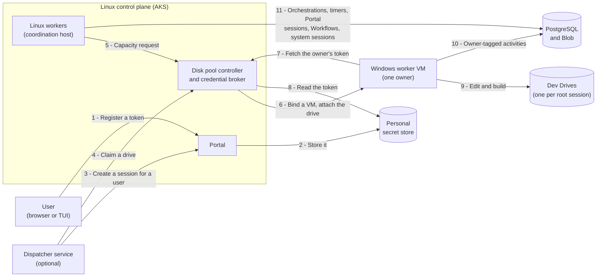

# Proposal: Windows Worker Pools with Dev Drive Workspaces

> **Status:** Proposal, for discussion before any code lands
> **Date:** 2026-11-11
> **Goal:** Let a PilotSwarm deployment run the agent sessions that need Windows on a pool of Windows VMs, each serving one
> user, with a persistent Dev Drive per root session, behind opt-in settings that leave every existing deployment unchanged.
> **Discussion:** `<ISSUE_LINK>`
> **Builds on:** [session workspaces](./session-workspaces.md) (the workspace provider hook),
> [multitenant PilotSwarm](./multitenant-pilotswarm.md) §2c (tag routing), [worker registry](./worker-registry.md), the
> deferred owner-scoped messaging item in [base-infra-deferred-items-may-26](./base-infra-deferred-items-may-26.md), and the
> [provider-boundary audit](../architecture/provider-boundary-audit.md).
> **Baseline:** `main` at `7ee6eff4` (2026-11-11, tagged v0.8.11). File and line references point there; a bare file name,
> such as `client.ts`, is in `packages/sdk/src/`.

---

## Summary

A downstream deployment of PilotSwarm runs agent sessions against large Windows codebases. Its agents edit, build and test
in those repositories, and the builds run only on Windows. Some need Hyper-V-isolated containers, and a clone with its
package caches is tens of gigabytes, so a fresh clone per session is too slow. Today PilotSwarm's Azure deployment runs
every worker as a Linux pod on AKS, a session's files live on the worker or a repo pod, and any worker can run any user's
session.

This proposal adds a Windows worker pool, entirely opt-in:

- **Windows worker VMs** in a Flexible scale set with a standby pool of deallocated VMs. Each running VM serves one user,
  the owner, from binding until it is deleted, and is never handed to another user. It runs only the work that needs
  Windows: the turns of the sessions that a dispatcher creates for its owner, and of their sub-agents, where the agent
  edits, builds, tests and debugs.
- **A Dev Drive per root session:** a managed disk with the session tree's clone and build output. It moves between the
  owner's VMs, so builds stay incremental.
- **Owner routing:** a new orchestration version tags the activities of a session that a dispatcher service creates for a
  user, so they run only on that user's VMs. Sessions that people start in the Portal stay on the Linux workers, as today.
- **Owner-only workers and a coordination host:** Windows workers claim only their owner's activities. PilotSwarm's
  existing Linux workers run everything else: Portal sessions, Workflows, system agents, titles and the bookkeeping around
  every turn. They also run orchestrations and timers while no Windows VM is up, so the pool can scale to zero.
- **A disk pool controller** that leases drives to root sessions, attaches them, starts and recycles VMs, and releases
  each user's model token only to that user's VMs.
- **Personal model credentials in an external secret store**, resolved on every turn, with redaction and a gate that
  accepts only fine-grained, short-lived GitHub tokens.
- **CLI hardening** for VMs that hold a token: a scrubbed environment, the Copilot CLI program with `--secret-env-vars`, no
  CLI hooks, tool limits for title and system sessions, and an owner-scoped session message policy.
- **Delegation** that lets a user allow a deployment's dispatcher service to create and end sessions for them.

New core code stays cloud-neutral, and Azure code lives under `deploy/providers/azure`. The work ships as small pull
requests (U1 to U33, plus a proposed U34) after this proposal (U0). Every new behavior is off by default, and the Windows
fixes run only on Windows.

## Why

- **Windows-only builds.** Those repositories build only on Windows, with Windows tools such as SQL Server LocalDB.
- **Hyper-V isolation.** Some builds run Hyper-V-isolated Docker containers, which need nested virtualization. AKS Windows
  nodes run process-isolated containers only ([AKS Windows best practices](https://learn.microsoft.com/azure/aks/windows-best-practices)),
  and AKS controls the node image, while the worker needs its own image with build tools, Docker and locked-down ACLs.
- **Warm builds.** A drive per root session keeps the clone and build output across turns, sessions and VMs.
- **Isolation.** An agent that can run Docker is in effect an administrator of its VM, and the owner's token is in the CLI's
  memory. So a VM serves one owner, runs only that owner's activities, and is deleted rather than reused.
- **A user's own model budget.** Each user's sessions call models with that user's own GitHub Copilot token. System agents
  and titles use a deployment-wide provider instead.
- **Cost.** Windows VMs are the expensive part. The pool should scale to zero between bursts of work, so something other
  than a Windows VM must run orchestrations and timers.

## Design overview

| Piece | Lives in | What it does |
|---|---|---|
| SDK hooks, settings and orchestration `1.0.84` | `packages/sdk`, `packages/app` | Owner tags, capacity requests, admission, worker lifecycle hooks, personal secret resolution, CLI hardening, delegation |
| Dev Drive workspace extension | `packages/sdk/examples/devdrive-workspaces/` | A workspace provider, loaded through `PILOTSWARM_EXTENSION_MODULES` like `repo-workspaces`. It mounts a root session's drive as `Q:`. It holds no cloud code and reaches the controller and a local attacher over HTTP |
| Windows image and worker services | `deploy/providers/azure/windows/` | Image build, Dev Drive seeding, release packing, a launcher and a local disk attacher run as Windows services |
| Disk pool controller and broker | `deploy/providers/azure/disk-controller/` | Drive pool and leases, attach and detach, VM lifecycle and scaling, admission, capacity, the credential broker and the upgrade freeze |
| Key Vault personal secret store | `deploy/providers/azure/secret-store/` | Implements the new `PersonalSecretStore` contract. Core never imports it |
| Coordination host | `deploy/providers/azure/linux-worker/`, `gitops/worker/` | The existing Linux workers with a capacity requester |
| Bicep, deploy steps and a policy-restricted profile | `deploy/providers/azure/**`, `deploy/scripts/*` | Scale set, standby pool, gallery, vaults, network, alerts and the `AZURE_POLICY_RESTRICTED` profile |
| Docs | `docs/developer/**`, `.github/{CI,DEPLOYMENT}.md` | A Windows workers manual and every new setting with its default |

A deployment keeps its own inputs, such as repositories to seed, toolchain, model catalog and values, in its own repository.

## How it works

### A session's life

1. **Once:** a user registers a fine-grained GitHub token on the Portal, which checks it and writes it to the external
   secret store; PostgreSQL keeps only a reference. To use a dispatcher, the user also turns on delegation.
2. **Create:** a dispatcher creates a root session for the user and claims a drive for it before the first prompt, so every
   turn belongs to a root that holds a drive lease. The controller denies turns under a root without one.
3. **Capacity:** before the turn, `requestOwnerCapacity` runs on the coordination host. The controller binds a ready VM to
   the owner, or starts a standby VM that is bound from the start.
4. **Turn:** the VM's worker declares the owner's tag and claims the turn. Its admission hook asks the controller to admit
   it, the extension attaches the root's drive at LUN 0 as `Q:`, and the resolver fetches the owner's token for the CLI.
5. **Idle hold:** the drive stays mounted while the session idles, so the next turn starts warm, unless another of the
   owner's sessions takes the VM over (below).
6. **End:** the session is completed and the drive returned. The VM releases it, and the controller resets it from a
   golden snapshot or deletes it. The VM serves its owner until idle for `WIN_WORKER_IDLE_RECYCLE_MINUTES`, then goes.

Sessions that people start in the Portal skip all of this: they get no owner tag and run on the Linux workers, as today.

### Owner routing

With `PILOTSWARM_OWNER_ROUTING=1` on the Portal, a session that a dispatcher creates for a user (`onBehalfOfOwner`, see
[delegation](#delegation-to-a-dispatcher)) is owner-routed:
- The Portal records the delegated creation in the session's creation config (U17), and with the setting also the owner
  tag, `owner.<ownerOid>` of that user. The client already persists that config on the session's row
  (`client.ts:292-318`), and the Portal accepts neither from a caller.
- When the first message starts the session's orchestration, the client copies the tag from the stored config into the
  orchestration input, on whichever process receives the message and whatever that process's own settings. It reads the
  stored value (`client.ts:896-931`), not the merged config, where an in-memory resume config overrides stored fields
  (`client.ts:916-922`).
- As a backstop, the coordination host (a worker with a capacity requester, below) refuses, without retrying, a turn of a
  session whose stored config carries an owner tag that the turn's input doesn't. A session started by a client that
  doesn't know the tag then fails instead of running off its owner's VMs. No other worker checks, so nothing runs with
  routing off.

Sessions that people start in the Portal get no tag and run on the Linux workers, as today. With personal credentials in
an external store (below), they use the deployment's shared model providers only, because the broker releases a personal
token only to a VM bound to its owner.

In orchestration `1.0.84`, every session-scoped activity of a tagged session carries the tag:
- the turn (`runTurnV5` and `runTurnEpochV5` today);
- `hydrateSession`, `dehydrateSession`, `needsHydrationSession`, `checkpointSession` and `abortTurn`;
- `checkWorkspace`, `releaseWorkspace` and `destroySession`.

duroxide gives an activity one tag. The turn and the two workspace activities carry a capability tag today. On them the
owner tag replaces it and stands for all four capabilities, as the capability tags already stand for each other
(`activity-routing.ts:46-47, 68-69, 93-100`): only a release that has them can declare an owner tag.

- **Children:** a sub-agent that a turn creates through `spawn_agent` takes the turn's tag, and `continueAsNew` carries it.
  So does the regeneration distiller's service session, which a manager activity creates under the tree's root
  (`session-proxy.ts:7221-7224`): its input carries the tag.
- **New roots:** `create_agent_session` creates a new root session for the same owner, not a child
  (`session-proxy.ts:3323-3326`). In an owner-routed tree that root would hold no drive, and without a tag it would run on
  the Linux workers, where an owner's personal model can't authenticate, so U18 refuses it there for now. A dispatcher
  creates any other root session the work needs.
- **Workflows:** a Workflow started in an owner-routed tree would escape the tag, so for now it is refused
  ([Workflows](#workflows), below).
- **System sessions:** system sessions, sessions that the system user owns and sessions under a system root never get a
  tag. Manager activities get no owner tag and keep their capability routing, as multitenant §2c proposes.
- **The worker's filter:** `PilotSwarmWorker` appends the new option `ownerTag` to its default filter, which is
  `defaultAnd` with four capability tags (`worker.ts:928`).
  - That makes five tags, duroxide's `MAX_WORKER_TAGS`. Your Workflow design notes count four of them as used
    (`docs/proposals/workflow-messaging-request.md:504-510`).
  - A worker with a capacity requester (below) appends `pilotswarm.owner-capacity.v1` instead. A worker never has both: it
    refuses to start, because six tags exceed the limit. A unit test keeps every filter at five tags or fewer.
  - This follows the worker registry proposal, where placement tags derive from a worker's pool and owner.

### Owner-only workers and the coordination host

Under the default filter, a bound VM would also take untagged and capability-tagged work from every user, while it holds
its owner's token. That work includes:
- system sessions, the title generator and manager activities;
- sessions started in the Portal;
- every Workflow activity, including Workflow scripts, which run user code with network access, and their tool sessions.

So a VM that holds a personal token must be owner-only. With `PILOTSWARM_WORKER_OWNER_ONLY=1`, the filter is duroxide's
`{ tags: [ownerTag] }`, which admits only that tag. The worker refuses to start without an owner tag, so an unbound VM
never polls. It never declares the capacity tag, which isn't scoped to one owner.

Multitenant §2c notes that at least one pool must serve untagged work. Here that pool is the coordination host:
PilotSwarm's existing Linux workers, `copilot-runtime-worker`.
- **What they keep running:** everything they run today: orchestrations and durable timers, also while no Windows VM is
  up, system agents, the title generator, `listModels`, the manager activities around every turn, the sessions that people
  start in the Portal with their workspaces, and every Workflow activity.
- **What they add:** every capacity request (below).
- **What they never do:** claim an owner-tagged activity, mount a drive or receive a personal token. They run under their
  own identity, without the worker secrets.

`WIN_WORKER_COORDINATION_HOST=true` turns this role on, and a Windows pool requires it. With the Linux workers off,
owner-only Windows workers would leave untagged work and capacity requests unserved. Default-filter Windows workers would
run other users' Workflows next to a token.

### Workflows

Workflows are always on. Every Workflow activity, the script runner and the agent-step spawner included, carries the
workflow-request capability tag (`workflow/runtime.ts:843-848`). So owner-only Windows workers never run one, and the Linux
workers run them all. Inside an owner-routed tree that would break owner routing:
- agent-step sessions are created inside an activity, outside any turn (`workflow/agent-host.ts:141-172`), so they get no
  owner tag;
- a script's tool session attaches the root's workspace on whichever worker runs the script
  (`session-manager.ts:4184-4213`);
- so the owner's work would run on the shared pool without its drive, and an agent step on the owner's personal model
  would fail to authenticate there.

So U18 refuses to start or test a Workflow in an owner-routed tree: an agent's `spawn_workflow`, its `workflow_definition`
`start`, and its `test`, whose revision test runs the scripts for real (`workflow/definition-tool.ts:295`), and a person's
start. `createSessionForWorkflow` doesn't accept `onBehalfOfOwner`. Workflows of Portal sessions run on the Linux workers,
as today.

We propose a later slice, U34, that owner-routes the whole tree:
- a new Workflow controller version records the tag at the start;
- the agent host passes it to each agent step;
- the script runner and its tool session carry it, so they run on the owner's VMs under the root's drive lease, and the
  tool session resolves the owner's token through the per-turn resolver (U16);
- it brings its own TLA+ updates.

We'd like your view before we design it.

### Capacity requests

An owner-tagged activity waits in the queue until a worker with that tag polls. To get one started, orchestration `1.0.84`
schedules the activity `requestOwnerCapacity` before each turn, before a session's first owner-tagged activity after
creation or an affinity release, and before a set-workspace command's check. Asking before every turn matters because a
session can keep its affinity through a durable wait while its owner's last VM is deleted. The activity carries its own
capability tag, `pilotswarm.owner-capacity.v1`, so only a worker with a requester registered through
`worker.setOwnerCapacityRequester(fn)`, which here means only the coordination host, runs it. The hook gets
`{ sessionId, rootSessionId, ownerTag }` and an `AbortSignal`:

| Answer | What `1.0.84` does |
|---|---|
| OK | Schedules the turn |
| `deny` | Ends the turn as an admission refusal that isn't retried. The Azure controller denies a root that holds no drive lease |
| `busy` with `retryAfterMs` | Holds the session on its busy timer and asks again. The controller answers this for a parked or returning drive |
| No answer within 15 seconds | Fires the signal and returns `busy` with `retryAfterMs: 60_000` and the code `CAPACITY_UNAVAILABLE`, which doesn't count as a busy failure, so a controller outage releases no affinity |

- **Timers, not the queue:** a turn's result is never raced (`orchestration/turn.ts:541-542`), so a lifecycle command waits
  for the activity in flight. A turn stuck in the queue for a VM that never comes would hold complete, cancel and delete; a
  timer doesn't. For the same reason, a tagged set-workspace command asks for capacity first and caps its `checkWorkspace`
  at a new 20-minute `WORKSPACE_CHECK_CAP_MS`.
- **Ending a session:** for owner-tagged sessions, complete, cancel and the pending-shutdown path race `session.destroy()`
  against the existing `WORKSPACE_RELEASE_CAP_MS` (10 seconds, `orchestration/state.ts:516`), as `releaseAffinity` already
  races `releaseWorkspace` (`orchestration/lifecycle.ts:194-210`).

`1.0.84` also adds an opt-in **fast busy policy**. Today affinity is released after two `WORKSPACE_BUSY` failures in a row
on one worker (`orchestration/turn.ts:1258`), with retries at 30, 120, 300 and 900 seconds (`orchestration/state.ts:489`).
A session whose input carries `workspaceBusyFastRelease` releases on the first refusal and retries at 10, 20, 60, then
every 180 seconds. With `PILOTSWARM_WORKSPACE_BUSY_FAST_RELEASE=1`, the client sets that flag on owner-routed sessions,
and children inherit it. Portal sessions keep today's policy.

### Dev Drives and the disk pool controller

The controller, `pilotswarm-disk-controller`, runs as one replica on AKS, with its state in a storage container of its own,
written with per-drive locks and ETag compare-and-swap.

- **The drive pool:** it creates drives from a golden snapshot, never more than `WIN_DEV_DRIVE_POOL_COUNT`, and keeps
  `WIN_DEV_DRIVE_SPARE_COUNT` hydrated spares. It refreshes the snapshot weekly on a throwaway VM, checks the result and
  keeps the previous snapshot for rollback.
- **Leases:** a claim leases a drive to a root session, at most `WIN_DEV_DRIVE_MAX_PER_USER` per owner. Only a root holds a
  drive, so the Windows workers turn off child workspace inheritance: sub-agents run without a workspace. A child that
  inherited the workspace on another VM would only wait for its parent's drive. The Linux workers keep today's
  inheritance for the sessions that people start in the Portal.
- **Attach and growth:** a drive attaches at LUN 0 of a VM bound to its owner and mounts as `Q:`, with
  `deleteOption: Detach`, so deleting a VM never deletes a drive. When a mounted drive runs low on space, the controller
  grows it online, `WIN_DEV_DRIVE_GROW_STEP_GB` at a time, up to `WIN_DEV_DRIVE_MAX_GB`.
- **Return:** a returned drive is reset from the snapshot, or deleted when the pool is above its spare target or the drive
  grew. A lease that nothing uses for `WIN_DEV_DRIVE_LEASE_EXPIRY_DAYS` is returned automatically, unless it is parked.
- **Fencing:** a VM that goes silent is deleted before its drive moves, so two VMs never write one drive. When at least two
  VMs, and more than half of the active ones, go silent together, the controller alerts instead.
- **Asking through heartbeats:** VMs accept no inbound connection, so heartbeat responses ask a VM to release a drive
  (`releaseRequested`) or extend a grown one (`extendRequested`). A calling VM is known by its source IP, never by name.

On each VM, the extension serializes every attach and release through one LUN 0 lock. It detaches the drive only when the
last folder that its root session holds is released. Before a clean detach, it records the tips of each repository, so a
crash takeover checks only the objects written since. Some releases also back the drive's work up to a WIP branch
(`PS_WIP_BRANCH_PREFIX`), bounded to 90 seconds. A preemption doesn't, because the drive keeps every edit.

| Port or listener | Who calls it | Routes |
|---|---|---|
| Worker port, worker subnet only, `worker` role | Windows workers | `POST /v1/vms/register`, `/v1/vms/heartbeat`, `/v1/vms/admit`, `/v1/vms/busy`, `/v1/leases/attach`, `/v1/leases/detach`, `/v1/credentials/model`, `/v1/credentials/work`. No capacity route: owner-only workers send no capacity request |
| Coordination port, coordination pods only, `coordinator` role | The coordination host | `POST /v1/coordination/demand` |
| Admin, through `kubectl port-forward`, `admin` or `deployer` role | The deploy pipeline | `GET` and `POST /v1/admin/upgrade-freeze` |
| Dispatcher listener behind the Portal's ingress, `user` role, `DISPATCHER_SP_OBJECT_ID` only | A dispatcher | `POST /disk-pool/v1/disks/{claim,park,sync-branch,rebind,return,credential}`, `GET /disk-pool/v1/owners/{ownerOid}/model-credential` (status only: whether the user's token is stored, its expiry and whether the stored secret is enabled, never the token; it doesn't report delegation, which the Portal holds), and an unauthenticated `GET /disk-pool/v1/healthz` for the App Gateway probe |
| `127.0.0.1` on each VM, with a token file | The launcher and the extension | The attacher's `/sync-release`, `/online-lun0`, `/offline-lun0` and `/extend-lun0` |

The controller serves TLS from a private CA that its deploy step creates, so the leaf can carry the load balancer's IP and
rotate without draining workers. The broker also keeps an opaque per-root credential that a dispatcher sets with a claim,
for a deployment's own tools on the VM (`/v1/credentials/work`); PilotSwarm never reads it. Every dispatcher call and
credential release is audited without its value.

### Sharing a VM, and parking a drive

A VM mounts one drive at a time. When another of the same owner's sessions needs the VM, the extension takes the drive back
from the idle session through the new `worker.tryReleaseIdleWorkspace()`, without a WIP push, in under 40 seconds. That
call answers `busy` only when a lock, a running turn or a task holds the folder, and `notHeld` when nothing on the worker
holds it. A session that was just preempted is refused on that VM rather than taking the drive back, and the controller
binds or adds another VM for the owner. Owner routing keeps this within one owner.

A deployment can also park a drive, for example while a person continues the work on their own machine. A parked drive
refuses every attach, admission and credential request with `WORKSPACE_BUSY` and `retryAfterMs: 900_000`, so its sessions
wait without spinning, and it never expires. `sync-branch` unparks it and records a branch and commit, with the URL to
fetch them from. On the next attach, the extension pushes anything on the drive that the commit doesn't contain to the WIP
branch, then resets the working copy to that commit.

### How VMs come and go

The controller keeps `min(X, max(Y, bound + ready))` VMs active, where `X` is `WIN_WORKER_COUNT`, `Y` is
`WIN_WORKER_MIN_RUNNING`, and `ready` is 1 while demand arrived within `WIN_WORKER_IDLE_RECYCLE_MINUTES`.

- **Scale out:** demand binds the ready unbound VM, or raises the scale set's capacity, which starts a standby VM.
- **Scale in:** idle VMs, including those on an older image or configuration, are deleted at most
  `WIN_WORKER_SCALE_IN_BATCH` every `WIN_WORKER_SCALE_IN_INTERVAL_MINUTES`, down to `Y`. At `X`, another owner's demand
  recycles the longest-idle VM at once.
- **No reuse, and zero:** deletion is the wipe between owners, and the standby pool refills only with new VMs. `Y=0` works
  because the coordination host runs orchestrations and timers while no Windows VM is up.

### Personal model credentials

- **External mode:** today a provider's credential is stored in PostgreSQL and loaded by workers
  (`provider-store.ts:555-565`). With `PILOTSWARM_PERSONAL_SECRETS=external`, personal credentials go to a store that the
  Portal loads from `PILOTSWARM_PERSONAL_SECRET_STORE_MODULE`. It implements a new core contract, `PersonalSecretStore`
  (`put`, `delete`, `describe`). The row keeps only `{ kind: "externalSecret", store, name, version, expiresOn }`, which
  the model catalog treats as a present credential.
- **Per turn:** workers resolve the token on every turn through `worker.setPersonalCredentialResolver(fn)`, cached by secret
  name and version, with no fallback to another credential. A refusal fails the turn as an authentication error, an outage
  fails it with a retry, and a busy answer holds it on the busy policy. The worker's `manage_provider` tool refuses
  personal credentials, so agents have no way to register one.
- **Redaction:** GitHub token patterns, and any prefix in `PILOTSWARM_REDACT_SECRET_PREFIXES`, are redacted from the
  events, tool output and logs that PilotSwarm persists.
- **The Azure store:** a Key Vault store writes a new secret per registration, tagged with its owner and expiring with the
  token. Only the controller's broker reads it, and it releases a token only to a VM bound to its owner, for a session
  under a root with an active lease.

The gate `PILOTSWARM_REQUIRE_FINE_GRAINED_GH_PAT=1` accepts only `github_pat_` tokens for GitHub-type providers. It checks
that the token reaches only public repositories, expires within 30 days, and can't read the account's keys, emails or
Codespaces secrets. It also turns off the legacy key RPCs.

### Keeping the token away from agents

Every CLI, a Workflow's tool session included, starts through `createCopilotClient`, which filters nothing from the
worker's environment and starts the SDK's bundled runtime (`copilot-client.ts:250`).

- **Allowlist:** `PILOTSWARM_SCRUB_CLI_ENV=1` gives every CLI only a platform baseline, the Copilot settings and the names
  in `PILOTSWARM_CLI_ENV_ALLOWLIST`.
- **The CLI program:** `PILOTSWARM_CLI_SECRET_ENV_VARS=COPILOT_SDK_AUTH_TOKEN` starts every CLI as the Copilot CLI program
  (`@github/copilot`, already a dependency), with `--secret-env-vars`, because the bundled runtime rejects that flag. It
  also sets `includedBuiltinSkills: []`, because the program offers bundled skills that the runtime doesn't.
- **Fail closed:** in external mode, the worker refuses to start unless the program is the SDK's pinned version, the flag
  names the token, and `COPILOT_PKG_CACHE_HOME` names a complete copy of the program that the worker can't write.
- **Hooks off:** today only workspace sessions, sessions whose workspace was cleared and a Workflow's tool sessions set
  `enableFileHooks: false` (`session-manager.ts:2918-2924, 2981`), which turns off the working directory's hooks but not the
  CLI home's.
  `PILOTSWARM_CLI_DISABLE_HOOKS=1` sets it on every session, and
  before every CLI launch and session create or resume keeps the home's `settings.json` at `{"disableAllHooks": true}` and
  its `config.json` in the program's own form. It requires a `COPILOT_HOME` of its own, never a person's `~/.copilot`.
- **Tool limits:** `PILOTSWARM_LIMIT_TITLE_SESSION_TOOLS=1` gives the title session no tools and a denying permission
  handler; today it gets every built-in tool and auto-approves (`session-proxy.ts:6300`).
  `PILOTSWARM_LIMIT_SYSTEM_SESSION_TOOLS=1` gives system sessions only their PilotSwarm tools and `skill`, and the
  Workflow context `none` that the tuner and distiller sessions already get (`session-manager.ts:2452, 4861`), which
  declares no Workflow tools (`managed-session.ts:1531-1536`): a Workflow's script runs code with network access, like a
  shell. Both settings also turn off the CLI's session store and embedding retrieval for those sessions.
- **Message scope:** `PILOTSWARM_SESSION_MESSAGE_SCOPE=owner` delivers `send_session_message` and `reply_session_message`
  only between one owner's sessions or between system sessions. Today delivery is intentionally ungated
  (`session-messages.ts:45-55`). With `owner`, the Portal also refuses a non-admin's shared fact writes under `skills/`,
  `asks/` and `config/facts-manager/`. This is phase 2, opt-in enforcement, of the deferred owner-scoped messaging item.
  A Workflow's sends, requests and typed input already stay with its parent or the same owner's sessions
  (`workflow/runtime.ts:2232-2237`, `workflow/authority.ts:4-27`).

### Delegation to a dispatcher

- **Opt-in:** a deployment may run a dispatcher service that creates sessions for users. Migration `0090` adds
  `users.allow_dispatcher_delegation` (default `false`) with two stored procedures. Users set it through
  `setMyDispatcherDelegation`, from a Portal switch or a TUI command, bound to the signed-in caller.
- **Creating sessions:** `createSession` and `createSessionForAgent` accept `onBehalfOfOwner`, only from
  `DISPATCHER_SP_OBJECT_ID` and only for a user who opted in. The session stays private, the dispatcher gets a targeted
  `write` share, and the creation is audited and recorded in the session's creation config for owner routing.
  `createSessionForWorkflow` doesn't accept it.
- **Ending sessions:** the dispatcher may complete, cancel and delete sessions it holds that share on. Today these are owner
  or admin only (`packages/sdk/api/src/session-authz.js:138-141`). Each call writes its audit entry before the Portal
  answers.
- **Sharing:** a session created on behalf of a user can be shared for reading only. The Portal refuses a `write` share and
  `shared_write` visibility on it, apart from the dispatcher's own share. Otherwise a teammate's prompt would run on the
  owner's VM with the owner's token. Administrators keep their access, as upstream's rule gives them every access
  (`packages/sdk/api/src/session-authz.js:96-103`), so a deployment trusts them like the deployment itself.
- **Revocation:** turning delegation off takes effect at the dispatcher's next Portal call (`403 DELEGATION_REVOKED`),
  across listings and live subscriptions too. The disk pool controller doesn't check delegation in this proposal: its
  dispatcher routes keep accepting the dispatcher for that user, a new claim included. A drive is useless without the
  user's sessions, which the Portal no longer opens to the dispatcher, but the controller checking delegation itself is
  later work.

With `DISPATCHER_SP_OBJECT_ID` unset, nothing changes. The Portal accepts `onBehalfOfOwner` only with the existing
`AUTHZ_ENFORCE_OWNERSHIP=true`: with today's default (`deploy/providers/azure/envs/template.env:146`), every decision is
only audited and nothing is blocked (`packages/app/web/authz.js:25-28`), so the sharing rule above would hold nothing.

**Handing work over.** To continue another user's work, a dispatcher creates a new session for the new user, on their own
VMs, drive and token, from the work's branch; the old session isn't shared for writing. Transferring a session's ownership
stays out of scope here; the [user and admin security model](./user-admin-security-model.md) sketches it for later.

### Ending a session tree that doesn't settle

Today `deleteSession` takes the terminal path only for a pending or terminal session (`management-client.ts:1780-1788`),
and it throws when the `delete` command doesn't settle. The optional `deleteSession(sessionId, reason, { force: true })`
takes that path for the session's subtree after the settle timeout. It works from the leaves up, with the target last, and
throws, naming what failed, if any part fails, so a retry can finish. `settleTimeoutMs: 0` skips the command and the wait.

### Upgrades

VMs take their worker code from a release zip at boot, so worker code, the Portal, the controller and the database move
together in four steps: freeze (the controller stops activating VMs and attaching drives, drains and stops every worker,
and the coordination host scales to zero); migrate; publish and roll the Portal and controller; unfreeze. No worker runs
while the versions change, so this already follows your rule for a release that changes the default orchestration version:
stop every worker, deploy, then start. Every worker of a deployment, Windows and Linux, runs the same release. Operating
system updates come as a new gallery image, and the controller recycles VMs on the old one.

### Azure deployment

- **Turning it on:** `WIN_WORKERS_ENABLED=true` adds the scale set, standby pool, gallery image definition, a personal Key
  Vault, the controller's storage account, a worker subnet and alerts. It registers the controller as a service, skipped
  otherwise, as the repo service is skipped without workspaces (`deploy.mjs:407-411`).
- **Network and database:** the worker subnet's NSG admits no inbound connection. Inside the VNet, workers reach only the
  controller's worker port and the blob private endpoint, so one owner's VM can't reach another's. PostgreSQL takes Entra
  sign-in only, from the deployment's egress addresses.
- **Policy-restricted subscriptions:** `AZURE_POLICY_RESTRICTED=true` is a deploy profile for subscriptions whose Azure
  Policy denies parts of today's deployment. It adds a Network Security Perimeter for Key Vault and Storage, blob private
  endpoints and explicit subnet NSGs, turns off storage account key access, and replaces ARM deployment scripts with deploy
  steps.
- **Combination checks:** the deploy refuses combinations that can't work or aren't safe:
  - owner routing without Windows workers;
  - a Windows pool without the coordination host;
  - a Windows pool or a dispatcher (`DISPATCHER_SP_OBJECT_ID`) without `AUTHZ_ENFORCE_OWNERSHIP=true`;
  - personal credentials on Windows workers that aren't owner-only.
- **Entra roles:** `Setup-PortalAuth.ps1 -WorkerRoles` (off by default) turns on v2 access tokens, adds the `worker` and
  `deployer` application roles (`coordinator` with U31), and lets the `user` role go to applications, for a dispatcher.

## Settings and hooks

Every new behavior is off until a setting, a hook, an optional parameter or a deploy flag turns it on.

**SDK, worker and Portal settings**

| Setting | Upstream default | When set | Slice |
|---|---|---|---|
| `PILOTSWARM_DISABLE_CHILD_WORKSPACE_INHERITANCE` | `0`: children inherit the parent's workspace | `1`: children get none, and an explicit child workspace is rejected at spawn | U6 |
| `PILOTSWARM_WORKSPACE_ATTACH_TIMEOUT_MS` | `30000` (`workspace.ts:40`) | Per-folder attach deadline | U7 |
| `PILOTSWARM_DEFAULT_IDLE_TIMEOUT_SEC` | Unset: the client's 1,800 seconds (`client.ts:994`) | Passed to the Portal's client as `dehydrateOnIdle` | U7 |
| `PILOTSWARM_CLI_ABORT_TIMEOUT_MS` | Unset: a turn guard waits for the CLI's abort without a limit (`managed-session.ts:4697-4698`) | Bounds the wait, then force-stops that CLI client; the turn retries | U7 |
| `PILOTSWARM_EVENT_RETENTION_MINUTES` | Unset: a 60-minute floor (`resourcemgr-tools.ts:547`) | An extra floor for `purge_old_events` | U8 |
| `PILOTSWARM_DISABLE_K8S_SCALING` | `0` | `1`: `scale_workers` refuses | U9 |
| `PILOTSWARM_SKIP_DB_MIGRATIONS` | `0` | `1`: CMS and facts stores skip migrations at startup | U10 |
| `PILOTSWARM_SCRUB_CLI_ENV` | `0`: every CLI gets the worker's whole environment | `1`: every CLI gets only the allowlist | U11 |
| `PILOTSWARM_CLI_ENV_ALLOWLIST` | Unset: the baseline and Copilot settings only | Extra names, comma-separated, `*` as a trailing wildcard | U11 |
| `PILOTSWARM_CLI_SECRET_ENV_VARS` | Unset: the SDK's bundled runtime, no flag | Every CLI starts as the Copilot CLI program with `--secret-env-vars` | U12 |
| `PILOTSWARM_LIMIT_TITLE_SESSION_TOOLS` | Unset: every built-in tool | No tools, a denying permission handler | U13 |
| `PILOTSWARM_LIMIT_SYSTEM_SESSION_TOOLS` | `0`: every built-in tool | PilotSwarm tools and `skill` only, no native tasks | U14 |
| `PILOTSWARM_REQUIRE_FINE_GRAINED_GH_PAT` | Unset (`0`) | GitHub-type providers accept only fine-grained, public-only tokens that expire within 30 days | U15 |
| `PILOTSWARM_PERSONAL_SECRETS` | `database` | `external`: personal credentials only in the external store | U16 |
| `PILOTSWARM_PERSONAL_SECRET_STORE_MODULE` | Unset | The Portal loads the `PersonalSecretStore` from this module | U16 |
| `PILOTSWARM_REDACT_SECRET_PREFIXES` | Unset | Extra token prefixes to redact | U16 |
| `DISPATCHER_SP_OBJECT_ID` | Unset | Turns on `onBehalfOfOwner` and the delegated end of work for that principal | U17 |
| `PILOTSWARM_OWNER_ROUTING` | `0`: no owner tags | `1`: the Portal records an owner tag on each session it creates on behalf of a user, and every client copies it into that session's orchestration input | U18 |
| `PILOTSWARM_WORKSPACE_BUSY_FAST_RELEASE` | Unset: release after two busy failures; retry at 30, 120, 300, 900 s | `1`: owner-routed sessions release on the first; retry at 10, 20, 60, then 180 s | U18 |
| `PILOTSWARM_WORKER_OWNER_TAG` | Unset | `packages/sdk/examples/worker.js` passes it as `ownerTag` | U18 |
| `PILOTSWARM_WORKER_OWNER_ONLY` | Unset: today's filter | `1`: `ownerOnly`, the filter names only the owner tag | U30 |
| `PILOTSWARM_SESSION_MESSAGE_SCOPE` | `fleet`: any live session | `owner`: within one owner's sessions or among system sessions | U32 |
| `PILOTSWARM_CLI_DISABLE_HOOKS` | Unset: home hooks run, and only workspace sessions, sessions whose workspace was cleared and a Workflow's tool sessions skip the working directory's | `1`: no file hooks in any session, fixed home settings files | U33 |

**Dev Drive extension and coordination module settings** (read only by the example extension or the Azure modules)

| Setting | Upstream default | What it is | Slice |
|---|---|---|---|
| `PS_WORKSPACE_ROOTS` | Unset | Root names and paths on the drive, as in `repo-workspaces` | U19 |
| `PS_DISK_POOL_CONTROLLER_URL` | Unset | The controller's worker endpoint | U19 |
| `PS_DISK_CONTROLLER_TOKEN_MODULE` | Unset | A deployment module whose `getToken()` returns a controller token | U19 |
| `PS_DISK_CONTROLLER_TOKEN_SCOPE` | Unset | The scope that the Azure token module requests and the controller checks | U20, U21 |
| `PS_DISK_CONTROLLER_CA_CERT` | Unset | The CA file trusted for the controller | U19 |
| `PS_DISK_ATTACHER_URL`, `PS_DISK_ATTACHER_TOKEN_FILE` | `http://127.0.0.1:3099`, `C:\pilotswarm\run\attacher.token` | The local attacher and its token file | U19 |
| `PS_WORKSPACE_ADOPT` | `instructions,agents,skills` | What a session adopts from the repository | U19 |
| `PS_WIP_BRANCH_PREFIX` | `pilotswarm/wip/` | Prefix of each root's WIP branch | U19 |
| `PS_COORDINATION_URL`, `PS_COORDINATION_TOKEN_SCOPE` | Unset | The controller's coordination route, and its token scope | U31 |

**Deploy settings** (the environment file, `new-env.mjs` and `aks-env.mjs`)

| Setting | Upstream default | What it is |
|---|---|---|
| `WIN_WORKERS_ENABLED` | `false` | Turns on the Windows worker pool |
| `AZURE_POLICY_RESTRICTED` | `false` | Turns on the policy-restricted profile |
| `PERIMETER_OPERATOR_IP_PREFIXES` | Unset | Operator address prefixes that the perimeter admits |
| `WIN_WORKER_COUNT`, `WIN_WORKER_MIN_RUNNING` | `5`, `1` | Most (`X`) and fewest (`Y`) active VMs; `Y=0` lets the pool scale to zero |
| `WIN_WORKER_STANDBY_MIN` | `1` | Deallocated standby VMs kept ready |
| `WIN_WORKER_VM_SIZE` | `Standard_D16ds_v5` | VM size; nested virtualization is required |
| `WIN_WORKER_IMAGE_VERSION` | Unset | Gallery image version; until set, only the gallery and image definition deploy |
| `WIN_WORKER_IDLE_RECYCLE_MINUTES` | `30` | Idle time before a VM is recycled |
| `WIN_WORKER_SCALE_IN_BATCH`, `WIN_WORKER_SCALE_IN_INTERVAL_MINUTES` | `1`, `5` | Most VMs deleted per scale-in step, and fewest minutes between steps |
| `WIN_WORKER_WORKING_HOURS` | Unset: `Y` all day | Hours in which at least one VM stays active |
| `WIN_WORKER_COORDINATION_HOST` | `false` | Runs the Linux workers as the coordination host and makes Windows workers owner-only; required with `WIN_WORKERS_ENABLED=true` |
| `WIN_WORKER_EXTRA_ENV` | Unset | Non-secret `NAME=VALUE` pairs for every VM; reserved names are refused |
| `WIN_WORKER_ALERT_EMAILS` | Unset; required with `WIN_WORKERS_ENABLED=true` | Alert receivers |
| `WIN_DEV_DRIVE_POOL_COUNT` | `10` | Most drives at once (`M`) |
| `WIN_DEV_DRIVE_SPARE_COUNT` | `2` | Hydrated spares |
| `WIN_DEV_DRIVE_MAX_PER_USER` | `3` | Most leases per owner |
| `WIN_DEV_DRIVE_LEASE_EXPIRY_DAYS` | `7` | Unused lease expiry, except parked drives |
| `WIN_DEV_DRIVE_SIZE_GB`, `WIN_DEV_DRIVE_IOPS` | `1024`, `6000` | Starting size and provisioned IOPS |
| `WIN_DEV_DRIVE_GROW_FREE_PERCENT`, `WIN_DEV_DRIVE_GROW_STEP_GB`, `WIN_DEV_DRIVE_MAX_GB` | `20`, `256`, `2048` | Grow a drive whose free share falls below the first, by the second, up to the third |

The deploy computes or derives the rest from Bicep outputs: `WIN_WORKER_CONFIG_VERSION`, a hash of the VM settings that
makes the controller recycle outdated VMs, and the identity and resource IDs and state URL that VMs and the controller use.

**Hooks and APIs**

| Hook or API | Slice | Without it |
|---|---|---|
| `worker.onShutdown(fn)`, `worker.tryReleaseIdleWorkspace(sessionId, { reason, releaseTimeoutMs })`, `worker.getActiveWorkloadCount()`, and `releaseTimeoutMs` on `gracefulShutdown()` and `releaseIdleWorkspaces()` | U5 | Nothing runs, and each provider release gets 5 seconds (`session-manager.ts:3612`), within the shutdown's existing bound of the drain budget plus `PILOTSWARM_WORKER_SHUTDOWN_GRACE_MS` (`worker.ts:1255-1270`), as today |
| `worker.setPersonalCredentialResolver(fn)` and the `PersonalSecretStore` contract | U16 | Database credentials, as today |
| `onBehalfOfOwner`, `getMyDispatcherDelegation` and `setMyDispatcherDelegation` (`GET` and `PUT /me/dispatcher-delegation`) | U17 | No delegation |
| `ownerTag` input, `workspaceBusyFastRelease` input, the `requestOwnerCapacity` activity and `worker.setOwnerCapacityRequester(fn)` | U18 | Sessions without them run exactly as on `1.0.83` |
| `worker.setSessionAdmission(fn)`: admit, `busy` or `deny` before every turn | U28 | Every turn is admitted |
| `deleteSession(sessionId, reason, { force, settleTimeoutMs })` | U29 | Today's delete |
| `PilotSwarmWorkerOptions.ownerOnly` and `.sessionMessageScope` | U30, U32 | Today's filter and delivery |

## Compatibility contract

Every slice meets these rules, with two stated exceptions: U26 and U27 propose new defaults, which you decide on (C1, open
question 7), and U26's capped destroy, if it ships in `1.0.84`, applies to every session (C4). Reviewers can check the
rules, and tests cover them.

| Rule | What it means |
|---|---|
| C1. Off by default | Each new behavior needs a setting, a registered hook, an optional parameter or a deploy flag, and its default reproduces today's behavior |
| C2. Additive APIs | New optional parameters, methods, routes and settings only. Nothing is renamed or removed, and the regenerated protocol client keeps every existing call working |
| C3. Additive schema | One CMS migration, `0090`, adds a column with a default and two new stored procedures. It replaces no procedure and rewrites no data |
| C4. Versioned orchestration | `1.0.84` is a new version. `1.0.83` is frozen as `orchestration_1_0_83/`, and every version down to the floor, `1.0.47`, stays registered. `1.0.84` changes nothing for a session unless its input carries an owner tag or the fast busy flag. Orchestration code never reads `process.env`. A release that contains it changes the default orchestration version, so every deployment that takes that release upgrades by stopping every worker, deploying, then starting, as the 0.8.11 release notes ask (`CHANGELOG.md:5-21`) |
| C5. Platform guards | Windows code paths run only under `process.platform === "win32"`, and Linux behavior is unchanged. The required Windows unit-test job covers them |
| C6. Cloud-neutral core | No new cloud SDK or cloud logic in core, as `.github/copilot-instructions.md` requires. New Azure code lives under `deploy/providers/azure`, including new deploy steps in `deploy/providers/azure/deploy-steps/`. Modules with npm dependencies have their own `package.json` and lockfile. `deploy.mjs` only calls the new steps, behind `WIN_WORKERS_ENABLED` or `AZURE_POLICY_RESTRICTED`. The Azure-specific scripts already under `deploy/scripts/`, such as `render-params.mjs`, `deploy-bicep.mjs` and `compose-env.mjs`, and `Setup-PortalAuth.ps1`, get only the wiring that calls code under `deploy/providers/azure`, so no new logic joins the existing exceptions (`.github/copilot-instructions.md:38-41`; open question 4). Core's existing Azure Blob code isn't extended |
| C7. Deploy opt-in | New Bicep and deploy paths run only with `WIN_WORKERS_ENABLED=true` or `AZURE_POLICY_RESTRICTED=true`. With both off, a redeploy changes nothing: tests check that rendered parameters and manifests match today's, and an ARM what-if shows nothing beyond what changes on every run today |
| C8. Nothing deployment-specific | No organization, host, feed, resource or tenant names, subscription IDs or secrets, on any branch. Every push to a public branch stays in history, and `npm run check:privacy` scans only indexed files, so contributors also run their own pre-push check and review |
| C9. Tests with every change | Unit tests under `packages/sdk/test/unit` (platform-guarded) and `packages/app/web/test`; a test under `packages/sdk/test/local/` for every new activity, orchestration branch or tool, registered with `scripts/run-tests.sh` and `test:local`; a clean `tsc --noEmit`; `npm run test:deploy-scripts` for deploy changes; and, for a change to the session orchestration, hydration or the Workflow controller, the TLA+ models updated and TLC run, as `.github/copilot-instructions.md` asks |
| C10. No cost when off | With the settings off, no extra activity, network call or environment work runs on the hot path |

## What our local tests showed

These are observations from throwaway local tests, not claims about PilotSwarm's code; the proposed tests must show them.

**duroxide routing.** duroxide-node 0.2.4, which v0.8.11 still uses, with its PostgreSQL provider on a local PostgreSQL 16,
PilotSwarm's lock, poll and session settings, every case run twice. The tests ran before v0.8.11 added its fourth capability
tag:

- **Routing held.** Owner-tagged, session-affined activities ran only on their owner's workers, also after the affinity key
  rotated and after a worker was killed while holding the session. A `{ tags: [ownerTag] }` worker never claimed an
  untagged, capability-tagged, capacity or other owner's activity. A five-tag `defaultAnd` worker (the three capability
  tags of that release, an owner tag and the capacity tag) ran untagged, capability, own-owner and capacity work, never
  another owner's. With the fourth capability tag that combination no longer fits, so this design never declares an owner
  tag and the capacity tag together, and the proposed tests rerun the routing cases with the four-tag default.
- **`MAX_WORKER_TAGS` isn't enforced.** In duroxide-node 0.2.4, six-tag filters of both kinds started and claimed all six
  tags. So PilotSwarm's own unit test that keeps a filter at five tags or fewer is the guard. This may be worth a duroxide
  issue.
- **Lock lapse and handover.** PilotSwarm sets no session lock timeout unless `PILOTSWARM_SESSION_LOCK_TIMEOUT_MS` is set
  (`worker.ts:119-120`). The default lock we saw lasted 30 seconds and renewed every 25, so a stopped holder's session moved
  5 to 30 seconds later: about 30 seconds after a hard kill, and about 13 after a graceful shutdown. A worker that restarted
  under the same `workerNodeId` before the lock lapsed took its session back within a second. With no worker of that
  owner, the activity stayed unclaimed, then ran within a second of one starting.
- **A live holder keeps its session.** It keeps the session from every other worker until the session idles out, an hour in
  PilotSwarm (`worker.ts:935`). An activity that the holder's filter doesn't admit waits rather than running elsewhere.
  That is why every session-scoped activity of a tagged session must carry the tag.
- **The destroy race.** With no owner worker, an owner-tagged `destroySession` that lost its race never started, also once an
  owner worker started later. A destroy already running isn't stopped by losing: duroxide flags `isCancelled()` only at the
  next worker-lock renewal (every 5 seconds with PilotSwarm's 10-second lock), and `destroySession` doesn't check the flag
  (`session-proxy.ts:6027-6052`).
- **Not covered:** PilotSwarm's own code, duroxide-node's Linux build, and a worker killed mid-way through an orchestration turn.

**The Copilot CLI program under the SDK.** Copilot CLI 1.0.83 under SDK 1.0.13, on Windows and in a Linux container, started the
way U12 proposes, with our own tokens:

- **`--secret-env-vars` hides, but doesn't redact.** The named variables, `COPILOT_SDK_AUTH_TOKEN` included, never reached a
  shell, an MCP server or a hook, while a variable it didn't name did. The bundled runtime rejects the flag and gave the
  shell and the MCP server the token. The flag redacts nothing: a filtered value that a tool read from a file appeared in
  the tool's result, the reply, `events.jsonl` and the CLI's session store.
- **The CLI runs what a session plants.** It ran hooks from its home (`settings.json`, `config.json`, whose settings it
  moves into `settings.json`, and the `hooks` folder) and from the working directory (`.github/hooks/*.json`,
  `.github/copilot/settings.json`, `.github/copilot/settings.local.json` and `.claude/settings.json`). That held in new,
  resumed and tool-less sessions, with configuration discovery off. No single switch turns them all off: `disableAllHooks`
  covers only inline hooks, a writable `config.json` overrides it, and `enableFileHooks: false` covers only the working
  directory. That is why U33 exists. With U33's settings and an empty read-only `hooks` folder, no planted hook ran.
- **Other planted files.** Without read-only placeholders in its home, the program also started an MCP server from its
  `mcp-config.json`, even in a tool-less session, and gave the model the home's `copilot-instructions.md`. The Windows
  image ships those placeholders; that part is a deployment's job.
- **Its package cache.** The program reuses an unpacked copy of itself after checking only that a few files exist. A
  modified copy planted there ran in the next session; with `COPILOT_PKG_CACHE_HOME` naming a copy the worker can't write,
  it never ran.
- **Tool sets.** `availableTools: []` left a session no tool. `["custom:*", "builtin:skill"]` left only custom tools, plus
  `skill` when the session has a skill folder, and `includedBuiltinSkills: []` removed the program's bundled skills.
- **Fine-grained tokens.** A fine-grained token with only the Copilot Requests account permission completed a turn, and
  `GET /user` returned its `github-authentication-token-expiration` header, which the U15 gate reads.

Windows builds under the worker's service account on a Dev Drive haven't been tried yet.

## Slice plan

Each slice is one pull request with one change, its tests and its docs, cut from current `main` and squash-merged.
Slices without a dependency can land in any order.

| Slice | Change | Needs |
|---|---|---|
| U0 | This proposal and its issue | — |
| U1 | Windows: pin `System32\tar.exe` for session archives | — |
| U2 | Windows: process-tree cleanup | — |
| U3 | Front Door WAF policy name without hyphens or underscores, a bug fix (`deploy/providers/azure/services/global-infra/bicep/main.bicep:51`) | — |
| U4 | Deploy profile for policy-restricted subscriptions (`AZURE_POLICY_RESTRICTED`) | U3 |
| U5 | Worker lifecycle hooks and the shutdown release bound | — |
| U6 | Child workspace inheritance setting | — |
| U7 | Configurable attach and idle timeouts, and a bound on a wedged CLI's abort | — |
| U8 | Event retention floor | — |
| U9 | Kubernetes scaling gate | — |
| U10 | Migration skip on workers | — |
| U11 | CLI environment allowlist | — |
| U12 | The Copilot CLI program with `--secret-env-vars` | U11 |
| U13 | Title session tool limit | — |
| U14 | System session tool limit, with no Workflow tools | — |
| U15 | Fine-grained token gate | — |
| U16 | External personal secrets: the store contract, catalog references, per-turn resolution and redaction | U12, U15 |
| U17 | Dispatcher delegation: migration `0090`, `onBehalfOfOwner`, read-only sharing of the sessions it creates and the delegated end of work | U29 |
| U18 | Orchestration `1.0.84`: owner tags for the sessions created on behalf of a user, capacity requests, the fast busy policy, the capped owner-tagged destroy and set-workspace check, and Workflows and new root sessions refused in owner-routed trees | U17 |
| U19 | Dev Drive workspace extension | U5, U16, U18, U28 |
| U20 | Windows image and worker-service scripts | U19 |
| U21 | Disk pool controller and credential broker | U16, U18 |
| U22 | Key Vault personal secret store | U16 |
| U23 | Entra v2 tokens and the `worker` and `deployer` roles (`-WorkerRoles`) | — |
| U24 | Windows worker pool deployment: settings, Bicep and tests; the deploy accepts the pool once U31 adds the coordination host | U4, U20, U21, U22, U23 |
| U25 | Windows workers manual and reference pages | U24 |
| U26 | Proposal: cap the destroy wait for every session (it could ship in U18's version, to avoid a second stop, deploy, start) | U18 |
| U27 | Proposal: no tools for the title session by default | U13 |
| U28 | Session admission hook (worker only) | U5 |
| U29 | Forced delete of a session tree that doesn't settle | — |
| U30 | Owner-only workers | U18 |
| U31 | Linux coordination host: requester, identity, manifests and the `coordinator` role and route | U21, U23, U24, U30 |
| U32 | Session message scope | — |
| U33 | CLI hooks off | — |
| U34 | Proposal: owner routing for Workflows in an owner-routed tree (see [Workflows](#workflows)) | U16, U18, U30 |

U18 is the one bundle: its behaviors all change the orchestration, and one frozen version keeps one replay boundary.
It can split into one version per behavior if you prefer. The admission hook needs no orchestration change, because
`1.0.83`, like `1.0.82`, already handles busy and deny results (`orchestration/turn.ts:1450, 1670`), so it ships alone as
U28.

**Numbers stay provisional until U17 and U18 merge.** A migration's version and an orchestration's version end up in durable
state. The migrator skips any version it has already recorded (`pg-migrator.ts:122-128`), and a deployed orchestration
version can't change (`docs/architecture/system.md:928`). Holding a number for us would block or reorder your own changes.
So we use the next free numbers, `0090` and `1.0.84` today, only on a test deployment whose data we can throw away. If
`main` takes a number first, as v0.8.11's Workflows did with `0088`, `0089` and `1.0.83` while we drafted this, the slice
takes the next free one and we recreate that data. We run them nowhere else until both are merged.

**Early review: U5, U17, U18 and U29.** They need no Azure work, so they can go up as soon as their local tests pass. U18
carries the orchestration version and the core routing design, where your input matters most, and its TLA+ updates. U17
carries migration `0090` and changes who may create, share and end sessions. U29 is small and comes first, because U17
needs it: the delegated end of work may pass `force`. U18 then needs U17, whose delegated creation it tags. U5 is small
too, and the Dev Drive extension and the admission hook need it.

## How we propose to work

- **A dev branch:** `feature/windows-workers` in this repository, following the `feature/` naming that the release
  workflow uses, where we integrate and run the slices together before you review them one at a time. Its ruleset would
  require pull requests, the required PR checks and one approval, allow merge commits so syncing `main` keeps its history,
  and block force pushes and deletion.
- **Write access:** GitHub grants it repository-wide, and it also lets its holders start `/test all`, so we'd name who
  gets it. If you prefer, the same branch lives in a fork, whose pull requests get the same PR checks.
- **Keeping up:** we'd merge `main` in at least weekly and after every slice merges, resolving conflicts there, never in an
  upstream pull request. Once its difference from `main` is empty and released, the branch is deleted or kept read-only.
- **If a slice is declined:** we'd keep it on the branch while it's redesigned, preferring an extension or a hook.

## Security model and known limits

A deployment that turns this on gets one owner per VM, with VMs deleted rather than reused. Tokens are fine-grained,
public-only and short-lived, stored outside PostgreSQL, released per turn only to the owner's VMs, never written to disk by
PilotSwarm, hidden from agent environments and redacted from the events, tool output and logs that PilotSwarm records.
Workers accept no inbound connection. Windows VMs run only their owner's activities. System sessions, titles, Workflows and
the sessions that people start in the Portal run on the Linux workers, which hold no personal token and mount no drive.
With the message scope on, no session message crosses owners. The manual will state the limits plainly:

- **An agent can still reach its own owner's token.** It runs as the CLI's account and, with Docker, as a VM administrator,
  so it can read the token from the CLI's memory. A token an agent prints stays in the CLI's own session files, which
  dehydration archives as recorded.
- **VMs share one managed identity for PostgreSQL and Blob.** An agent can therefore read and change other users' session
  data and queued work, and steer another owner's session. Users of one deployment must trust each other with session data.
  Running agent tools under a separate account without administrator rights is future hardening.
- **The Linux workers serve every user.** Content injected through one user's facts or messages can steer a system agent,
  which keeps its PilotSwarm tools. The knowledge facts that `facts-manager` promotes for everyone remain an indirect path
  to other users' sessions. Portal sessions' agents and Workflow scripts run there with shells and network access, next to
  the system agents and with the pod's identity, as on PilotSwarm's workers today: they can read and change other users'
  session data there too.
- **The Portal and a dispatcher are trusted like the deployment.**

**Not in this proposal:**
- a drive claim for sessions that people start in the Portal, which keep running on the Linux workers with shared model
  providers;
- owner routing for Workflows (proposed as U34);
- VMs used by more than one user, and Git worktrees on one drive;
- transferring a session's ownership;
- controller high availability (it runs one replica);
- per-user MCP credentials, which PilotSwarm doesn't have.

## Open questions

1. Is this design acceptable in shape, and are there settings or hooks you'd rather see differently?
2. Will you review U5, U17, U18 and U29 early, so that `0090` and `1.0.84` become final on `main`?
3. Will you create `feature/windows-workers` and grant write access, or do you prefer a fork?
4. Should the new Azure deploy steps plug into the deployment-provider contract that the provider-boundary audit calls for
   (finding 7, #64), or stay as steps that `deploy.mjs` calls behind its settings until that contract exists?
5. Should U18 ship as one orchestration version or one per behavior? Is `packages/sdk/examples/devdrive-workspaces/` the
   right home for the extension, next to `repo-workspaces`?
6. Should the owner tag, `owner.<ownerOid>` from the row's owner (an Entra object ID with Entra sign-in), also carry the
   auth provider, or follow the worker registry's pool and owner identity?
7. U26 and U27 propose new defaults for every deployment. Do you want them, or should both stay opt-in?
8. We plan to ask the Copilot SDK owners to accept `--secret-env-vars` in the bundled runtime, and for one switch that turns
   off every hook, so PilotSwarm could return to the bundled runtime. Is there a better route?
9. With four capability tags in every default filter, an owner tag takes the last of duroxide's five. Is that the right use
   of it, and how should it fit with the worker registry's placement tags?
10. For Workflows in an owner-routed tree, is refusing them until U34 acceptable, and is U34's whole-tree rule (a new
    Workflow controller version that carries the owner tag to agent steps and scripts) the direction you'd take?
11. Only sessions created on behalf of a user run on the Windows pool; sessions that people start in the Portal stay on
    the Linux workers. Should the Portal later be able to claim a drive, so those can use the pool too?
