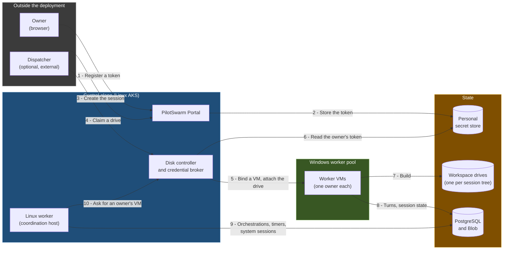
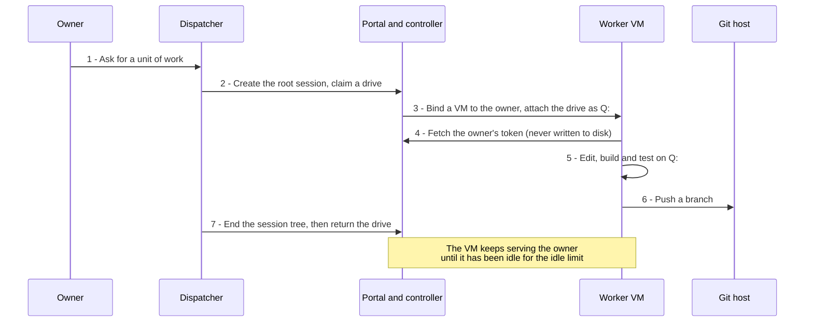
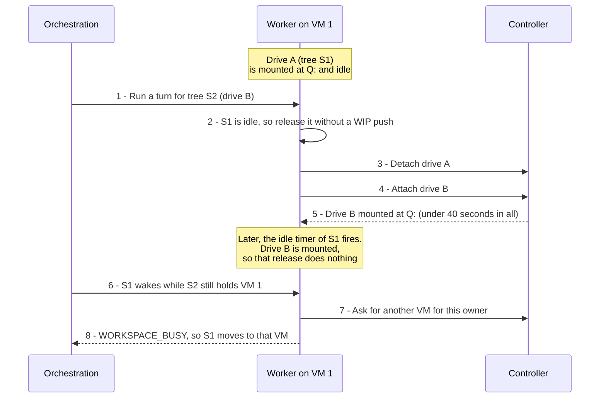
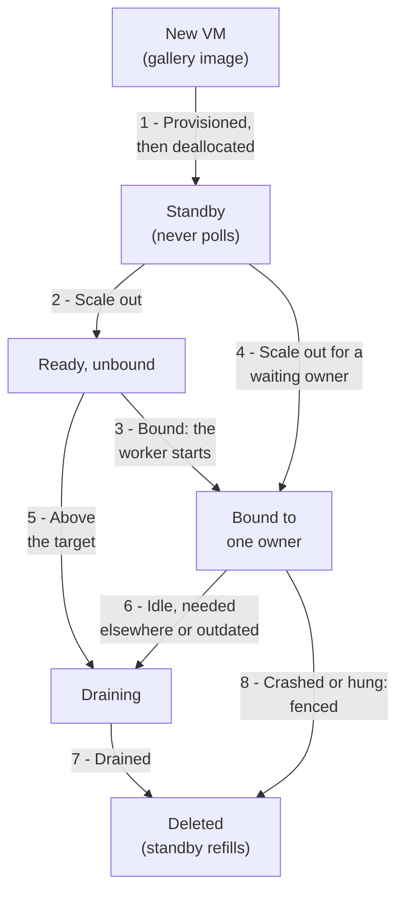

# Windows worker pool

**Status:** Proposal (rev 1)

**Date:** 2026-11-10

**Scope:** an optional pool of Windows worker VMs that each serve one owner, with a managed workspace drive per session
tree: the SDK hooks, settings and orchestration version it needs, a workspace-drive extension, Windows image scripts and
an opt-in Azure deployment profile. Grounded in PilotSwarm `main @ 4ccbedcc` (orchestration `1.0.82`, CMS migration
`0087`).

## Summary

Some codebases build only on Windows: large solutions that need MSBuild, SQL Server LocalDB and Hyper-V-isolated
containers. PilotSwarm's workers run on Linux. This proposal adds an optional Windows worker pool, built from pieces
PilotSwarm already has (durable sessions, workspace providers, duroxide tag routing) and a few new hooks:

- **Worker VMs** from the deployment's own gallery image, in a Flexible virtual machine scale set with deallocated standby
  VMs. A VM serves one owner from binding until deletion and runs only that owner's activities. The pool scales in steps,
  down to zero.
- **Workspace drives:** one Dev Drive, a ReFS data disk, per session tree. It holds the tree's clones and build output,
  moves between the owner's VMs so builds stay incremental, and grows online.
- **A disk controller** on the Linux control plane starts and recycles VMs, moves drives, and releases each owner's model
  token only to that owner's VMs.
- **A Linux coordination host:** PilotSwarm's Linux worker runs orchestrations, timers, system agents and titles. So the
  pool can be empty while nothing runs, and no VM that holds a token runs other users' content.

An owner's sessions call models with the owner's own GitHub Copilot account, through a fine-grained token registered once
on the Portal; system agents and titles use a shared provider that needs no personal credential. Every new behavior is
off by default. Core gets cloud-neutral hooks and settings, and Azure code lives under `deploy/providers/azure/`. The work
lands as slices U0 to U34, plus U24b, one change per pull request. This document is U0.

## Motivation

- **Windows-only builds** need the full toolchain where the agent's tools run: build tools, SQL Server LocalDB, and
  Docker with Hyper-V isolation, which needs nested virtualization.
- **Warm builds:** a drive per session tree keeps the clone, build output and package caches across turns and VMs, so
  long agent work goes on while the owner's own machine is off.
- **Isolation between owners:** agents that run Hyper-V containers are administrators of their VM, and the owner's token
  is in its memory. One owner per VM, and deletion between owners, keep each token away from other owners' agents.
- **Pay for Windows only while it works:** at list price, a 16-core Windows VM that never stops costs about $1,200 a
  month. Coordination needs no Windows, so it runs on Linux, and the pool scales to zero between bursts.

## Non-goals

- **Owners' turns on Linux.** The Linux worker runs only coordination work and system sessions, and never gets a token.
- **VMs shared between owners, or git worktrees on one drive.** A VM handed on would still hold the previous owner's
  token in memory and their agents' changes. Parallel worktree builds overload one VM and collide in tests.
- **A sandbox between an agent and its own owner's token.** Agents are administrators of their VM. A separate,
  unprivileged account for agent tools is follow-up hardening.
- **Controller high availability** (one replica), **per-user MCP credentials** (PilotSwarm has none), and **other clouds**
  (only an Azure profile is in scope; the core hooks stay cloud-neutral).

## Design

### The big picture

The **dispatcher** is optional: an external service that creates, steers and ends sessions for owners who opted in
(`DISPATCHER_SP_OBJECT_ID`). In this design it is the only caller that claims drives
([open question 8](#open-questions-for-the-maintainers)). PostgreSQL holds the durable queue and the session catalog, and
Blob holds session state between VMs. When a session needs a turn and no VM of its owner is up, the coordination host
sends its capacity request to the controller (step 10), so the Windows pool can be empty while nothing runs.

### The life of a session tree

A unit of work runs as one root session tree, a root session and its sub-agents, which holds one drive.

1. **Once:** the owner registers a fine-grained GitHub token (`github_pat_`, valid at most 30 days) on the Portal's
   provider page, and turns on delegation (`setMyDispatcherDelegation(true)`) in the Portal or the TUI.
2. **Start:** the dispatcher creates the root session with `onBehalfOfOwner`, so the owner owns it, then claims a drive
   (`POST /disk-pool/v1/disks/claim`) with an opaque per-tree credential that PilotSwarm never interprets. It sends the
   first prompt only after the claim, so every turn belongs to a root that holds a drive lease.
3. **Run:** the worker runs the turns as `NT SERVICE\PilotSwarmWorker`, with the owner's token from the controller's
   broker, which it never writes to disk. Pull requests and reviews belong to the deployment's own workflow.
4. **Finish:** the dispatcher stops any running turn, ends the tree and returns the drive
   (`POST /disk-pool/v1/disks/return`). Once the holding VM has detached it, the controller resets the drive from the
   golden snapshot, or deletes it above the spare target or after growth. The VM stays for the owner's other trees,
   unless it fails to detach within 10 minutes; then it is deleted first, like a crashed VM.

### Sharing one VM between an owner's session trees

A VM mounts one drive at a time, at LUN 0 as `Q:`. After a turn, the session keeps its drive mounted for an idle hold
(`PILOTSWARM_DEFAULT_IDLE_TIMEOUT_SEC`), so its next turn starts warm. When another of the owner's trees needs the VM,
the worker takes the drive back from the idle session instead of waiting:

The released drive keeps every edit, so preemption needs no WIP push. A session that was just preempted is refused on
that VM (`lastPreemptedSessionId`) rather than taking the drive back, and the controller binds or adds another VM for the
owner. Owner routing keeps other owners' sessions off the VM. One LUN 0 mutex per VM serializes attaches and releases,
and a release touches only its own tree's drive.

### Parking a drive while the owner works elsewhere

The owner can take a tree's work to their own machine for a while. The dispatcher parks the drive, then stops the turns:

- **Park first.** `POST /disk-pool/v1/disks/park` sets the drive `Parked`. Capacity requests answer `busy`, and admission
  and every attach (from a timer, a cron, a child's update or a webhook) get `WORKSPACE_BUSY` with
  `retryAfterMs: 900_000`, so no turn starts. A VM that holds the drive in an idle hold is asked to release it.
- **Then stop running turns** with `stopSessionTurn`, until each reports `stopped`, `too_late` or `no_active_turn`.
  Stopping first would leave a gap in which a cron or a child's update starts a new turn. Nothing is handed over on a
  timeout; the bounded CLI abort (U7) ends a wedged turn and that CLI's shells.
- **Unpark with a sync.** `POST /disk-pool/v1/disks/sync-branch` records `{ sourceBranch, headSha }` and the URL to fetch
  them from. The next attach pushes anything on the drive that `headSha` doesn't contain to the tree's WIP branch, then
  resets the working copy to `headSha`, keeping ignored build output; a `retrySessionWorkspace` call runs the waiting
  turn at once. A parked drive never expires. Parking wipes the per-tree credential, and `sync-branch` carries a new one.

### How VMs come and go

- **One owner from binding until deletion.** A bound VM runs only its owner's activities; with owner-only workers
  (`PILOTSWARM_WORKER_OWNER_ONLY=1`), untagged work and system sessions run on the coordination host. An unbound VM runs
  nothing until it is bound. A used VM never rejoins the standby pool: deletion is the wipe between owners.
- **Idle VMs go in steps.** A finished tree doesn't delete its VM, which serves its owner until idle for
  `WIN_WORKER_IDLE_RECYCLE_MINUTES`, or until the pool is full and another owner waits. On every 15-second heartbeat tick,
  and at once on demand, the controller keeps `min(X, max(Y, bound + ready))` VMs active: `X` is `WIN_WORKER_COUNT`, `Y`
  is `WIN_WORKER_MIN_RUNNING`, and `ready` is 1 while a demand signal (a claim, a capacity request or a busy call) arrived
  within the idle limit. Scale-in deletes at most `WIN_WORKER_SCALE_IN_BATCH` idle VMs every
  `WIN_WORKER_SCALE_IN_INTERVAL_MINUTES`, down to `Y`. `Y = 0` needs the coordination host, whose capacity requests start
  the next VM. Azure Monitor autoscale can't do this: it doesn't see claims, owner bindings or attached drives, and would
  scale in a VM that holds a drive.
- **Crashes.** A VM silent for 60 seconds, or stuck in a restart loop, is fenced before its drive moves: the controller
  deletes it and waits for the deletion, because silence can also mean a partition while the VM keeps writing. When at
  least two VMs, and more than half of the active ones, go silent at once, it alerts instead. The next attach removes
  stale Git locks and checks only the objects written since the drive's last clean detach.
- **Rollouts and the idle limit.** A new image or configuration version replaces the standby VMs, and active VMs are
  recycled when idle. A deployment sets the idle limit to three times its measured p90 time from demand to first turn on
  a standby VM, between 10 and 30 minutes, so an owner who pauses for less never waits.

### Where the machines run

A Linux AKS cluster is the control plane: the Portal and its DB job, the controller (one replica) and the coordination
host (two replicas). The Windows workers are a Flexible scale set with a standby pool, outside AKS, in their own subnet of
the same VNet. They reach the controller's internal load balancer, Blob through a private endpoint, and PostgreSQL and the
internet through a NAT gateway; nothing else in the VNet is reachable from them, and nothing reaches them. The dispatcher
comes in through Front Door and the App Gateway. One deploy run creates both sides, Bicep first, and each VM takes its
code from a hashed release zip at boot.

**Why not AKS Windows node pools?** AKS controls the node image, but the worker needs its own: build tools, LocalDB,
Hyper-V, Docker, locked-down folder ACLs and pre-installed MCP servers. Windows containers on AKS use process isolation
only, without Hyper-V isolation or nested virtualization
([AKS Windows best practices](https://learn.microsoft.com/azure/aks/windows-best-practices)). And one owner with one
large drive per machine fits whole VMs, not pods that share a node.

### Upgrading in four steps

1. **Freeze:** the controller stops adding VMs, activating them and attaching drives, then drains and stops the worker on
   every active VM. The pipeline scales the coordination host to zero through its GitOps manifest.
2. **Migrate:** a Kubernetes job runs the migrations and role grants, and seeds the catalog's default model.
3. **Publish and roll:** the new release zip is published, and the Portal, the controller and the coordination host's
   manifest (still at zero replicas) take the new version.
4. **Unfreeze:** the coordination host gets its replicas back, and the controller restarts the stopped workers, which pull
   the new release before they start.

The pipeline reaches the controller's admin route through `kubectl port-forward` with an app-only `deployer` token.
Operating-system updates come as a new gallery image and recycled VMs.

## What changes in PilotSwarm

### SDK and orchestration

Most SDK slices are small opt-in settings or hooks; the [slices table](#slices) lists them all. These carry the design:

- **Orchestration `1.0.83` (U18, provisional),** with four behaviors, each inert unless a session's input asks for it:
  1. **Owner tags.** With `PILOTSWARM_OWNER_ROUTING=1`, the client records `owner.<ownerOid>`, read from the session's
     row, for every top-level user session, and a session created during a turn takes that turn's tag. Every
     session-scoped activity carries the tag. System sessions, and sessions under a system root, stay untagged.
  2. **Capacity requests.** Before each turn, the activity `requestOwnerCapacity` (tagged `pilotswarm.owner-capacity.v1`)
     calls the hook from `worker.setOwnerCapacityRequester`. `deny` ends the turn without a retry; `busy` holds the
     session on its timer, where lifecycle commands still reach it. No answer in 15 seconds counts as `busy`
     (`CAPACITY_UNAVAILABLE`), so a controller outage releases no affinity.
  3. **A fast busy policy** for sessions created with `PILOTSWARM_WORKSPACE_BUSY_FAST_RELEASE=1` and their children:
     release affinity on the first `WORKSPACE_BUSY`, and retry after 10, 20, 60, then every 180 seconds.
  4. **Capped waits** for owner-tagged sessions: complete, cancel and delete race `session.destroy()` against
     `WORKSPACE_RELEASE_CAP_MS`, and a set-workspace command asks for capacity first and caps its check at a new
     20-minute `WORKSPACE_CHECK_CAP_MS`, so no command waits forever for an owner VM.

  `PilotSwarmWorkerOptions.ownerTag` adds the owner tag to a worker's default filter; a bound VM then declares five tags,
  duroxide's limit. duroxide-node 0.2.4 doesn't enforce that limit, so a unit test keeps the filter at five tags or fewer.
- **Owner-only workers (U30) and admission (U28).** `PilotSwarmWorkerOptions.ownerOnly` sets duroxide's
  `{ tags: [ownerTag] }` filter, so the worker claims only its owner's activities and refuses to start without an owner
  tag. It still runs orchestration turns, but duroxide's own activities behind `ctx.utcNow()` and `ctx.newGuid()` are
  untagged, so a deployment with owner-only workers also runs at least one worker without the option, as the coordination
  host does ([open question 10](#open-questions-for-the-maintainers)). `worker.setSessionAdmission` answers admit, `busy`
  or `deny` before every turn; orchestration `1.0.82` already handles both refusals.
- **Personal tokens (U11, U12, U15, U16).** `createCopilotClient` can give every CLI an allowlisted environment and start
  it as the Copilot CLI program with `--secret-env-vars`, which the SDK's bundled runtime rejects. The flag keeps the
  token out of the environments of shells, MCP servers and hooks, but the program redacts nothing from output. So in
  `external` mode PilotSwarm redacts token patterns from what it persists itself; the CLI's own session files, which
  dehydration archives as the CLI wrote them, are not covered. `external` mode also requires `COPILOT_PKG_CACHE_HOME` to
  name a complete copy of the pinned program that the worker can't write, so a session can't plant a modified one there.
  A gate accepts only short-lived, public-only `github_pat_` tokens. A `PersonalSecretStore` contract (`put`, `delete`,
  `describe`) keeps tokens out of PostgreSQL, and `worker.setPersonalCredentialResolver` fetches the token each turn,
  with no fallback to another credential.
- **Delegation and forced delete (U17, U29).** Migration `0088` (provisional) adds `allow_dispatcher_delegation` to the
  users table, with two procedures and the operations `getMyDispatcherDelegation` and `setMyDispatcherDelegation`.
  `createSession` takes `onBehalfOfOwner` only from `DISPATCHER_SP_OBJECT_ID`, for owners who opted in; the dispatcher
  gets a targeted `write` share and may end those sessions, and each such call is audited.
  `deleteSession(sessionId, reason, { force: true })` deletes a tree that doesn't settle, strictly, from the leaves up,
  and cancels any orchestration start that no worker has taken yet, so a deleted session never runs later. A forced
  delete whose root is already gone still finishes the tree; with ownership enforced, the Portal lets the owner, admins
  and the delegated dispatcher do it, the dispatcher only while a live session of the tree shows its share.
- **Lifecycle hooks and containment (U5, U13, U14, U32, U33):** `onShutdown`, `requestExit`, `getActiveWorkloadCount`, a
  shutdown release bound, and `tryReleaseIdleWorkspace`, a try-lock release of one idle session's folders that answers
  `released`, `busy` or `notHeld`; titles without tools, and system sessions with only their PilotSwarm tools, both kept
  out of the CLI's cross-session store and embedding retrieval; session messages kept within one owner; and no CLI hooks,
  whether from the CLI's home or from a repository's `.github/hooks`.

### The workspace-drive extension (U19)

`packages/sdk/examples/devdrive-workspaces/` (new) is a workspace provider loaded through `PILOTSWARM_EXTENSION_MODULES`,
like the [`repo-workspaces`](../../packages/sdk/examples/repo-workspaces/README.md) example, under the provider interface
of [session workspaces](./session-workspaces.md). It mounts the tree's drive through a local attacher service, reattaches
a mounted drive in under 50 ms, preempts an idle holder of the same owner, and sends a 15-second heartbeat to the
controller, whose answers can ask it to release a drive (`releaseRequested`) or extend a grown one (`extendRequested`).
Before each clean detach it records the object IDs of `HEAD` and every ref, so a crash takeover checks only newer objects.
It registers the admission hook, the token resolver and, without owner-only workers, the capacity requester. It holds no
cloud code: the deployment supplies a controller token module (`PS_DISK_CONTROLLER_TOKEN_MODULE`), the WIP branch prefix
(`PS_WIP_BRANCH_PREFIX`) and the URL each branch sync fetches from.

### Windows image and worker services (U20)

`deploy/providers/azure/windows/` (new) holds the image and service scripts. They take a toolchain manifest and a seed
manifest as inputs and name no repository or tool. `Build-WorkerOsImage.ps1` builds one generalized Windows Server 2025
image with a pinned, hash-checked Node.js, pre-installed MCP servers, locked-down folder ACLs and crash dumps off; the
image holds no secret and no deployment value. `Seed-WorkerReposDisk.ps1` builds the golden snapshot (repositories,
package caches, folder grants) and makes the service account the owner of each repository, so Git's ownership check
passes; the controller refreshes it weekly. `Pack-WinWorkerRelease.ps1` packs the worker code into a release zip whose
hashes `current-release.json` records. `launcher.mjs` and `disk-attacher.mjs`, Node built-ins only, run as two Windows
services: the launcher reads the deployment's values from the scale set's `userData`, starts the heartbeat, syncs the
release and starts the worker once the VM is bound; the attacher brings LUN 0 online and offline.

### Azure deployment profile (U3, U4, U21 to U24, U24b, U31, U34)

- **Disk controller and credential broker** (new: `deploy/providers/azure/disk-controller/`, its own package, and
  `deploy/Dockerfile.disk-controller`): one replica, with its state in its own storage account. Worker routes
  (`/v1/vms/*`, `/v1/leases/*`, `/v1/credentials/*`) sit on an internal load balancer that only the worker subnet reaches,
  and know each VM by its source IP. Dispatcher routes behind the Portal's ingress accept only `DISPATCHER_SP_OBJECT_ID`
  and are audited: `/disk-pool/v1/disks/{claim,park,sync-branch,rebind,return,credential}`, and
  `GET /disk-pool/v1/owners/{ownerOid}/model-credential`, which returns a token's expiry, never its value.
  `POST /v1/coordination/demand` serves only the coordination host, and `/v1/admin/upgrade-freeze` the deploy pipeline.
- **Key Vault personal secret store** (`deploy/providers/azure/secret-store/`, new, its own package): the Portal's
  identity may write and delete secrets but not read them; only the controller reads.
- **Bicep and deploy steps,** all behind `WIN_WORKERS_ENABLED=true`: the gallery, the scale set and standby pool, a
  personal vault, the controller's storage account, a worker subnet with a NAT gateway and an NSG, private endpoints,
  Entra-only PostgreSQL open only to the deployment's egress addresses, and alerts. New steps live in
  `deploy/providers/azure/deploy-steps/` (new), and `deploy.mjs` only calls them.
- **Database role Job (U24b):** the Windows workers never migrate. With the pool, the Portal's manifests step stages a
  Kubernetes Job that runs in the Portal's image and identity after its rollout, and again as an upgrade's migrate step.
  It applies the migrations, gives a `NOLOGIN` group exactly the grants a worker needs (no DDL, and audit rows it can add
  but not change), adds the workers' and the coordination host's identities as members, reads every privilege back,
  and sets the model catalog's default model.
- **The controller's CA (U34):** the controller serves TLS from a private CA whose key stays in a deploy-only vault.
  `npm run deploy:rotate-ca` rotates it in steps: a next CA, both CAs shipped to every place that trusts the controller,
  then a promote that switches the controller's certificate, and a finish that drops the old CA.
- **`SFI_COMPLIANT` (U3, U4),** named after Microsoft's Secure Future Initiative, for subscriptions whose Azure Policy
  denies parts of today's deployment: a Network Security Perimeter, blob private endpoints, an explicit NSG on every
  subnet, no shared storage keys and no ARM deployment scripts. U3, a Front Door WAF policy name fix, helps everyone.
- **Entra roles (U23, U31):** a `-WorkerRoles` switch on `Setup-PortalAuth.ps1` sets v2 access tokens, adds the
  application roles `worker` and `deployer` (U23) and `coordinator` (U31), and lets applications hold `user`.
- **Linux coordination host (U31):** with `WIN_WORKER_COORDINATION_HOST=true`, `copilot-runtime-worker` runs at two
  replicas with its own identity and no worker secrets, and `deploy/providers/azure/linux-worker/capacity-requester.mjs`
  (new) registers the capacity requester and an admission hook that admits only system sessions.

**Documentation (U25):** a Windows workers manual (`docs/developer/deploy/windows-workers.md`, new), plus the
[configuration reference](../developer/reference/configuration.md), the
[workspace provider guide](../developer/building/workspace-providers.md), `.github/CI.md`, `.github/DEPLOYMENT.md` and the
deploy skill's environment reference.

## Settings and hooks

Every default reproduces today's behavior. A deployment's own values (repositories, branch namespaces, model catalog,
alert receivers) stay in its own configuration. The hooks are under [SDK and orchestration](#sdk-and-orchestration).

**Deployment settings** (the env file, read by the deploy scripts, Bicep and the controller):

| Setting | Default | Meaning |
|---|---|---|
| `WIN_WORKERS_ENABLED` | `false` | Deploy the pool, the controller and the alerts; requires `EDGE_MODE=afd` or `private` |
| `SFI_COMPLIANT`, `PERIMETER_OPERATOR_IP_PREFIXES` | `false`, unset | The policy-restricted profile, and operator egress prefixes its perimeter admits |
| `WIN_WORKER_COUNT` (`X`), `WIN_WORKER_MIN_RUNNING` (`Y`) | `5`, `1` | Most and fewest active VMs; `Y = 0` requires the coordination host |
| `WIN_WORKER_STANDBY_MIN`, `WIN_WORKER_VM_SIZE` | `1`, `Standard_D16ds_v5` | Deallocated VMs kept ready; VM size, with nested virtualization |
| `WIN_WORKER_IMAGE_VERSION` | unset | Gallery image version; no scale set until it is set |
| `WIN_WORKER_IDLE_RECYCLE_MINUTES` | `30` | Idle time before a bound VM, or the ready VM, is recycled |
| `WIN_WORKER_SCALE_IN_BATCH`, `WIN_WORKER_SCALE_IN_INTERVAL_MINUTES` | `1`, `5` | Scale-in step size and spacing |
| `WIN_WORKER_COORDINATION_HOST` | `false` | The Linux worker as coordination host; Windows workers then run owner-only. Requires `PILOTSWARM_OWNER_ROUTING=1` |
| `WIN_WORKER_WORKING_HOURS` | unset | Hours in which at least one VM stays active |
| `WIN_WORKER_EXTRA_ENV`, `WIN_WORKER_ALERT_EMAILS` | unset | Non-secret `NAME=VALUE` pairs for every VM (reserved names refused); alert receivers, at least one required with `WIN_WORKERS_ENABLED=true` |
| `WIN_DEV_DRIVE_POOL_COUNT` (`M`), `WIN_DEV_DRIVE_SPARE_COUNT` | `10`, `2` | Most drives at once, and hydrated spares |
| `WIN_DEV_DRIVE_MAX_PER_USER` (`N`), `WIN_DEV_DRIVE_LEASE_EXPIRY_DAYS` | `3`, `7` | Most drives per owner; days before an unused, unparked lease is returned |
| `WIN_DEV_DRIVE_SIZE_GB`, `WIN_DEV_DRIVE_IOPS` | `1024`, `6000` | A new drive's size and performance |
| `WIN_DEV_DRIVE_GROW_FREE_PERCENT`, `WIN_DEV_DRIVE_GROW_STEP_GB`, `WIN_DEV_DRIVE_MAX_GB` | `20`, `256`, `2048` | Online growth |

**Portal, worker and extension settings:**

| Setting | Default | Meaning |
|---|---|---|
| `PILOTSWARM_OWNER_ROUTING` (Portal) | `0` | Record owner tags; the deploy refuses it without `WIN_WORKERS_ENABLED=true` |
| `PILOTSWARM_WORKSPACE_BUSY_FAST_RELEASE` (Portal) | unset | The fast busy policy for new sessions and their children |
| `PILOTSWARM_DEFAULT_IDLE_TIMEOUT_SEC` (Portal) | unset (1,800 seconds) | Idle hold before dehydration |
| `DISPATCHER_SP_OBJECT_ID` (Portal, controller) | unset | The dispatcher's principal |
| `PILOTSWARM_REQUIRE_FINE_GRAINED_GH_PAT` | `0` | The fine-grained token gate |
| `PILOTSWARM_PERSONAL_SECRETS` | `database` | `external`: tokens live only in the secret store |
| `PILOTSWARM_PERSONAL_SECRET_STORE_MODULE`, `PILOTSWARM_PERSONAL_SECRET_VAULT_URI` | unset | The store module, and the Azure store's vault |
| `PILOTSWARM_SESSION_MESSAGE_SCOPE` | `fleet` | `owner`: messages stay within one owner, or among system sessions |
| `PILOTSWARM_WORKER_OWNER_ONLY`, `PILOTSWARM_WORKER_OWNER_TAG` | unset | The owner-only filter, and the bound owner's tag (set by the launcher) |
| `PILOTSWARM_DISABLE_CHILD_WORKSPACE_INHERITANCE` | `0` | Children get no workspace |
| `PILOTSWARM_WORKSPACE_ATTACH_TIMEOUT_MS`, `PILOTSWARM_CLI_ABORT_TIMEOUT_MS` | `30000`, unset (no limit) | Attach deadline per folder; bound on a wedged CLI's abort |
| `PILOTSWARM_EVENT_RETENTION_MINUTES`, `PILOTSWARM_DISABLE_K8S_SCALING`, `PILOTSWARM_SKIP_DB_MIGRATIONS` | unset, `0`, `0` | Extra floor for event purges; refuse `scale_workers`; skip migrations on workers |
| `PILOTSWARM_SCRUB_CLI_ENV`, `PILOTSWARM_CLI_ENV_ALLOWLIST` | `0`, unset | The CLI environment allowlist |
| `PILOTSWARM_CLI_SECRET_ENV_VARS` | unset | Start CLIs as the Copilot CLI program; `external` mode requires `COPILOT_SDK_AUTH_TOKEN` here, and a complete copy of the program in `COPILOT_PKG_CACHE_HOME` that the worker can't write |
| `PILOTSWARM_CLI_DISABLE_HOOKS` | `0` | `1`: no CLI hooks. Every session sets `enableFileHooks: false`, and the settings files in `COPILOT_HOME` (then required) are reset to fixed contents before each CLI launch and each session create or resume |
| `PILOTSWARM_LIMIT_TITLE_SESSION_TOOLS`, `PILOTSWARM_LIMIT_SYSTEM_SESSION_TOOLS` | unset, `0` | The tool limits, which also keep those sessions out of the CLI's session store and embedding retrieval |
| `PILOTSWARM_REDACT_SECRET_PREFIXES` | unset | Extra token prefixes to redact |
| `PS_WIP_BRANCH_PREFIX`, `PS_DISK_CONTROLLER_TOKEN_MODULE` (extension) | `pilotswarm/wip/`, unset | The WIP branch prefix; the module that supplies controller tokens |

A deployment that shares the pool between owners also turns on the existing `AUTHZ_ENFORCE_OWNERSHIP`. With its default,
`false`, ownership is only audited, and revoking delegation would change nothing.

## Compatibility contract

Every slice meets these rules, and reviewers check them.

| Rule | What it means |
|---|---|
| C1. Off by default | Every new behavior needs a setting, a registered hook, an optional parameter or a deploy flag, and its default reproduces today's behavior |
| C2. Additive APIs | New optional parameters, methods, routes and settings only. Nothing is renamed or removed, and the regenerated protocol client (`generated-op-methods.ts`) keeps every existing call working |
| C3. Additive schema | The one new CMS migration adds a column with a default and two new stored procedures. It replaces no existing procedure and rewrites no data |
| C4. Versioned orchestration | `1.0.83` is a new version: `1.0.82` is frozen as `orchestration_1_0_82/`, and every older version stays registered down to the compatibility floor, `1.0.47`. `1.0.83` changes nothing for a session unless its input asks for it (an owner tag or the fast busy flag). Orchestration code never reads `process.env` |
| C5. Platform guards | Windows code paths run only under `process.platform === "win32"`, and Linux behavior is unchanged. The required Windows unit-test job covers them |
| C6. Cloud-neutral core | No cloud SDK or cloud-specific logic enters core. Azure code lives under `deploy/providers/azure/`; modules with npm dependencies have their own `package.json` and lockfile; `deploy.mjs` only calls the new steps, behind `WIN_WORKERS_ENABLED` or `SFI_COMPLIANT`. Files that are already Azure-specific outside that tree (`render-params.mjs`, `deploy-bicep.mjs`, `compose-env.mjs`, `Setup-PortalAuth.ps1`) are extended in place ([open question 2](#open-questions-for-the-maintainers)). Core's existing Azure Blob support is untouched |
| C7. Deploy opt-in | New Bicep and deploy-script paths run only with `WIN_WORKERS_ENABLED=true` or `SFI_COMPLIANT=true`. With both off, redeploying an existing deployment changes nothing: the rendered parameters and manifests match today's, and an ARM what-if shows nothing beyond the same what-if at the previous commit |
| C8. Nothing deployment-specific goes upstream | No names of a particular deployment, organization, repository or feed, no internal host names, and no subscription IDs, tenant IDs or secrets, on any branch: a push to a topic branch or the dev branch is public at once and stays in history. `npm run check:privacy` is a targeted text guard that scans no history, so contributors check before each push and reviewers check again |
| C9. Tests with every change | Unit tests under `packages/sdk/test/unit/` (platform-guarded) and `packages/app/web/test/` for the Portal; for every new activity, orchestration branch or tool, a test under `packages/sdk/test/local/`, registered with `scripts/run-tests.sh` and `test:local`; a clean `tsc --noEmit`; and `npm run test:deploy-scripts` for deploy changes |
| C10. No cost when off | With the settings off, no extra activity, network call or environment work runs on the hot path |

## How each change keeps today's behavior

| Change | Today | With this proposal |
|---|---|---|
| Busy policy | Affinity is released after two `WORKSPACE_BUSY` failures in a row on one worker; retries at 30, 120, 300 and 900 seconds (`WORKSPACE_RETRY_SCHEDULE_SECONDS`) | Release on the first refusal and retry at 10, 20, 60 and 180 seconds, only for sessions whose input carries `workspaceBusyFastRelease` |
| Waiting for `session.destroy()` | Unbounded | Capped at `WORKSPACE_RELEASE_CAP_MS` for owner-tagged sessions; proposed for every session in U26 |
| Ending a delegated session | Complete, cancel and delete are owner or admin only (`packages/sdk/api/src/session-authz.js`) | Also the dispatcher, on sessions it holds the targeted write share on, only when `DISPATCHER_SP_OBJECT_ID` is set and the owner opted in; every call is audited |
| A session that doesn't settle | `deleteSession` throws after the settle timeout; only pending or terminal sessions take the terminal path | The optional `force` takes it for the subtree, strictly; without it, nothing changes |
| A wedged CLI's abort | A turn guard waits for the CLI's abort answer without a limit | Bounded by `PILOTSWARM_CLI_ABORT_TIMEOUT_MS` when set; then the CLI and every process below it, its shells included, are ended, and the turn retries |
| Worker tags | Three capability tags, through duroxide's `defaultAnd` | Plus `ownerTag` when set, and the capacity tag only when a requester is registered before `start()`. Only owner-only workers use `{ tags: [ownerTag] }` |
| Linux worker deployment | `copilot-runtime-worker` at three replicas, federated to the Portal's identity, with the worker secrets | With `WIN_WORKERS_ENABLED=true`, zero replicas and no federation to the Portal's identity; with the coordination host too, two replicas with their own identity and no secrets. Unchanged with both off |
| Event purge floor | `purge_old_events` keeps at least 60 minutes | An extra floor only when `PILOTSWARM_EVENT_RETENTION_MINUTES` is set |
| The CLI's bundled skills | Not set | `includedBuiltinSkills: []` only when the worker starts the Copilot CLI program |
| Title session | Every built-in tool, auto-approved | No tools, a denying handler, and neither the CLI's session store nor embedding retrieval, with `PILOTSWARM_LIMIT_TITLE_SESSION_TOOLS=1`; proposed as the default in U27 |
| System sessions | Every built-in tool besides their PilotSwarm tools | Only their PilotSwarm tools and the CLI's `skill` tool, no native task agents, and neither the session store nor embedding retrieval, with `PILOTSWARM_LIMIT_SYSTEM_SESSION_TOOLS=1`; it also covers the sessions they spawn |
| CLI hooks | The CLI runs hooks from its home's `settings.json` and from the working directory's `.github/hooks` | None with `PILOTSWARM_CLI_DISABLE_HOOKS=1` |
| Cross-session messages | Reach any live session; a message from another user's session is framed as advisory | Unchanged unless `PILOTSWARM_SESSION_MESSAGE_SCOPE=owner` |
| Token redaction and legacy key RPCs | No redaction; the legacy key RPCs work | In `external` mode, GitHub token patterns, plus `PILOTSWARM_REDACT_SECRET_PREFIXES`, are redacted from what PilotSwarm persists; the fine-grained gate disables the legacy key RPCs, and `external` mode also refuses `setCurrentUserGitHubCopilotKey`, so no token reaches the database |
| Deployment-specific inputs | None | Generic hooks: an opaque per-tree credential (`POST /v1/credentials/work`); `WIN_WORKER_EXTRA_ENV`, which refuses reserved names; seed and toolchain manifests, so code names no repository or tool |
| Model catalog | One shared catalog, or a deployment's own through `MODEL_PROVIDERS_FILE` | The shared catalog is not edited; the DB job sets the default model to the catalog's `defaultModel` |
| Worker shutdown | `gracefulShutdown()` gives each provider release 5 seconds, and `packages/sdk/examples/worker.js` always exits with 0 | An optional `releaseTimeoutMs` (5 seconds when unset), and the exit code the worker requests, which stays 0 unless a hook asks otherwise |
| Front Door WAF policy name | Fails for a prefix with hyphens or underscores | Drops them and keeps the case, so every name that could deploy stays the same |
| Egress IP and PostgreSQL | A pinned egress IP only for `EDGE_MODE=public` with HorizonDB; PostgreSQL admits all Azure services, with a password login outside `public` | With either deploy flag: the egress IP in every edge mode, keeping an existing one, and Entra-only PostgreSQL open only to the deployment's egress addresses. The deploy steps delete an existing allow-all rule, which an incremental redeploy would keep |
| Extension inputs | None | `PS_WIP_BRANCH_PREFIX` (default `pilotswarm/wip/`); `sync-branch` carries the URL to fetch from; a module named by `PS_DISK_CONTROLLER_TOKEN_MODULE` supplies controller tokens (the Azure one asks the instance metadata service) |
| Build tools in the CLI's environment | The CLI gets the worker's whole environment | With the allowlist: a platform baseline and the Copilot settings; a deployment names its tools in `PILOTSWARM_CLI_ENV_ALLOWLIST` |
| Entra app roles | `admin` and `user`, for users only; token version unset | With `-WorkerRoles`: v2 tokens, `worker`, `deployer` and `coordinator`, and `user` for applications |

## Slices

Each slice is one pull request with one change, its tests and its docs, as [CONTRIBUTING.md](../../CONTRIBUTING.md) asks.
Slices without a dependency can go in any order. U18 is the one bundle: its four behaviors all change the orchestration,
and one version keeps one replay boundary; it can split into one version per behavior
([open question 3](#open-questions-for-the-maintainers)). The admission hook needs no orchestration change, so it ships
on its own as U28.

| Slice | What | Needs |
|---|---|---|
| U0 | This proposal and its issue | — |
| U1 | Windows `tar.exe` fix | — |
| U2 | Windows process-tree cleanup | — |
| U3 | Front Door WAF policy name fix | — |
| U4 | `SFI_COMPLIANT` deploy profile | U3 |
| U5 | Worker lifecycle hooks and the shutdown release bound | — |
| U6 | Child workspace inheritance setting | — |
| U7 | Configurable attach and idle timeouts, and a bound on a wedged CLI's abort | — |
| U8 | Event retention floor | — |
| U9 | Kubernetes scaling gate | — |
| U10 | Migration skip on workers | — |
| U11 | CLI environment allowlist | — |
| U12 | The Copilot CLI program with `--secret-env-vars` | U11 |
| U13 | Title session tool limit | — |
| U14 | System session tool limit | — |
| U15 | Fine-grained token gate | — |
| U16 | External personal secrets: the store contract, catalog references, per-turn resolution and redaction | U12, U15 |
| U17 | Dispatcher delegation: migration `0088` (provisional), `onBehalfOfOwner` and the delegated end of work | U29 |
| U18 | Orchestration `1.0.83` (provisional): owner tags, capacity requests, the fast busy policy and the capped waits | U5 |
| U19 | Workspace-drive extension | U5, U16, U18, U28 |
| U20 | Windows image and worker-service scripts | U19 |
| U21 | Disk controller and credential broker, with scale-to-zero, scale-in steps, drive spares and online growth | U16, U18 |
| U22 | Key Vault personal secret store | U16 |
| U23 | Entra v2 tokens and the `worker` and `deployer` roles (`-WorkerRoles`) | — |
| U24 | Windows worker pool deployment: settings, Bicep and tests | U4, U20, U21, U22, U23 |
| U24b | Database role Job: migrations, the workers' group and its grants, and the default model | U10, U24 |
| U25 | Windows workers manual and reference pages | U24, U24b, U31, U34 |
| U26 | Proposal: cap the destroy wait for every session | U18 |
| U27 | Proposal: no tools for the title session by default | U13 |
| U28 | Session admission hook (worker only) | U5 |
| U29 | Forced delete of a tree that doesn't settle: strict, with an immediate mode | — |
| U30 | Owner-only workers | U18 |
| U31 | Linux coordination host: requester, admission hook, identity, manifests, the `coordinator` role and route | U21, U23, U24, U28, U30 |
| U32 | Session message scope, and the Portal's guard on shared knowledge writes | — |
| U33 | CLI hooks off | — |
| U34 | Rotating the disk controller's CA | U20, U21, U24, U31 |

**Numbers become final only when a slice merges.** Migration and orchestration versions end up in durable state:
`pg-migrator.ts` skips any migration whose version it has recorded, and a deployed orchestration version can't change
while sessions use it ([system design](../architecture/system.md), invariant 10). If `main` gave `0088` or `1.0.83` to
another change, a deployment that ran the dev branch's would silently skip upstream's migration, or replay live sessions
against another handler. Holding a number doesn't work either: each new orchestration version freezes the latest one, so a
held `1.0.83` would block every other orchestration change, and a held `0088` that merged after `0089` would run after it.
So:

- the dev branch uses the next free numbers (`0088` and `1.0.83` today), provisional until U17 and U18 merge. Only a
  test deployment whose data can be thrown away runs them. If `main` takes a number first, the slice takes the next free
  one by the upstream rules (freeze the latest version, bump `orchestration-version.ts`, update
  `orchestration-registry.ts`), and that deployment's database and session state are recreated before it runs it;
- the migration only adds objects and replaces no procedure, so its final number changes nothing else;
- U5, U17, U18 and U29 go upstream as early as their local tests allow, since they need no cloud validation (U18 needs
  U5, and U17 needs U29). Real owners use the pool only once U17 and U18 are merged on `main`: unlike other slices, they
  can't wait in a patch set, because a number that `main` doesn't own can later go to another change;
- at every re-pin, a deployment compares each orchestration handler and migration between the old and new commits, and
  a version that changed under the same number fails the re-pin until the state is recreated.

## Branches and process

This proposal and its issue come first (U0), so the maintainers can shape the design before code lands. Then:

1. **A dev branch,** `feature/windows-workers`, with a ruleset of its own: pull requests, the required PR checks and one
   approval; merge commits allowed, so syncing `main` keeps its history; no force pushes; and a deletion rule that the
   maintainers lift when the branch retires. GitHub write access is repository-wide and also starts `/test all`, so the
   ruleset is the guard. If the maintainers prefer, the branch lives in a fork, whose pull requests get the same checks.
   It is public from its first push, so C8 applies to every push.
2. **Topic branches** merge into it through pull requests, and `pr-checks.yml` runs on each whatever its base. A test
   deployment runs a pinned dev-branch commit. `main` is merged in weekly and after every slice merges, with a merge
   commit; conflicts are resolved there, never in an upstream pull request.
3. **A slice goes upstream when it is stable:** its tests pass and the end-to-end check that exercises it has passed on
   the test deployment (U5, U17, U18 and U29 earlier). It is re-cut on a fresh branch from current `main`, with one
   change, its tests and its docs. A maintainer runs `/test all`, and `main` squash-merges it after the required Linux
   and Windows checks. Merging `main` back removes it from the dev branch's difference.
4. **Retiring the branch:** when its difference from `main` is empty and a release contains everything, deployments
   re-pin to that release, and the maintainers lift the deletion rule and delete the branch, or keep it read-only.

## Testing

- **Unit tests** in `packages/sdk/test/unit/` (Windows paths behind `process.platform === "win32"`, run by the required
  Windows job) and `packages/app/web/test/` for the Portal. **Deploy tests** in `npm run test:deploy-scripts` use fake
  Azure clients and a fake vault; with both deploy flags off, the rendered parameters and manifests match today's.
- **Orchestration and activities** in `packages/sdk/test/local/`, registered in `scripts/run-tests.sh` and `test:local`.
  `owner-routing.test.js` runs owner-tagged workers, on bare duroxide runtimes and as PilotSwarm workers: each owner's
  session-scoped activities, and a session's `spawn_agent` child, run only on their owner's worker, also under a new
  affinity key and after a restart, under a new `workerNodeId` once the stopped worker's session lock lapses and under
  the same one at once; `deny`, `busy` and a forced delete behave; and a session started on `1.0.82` stays on that
  version, untagged, and keeps running after its `continueAsNew` to `1.0.83`. `owner-only-workers.test.js` pairs a
  default worker with an owner-only one: the owner's turns and its child run only on the owner-only worker, and the
  title, the system session, capacity requests and manager activities only on the default one. They are files of their
  own because they need worker setups of their own; `durability.test.js` is unchanged, and `multi-worker.test.js` gains
  the forced delete of trees no worker runs. The capped set-workspace wait and the fast busy schedule are unit tests of
  the orchestration (`packages/sdk/test/unit/owner-routing.test.mjs`). A CMS test covers the migration and the
  delegation procedures.
- **Compatibility:** the full suite (`./scripts/run-tests.sh`) passes with every new setting off, and the SDK slices keep
  `scripts/local-pilotswarm.sh` working. The VMs, drives and controller can't run locally, and their PRs say so.
- **Spikes, done first:** a throwaway routing spike (duroxide-node 0.2.4 on PostgreSQL 16, with PilotSwarm's lock, poll
  and session settings) confirmed that a tagged, session-affined activity runs only on a worker that admits its tag, also
  after the affinity key rotates and after a worker dies holding it, and that a `{ tags: [...] }` worker never claims
  untagged or capability-tagged work. It also found that duroxide-node 0.2.4 doesn't enforce its five-tag limit, and that
  a live worker keeps a session until the session idles out, so an activity of that session that the worker's filter
  doesn't admit waits rather than moving. A second spike ran the Copilot CLI program under the SDK on Windows and Linux:
  `--secret-env-vars` keeps a token out of agent environments but redacts nothing from output, and the program runs
  hooks, MCP servers and instructions that a session can plant in its home or working directory, and a modified copy of
  itself planted in its package cache. The hooks setting, the package-cache check and the worker's folder permissions turn
  those off or lock them. A full build on a plain VM with a Dev Drive comes next.

## Security notes

- **One owner per VM, deletion between owners.** A VM runs only its owner's activities and is deleted when recycled,
  never handed on. Workers load no agent packages from the registry (`PILOTSWARM_AGENT_PACKAGES=0`).
- **No personal token on disk.** The Portal writes the token to the secret store with a write-only role, and PostgreSQL
  keeps only a reference. The broker releases it only to a VM bound to its owner, for a root that holds a lease, and
  audits each release without the value. CLIs start with `--secret-env-vars`, and crash dumps are off. PilotSwarm
  redacts token patterns from the session records it keeps and from what one agent sends another, before either is saved
  or queued, so tokens don't travel between agents; facts, artifacts, canvas content, a person's own prompts and the
  CLI's own session files keep what was written. Titles and
  system sessions, which read every user's content, run on the token-free coordination host without shell or file
  tools, and the `owner` message scope stops them prompting owners.
- **A closed network.** A worker accepts no connection. Inside the VNet it reaches only the controller's worker port and
  the Blob private endpoint, and everything else leaves through a NAT gateway.
- **Audited delegation.** Each owner opts in, the dispatcher gets a write share only on the sessions it creates, the
  Portal records every delegated creation, end of work and forced delete before it answers, and opting out takes effect
  at the dispatcher's next call.
- **What stays open.** An agent can read its own owner's token from the worker's memory, and the CLI program redacts
  nothing it prints, so the CLI's own session files can hold a token that an agent printed. Every VM
  has the shared worker identity, which can read and change every user's session data, so an agent could steer another
  owner's session through the shared queue; users of one deployment trust each other with session data. The token is
  public-only, lives at most 30 days and can be revoked. A separate, unprivileged account for agent tools comes next.

## Performance notes

- **Drives:** the tree that holds a drive reattaches it in under 50 ms, an attach takes under 25 seconds, and a
  preemption under 40 seconds, because it needs no WIP push. Clones, build output and package caches stay on the drive,
  and the image carries the toolchain, so nothing installs at run time.
- **Routing instead of retries:** owner tags send each turn straight to the owner's VMs, and the fast busy policy retries
  after 10 seconds instead of 30. The token comes from memory; the broker is called only for a new version or a `401`.
- **From zero:** published reports put a deallocated Windows VM's start at about 2 to 4 minutes, and a new VM's creation
  at 5 to 15, before the worker starts. Hence the standby pool, and an idle limit that follows measured start-up times.
- **Load and cost:** the controller gets one heartbeat per VM every 15 seconds, and one admission call and one capacity
  request per turn. At list prices a 1 TiB drive costs about $103 a month, so the pool keeps a couple of spares, not `M`.

## Open questions for the maintainers

1. **Dev branch or fork?** `feature/windows-workers` here, with the ruleset above, or a fork?
2. **The deployment-provider contract.** Should the new deploy steps plug into the contract that the
   [provider-boundary audit](../architecture/provider-boundary-audit.md) calls for (finding 7, issue #64) instead of
   living in `deploy/providers/azure/deploy-steps/` behind `deploy.mjs`? Should that contract come first?
3. **One orchestration version or four?** U18 bundles four behaviors into `1.0.83` to keep one replay boundary. Would you
   rather have one version per behavior?
4. **Settling numbers.** Is "provisional until merged" an acceptable way to sequence the migration and the orchestration
   version with other work on `main`, or do you prefer another?
5. **Default changes.** Do you want the proposals U26 and U27, or should both behaviors stay opt-in?
6. **Where should the workspace-drive extension live?** Beside `repo-workspaces` in `packages/sdk/examples/`, or in a
   separate provider package? It is Windows-specific but holds no cloud code.
7. **Early review.** U5, U17, U18 and U29 need no cloud validation, and U17 and U18 carry numbers that stay provisional
   until they merge. Could you review them early?
8. **Drive claims without a dispatcher.** Only `DISPATCHER_SP_OBJECT_ID` claims drives, so a deployment without one
   can't run owners' sessions on the pool. Should the Portal or the management API offer owners a claim path?
9. **Owner tag format.** `owner.<ownerOid>` uses the owner's subject on the session's row (the object ID under Entra
   sign-in). Should it carry the auth provider too, to line up with the worker registry's owner identity? Today the Azure
   provider binds VMs to object IDs only, so both capacity requesters answer `deny` (`OWNER_NOT_SUPPORTED`) for an owner
   whose subject isn't one, rather than retrying a request the controller can never serve.
10. **duroxide's built-in activities and tag filters.** `ctx.utcNow()` and `ctx.newGuid()` run as untagged duroxide
    activities, so a worker with a `{ tags: [...] }` filter never runs them, and every orchestration step that reads the
    clock or makes an ID waits for a worker without such a filter. Should duroxide exempt its own activities from tag
    filters, or is a default worker in every such deployment the intended design?

## Impact on existing proposals

- [Session workspaces](./session-workspaces.md): the drive extension is a provider under its hook, and U5 adds
  `tryReleaseIdleWorkspace`. Child workspace inheritance is off, so only a root holds a drive.
- [Multitenant PilotSwarm](./multitenant-pilotswarm.md): uses its typed-pool primitive, duroxide tags, for owners, and
  keeps manager activities untagged (its section 2c). The coordination host is the pool that serves default work. Its
  tag-granularity question becomes concrete: an activity carries one tag, so the owner tag replaces the capability tag
  on the three activities that carry one today.
- [Worker registry](./worker-registry.md): owner tags are the first use of the owner-based placement it records as future
  work. Windows VMs fit its VM profile: no `worker-image` directive, the release taken at boot, and recycling when the
  image or configuration is outdated. Its tables don't change.
- [Persistent user workspaces](./persistent-user-workspaces.md): not used or changed; the drives come through the
  workspace provider hook, not `PILOTSWARM_WORKSPACE_ROOT`.
- [Base infrastructure deferred items](./base-infra-deferred-items-may-26.md): U32 is phase 2, opt-in enforcement, of its
  owner-scoped cross-session messaging.
- [User and admin security model](./user-admin-security-model.md): delegation adds a dispatcher principal on top of its
  ownership and targeted shares, and is meaningful only with `AUTHZ_ENFORCE_OWNERSHIP=true`.
- [Deploying to AKS](../developer/deploy/aks.md): gains an optional Windows pool and a coordination-host mode for the
  Linux worker.
